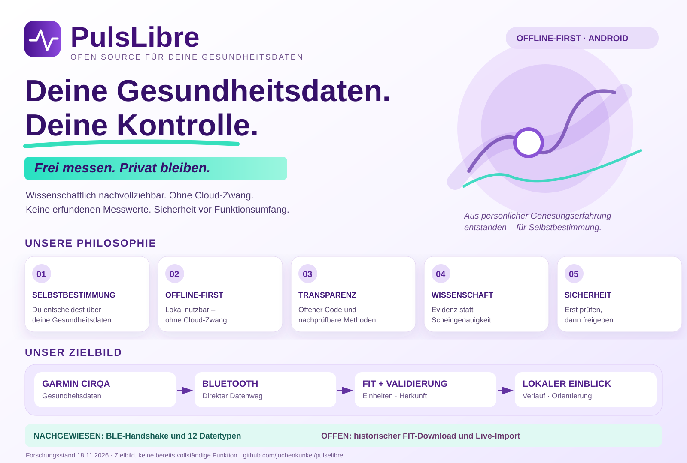

# PulsLibre

> **Aktueller Einstieg – 26.11.2026:** Claude Code / GUI-Agent ist der **alleinige aktive Entwicklungs- und Integrationsagent** für sämtliche offenen Tickets. Maßgeblich sind [AGENTS.md](AGENTS.md), [die vollständige FIT-Übergabe](docs/collaboration/agent-sync/2026-11-26_195500_opencode-an-claude_complete-handoff.md) und [der Projektstatus](docs/project/PROJECT_STATUS.md). **Die historische Monitoring-Vollabdeckung ist weiterhin nicht nachgewiesen.** PRs #705 (Archiv-Re-Decode), #712 (Sync-Bericht bis 64 KiB), #713 (Retry-/Neustart-Tests), #717 (SpO₂-Modus), #720 (Importfehler) und #722 (Codeaudit) wurden gemergt; diese Teilfortschritte nicht mit vollständigem Gerätedownload gleichsetzen. Der folgende Status vom 18.11.2026 bleibt als datierte historische Momentaufnahme stehen.

**Geplante Wissenschaftsnavigation:** eigener Hauptreiter [„Analysen“ (#227)](https://github.com/jochenkunkel/pulselibre/issues/227), [Sitemap und Modulgruppen](docs/science/ANALYSEN_NAVIGATION_CONCEPT.md); **noch nicht als App-Reiter implementiert**.

**Anwenderinnen und Anwender:** [Hilfe, Benutzerhandbuch und Fehlerbehebung](docs/product/user/README.md).

**Neuer Chat oder Entwicklungsagent?** Zuerst [CHAT_START_HERE.md](docs/project/CHAT_START_HERE.md) lesen, danach den [zentralen Projektstatus](docs/project/PROJECT_STATUS.md) und die offenen GitHub-Issues prüfen.

**Offline-first Android-Projekt für Garmin CIRQA auf Samsung Galaxy S25.**




*Unsere Vision: Selbstbestimmung, Offline-first, Transparenz, Wissenschaft und Sicherheit. [Poster als SVG ansehen](design/pulselibre-vision-poster-2026.svg). Der begrenzte historische Mehrdateiabruf ist durch V24/V25 nachgewiesen; die vollständige historische Abdeckung bleibt offen.*

**Projektstatus (18.11.2026):** Die CIRQA-Synchronisation und der begrenzte Mehrdateiabruf sind am Gerät nachgewiesen: V24/V25 übertrugen jeweils 33 gelistete Dateien (31 FIT, 2 Nicht-FIT). Die 31 FIT-Dateien wurden auf Länge, Header, CRC und SHA-256 geprüft; der SQLite-Import enthält 294 Metrikzeilen und wurde bei V25 ohne Duplikate wiederholt. **Nicht nachgewiesen** sind die vollständige historische Abdeckung, eine vollständige Feldinventur und die Validierung weiterer Gesundheitsmetriken. Frühere Legacy-Directory- und RFCOMM-Fehlversuche sind historische Zwischenstände. Die App ist **keine produktionsreife Garmin-Connect-Alternative**. Details und Grenzen: [aktueller Forschungsstand](docs/protocol/research/CIRQA_HISTORICAL_RESEARCH_STATUS_2026-11-18.md).

**Für die Haupt-IDE VSCodium/Codium (Claude Code oder Codex als alternativ genutzter API-Zugang) und weitere Mitwirkende:** [AGENTS.md](AGENTS.md) beschreibt die gemeinsamen Arbeitsregeln, Branch-/Review-Absprachen und Sicherheitsgrenzen. Für die aktuelle CIRQA-Evidenz gilt [PROJECT_STATUS.md](docs/project/PROJECT_STATUS.md); ältere Protokollnotizen sind historische Beobachtungen.

**Für neue Mitwirkende:** [Leitfaden zur Mitarbeit](docs/project/CONTRIBUTING_GUIDE.md) – Einstieg, Arbeitsbereiche, Qualitätsanforderungen und Sicherheitsregeln.

**Technische Abläufe als Bilder:** [Vier illustrierte Diagramme zu BLE, Transportforschung, FIT und Architektur](docs/architecture/diagrams/README.md).

## PulsLibre auf einen Blick


*Der dargestellte Ablauf ist eine schematische Projektillustration, kein Screenshot und kein Nachweis einer vollständig funktionierenden Gerätehistorie. Der begrenzte CIRQA-Dateiabruf und die lokale FIT-Verarbeitung sind dokumentiert; vollständige historische Abdeckung und sämtliche Messgrößen bleiben in Prüfung. [Poster als SVG öffnen](design/pulselibre-workflow-poster-2026.svg) · [Evidenz und Projektstatus](docs/project/PROJECT_STATUS.md).*

## Dokumentation nach Fachbereichen

**[Dokumentationswegweiser](docs/README.md)** · [UI-Konzept](docs/product/ui/README.md) · [CIRQA-Protokollentwicklung](docs/protocol/README.md) · [Wissenschaftliche Messwerte und Berechnungen](docs/science/README.md). Die früheren Markdown-Weiterleitungen wurden nach der Linkmigration entfernt; maßgeblich sind die kanonischen Pfade im Dokumentationswegweiser.

## Einstieg und Dokumentation

**Für alle Chats und Entwicklungsagenten verbindlicher Einstieg:** [Zentraler Projektstatus und Übergabeprotokoll](docs/project/PROJECT_STATUS.md). Änderungen und neue Erkenntnisse aus anderen Chats müssen dort explizit dokumentiert werden; Chatverläufe synchronisieren sich nicht automatisch.

- [Architektur, Code-Review und Ablaufdiagramme](docs/archive/2026-11-24/ARCHITECTURE_AND_CODE_REVIEW.md)
- [Priorisierte Roadmap bis zu echten CIRQA-Messwerten](docs/archive/2026-11-24/ROADMAP_TO_CIRQA_DATA.md)
- [Android-Gerätekompatibilität, Updates und Play-Store-Vorbereitung](docs/product/release/ANDROID_RELEASE_READINESS.md)
- [Geräte, Einschränkungen und Sicherheitsregeln](docs/project/TARGET_DEVICES.md)
- [Garmin-Protokollrecherche](docs/archive/2026-11-24/protocol/research/GARMIN_PROTOCOL_RESEARCH.md)
- [S25-Testplan](docs/protocol/device-tests/S25_BLE_TEST_PLAN.md)
- [Projektziele und Anforderungen](docs/project/REQUIREMENTS_AND_PRINCIPLES.md)
- [Qualitätsanforderungen](docs/quality/QUALITY_GATE.md)
- [Design und Branding](docs/product/BRANDING.md)

## Was derzeit tatsächlich funktioniert

- Android-Laufzeitberechtigung für Bluetooth beim ersten Start; bei bereits erteilter Berechtigung kein erneuter Dialog.
- Benutzerinitiierter, auf 60 Sekunden begrenzter **passiver** BLE-Scan; Werbeinformationen und vorsichtige Herstellerhinweise.
- Nur lesende Android-Abfrage zu CIRQA-Kopplung und Android-GATT-Status; die verbundene App ist **unbekannt**.
- Export einer Diagnose **nur nach ausdrücklicher Teilen-Aktion**. Vorsicht: Der Text kann Gerätebezeichnungen enthalten; rohe BLE-Service-Daten werden im Standardbericht nicht mitgeteilt.
- **Historien-Download vom CIRQA-Band (am S10-Testgerät belegt, 26.11.2026):** Garmin-ML/GFDI-Bootstrap, FileAccess-Dateiliste, read-only Dateiabruf über MLR, Integritätsprüfung (Größe, FIT-CRC, SHA-256), private Archivierung, FIT-Dekodierung und SQLite-Import. Lauf vom 26.11.: 29/29 angebotene Dateien übertragen, 0 Fehler. Leerlauf- und Gesamtfrist (120 s / 15 min); einzelne abgelehnte Dateien brechen den Lauf nicht ab.
- **Automatischer Abruf (seit 27.11.2026, Owner-Entscheidung #637):** beim In-den-Vordergrund-Kommen der App, höchstens alle 5 min ein Versuch bzw. 15 min nach Erfolg, nur bei genau einem gekoppelten CIRQA; kein Hintergrund-Worker. Während eines Laufs werden vom Band selbst gemeldete neue Dateien (Push) mit abgerufen. Bereits importierte Dateien mit belegter Identität werden nicht erneut übertragen (#148).
- **Wechselwirkung mit Garmin Connect (belegt per Mitschnitt, #637):** Connect markiert abgerufene Dateien; Tagesdateien (Stress, SpO₂, Atmung, Ganztagespuls, Schlaf, HRV) verschwinden danach vom Band, Aktivitäten bleiben. PulsLibre setzt **keine** Flags und löscht nichts – wer zuerst abruft, erhält die Tagesdaten. Die App weist darauf hin, wenn das Band keine Tageshistorie angeboten hat.
- **FIT-Dekodierung:** Standardfelder nach Garmin-Profil 21.222.0 (Puls, Distanz, Geschwindigkeit, Stress, SpO₂, Atmung, Schlafstufe, Hauttemperatur-Abweichung, Monitoring-Werte; ab Decoder 7 HRV, Ruhepuls, Aktivminuten/-kalorien). Auf 37 echten Dateien zu 100 % identisch mit dem offiziellen Garmin FIT SDK (#628, #707). Unbekannte und proprietäre Felder werden byte-genau als Rohdaten aufbewahrt, aber nicht als Messwert gedeutet. Gerätewerte sind keine medizinisch validierten Messungen.
- Experimentelles CIRQA-Testlabor (passiver Scan, Android-Verbindungsstatus, read-only GATT-Dienstsuche, Live-Messwertprobe, datensparsamer Testbericht) und Offline-Werkzeuge (`tools/garmin_hci_replay.py`, `tools/garmin_fileaccess_replay.py`) zur redigierten Auswertung von HCI-Mitschnitten.
- **Nicht nachgewiesen:** vollständige Gerätehistorie (das Band meldet kein „alles übertragen“), Aufbewahrungsdauer auf dem Band ohne Garmin Connect, Akkustand (weder in FIT noch als Standard-GATT-Dienst vorhanden, #532).

## Sicherheitsgrenzen

Keine INTERNET-Berechtigung, kein Cloud-Sync, keine Telemetrie, keine erfundenen Gesundheitswerte. Aktive BLE-Verbindungen zum CIRQA starten durch eine Nutzeraktion oder – für den Historien-Abruf – automatisch beim Öffnen der App (begrenzt wie oben, nur bei genau einem gekoppelten CIRQA). Gesendet werden ausschließlich lesende Anfragen: kein Setzen von Flags, kein Archivieren, Löschen, Zurücksetzen, Entkoppeln oder Firmware-Befehl. Die separate reine GATT-Dienstsuche schreibt und abonniert nicht; dies darf nicht pauschal auf den ML-Probe-Pfad übertragen werden. Keine automatische Neu-Kopplung behauptet. Die Android-Systemanzeige „GATT verbunden“ ist **kein** Beweis für Datenzugriff durch PulseLibre.

## Build und Tests

Lokale Build-Anleitung: JDK 17 (historischer lokaler Hinweis), Android SDK 37 (compileSdk), Gradle 9.6.0. Der verbindliche GitHub-Actions-Workflow `.github/workflows/android.yml` verwendet **JDK 21**; das **Java/Kotlin-Bytecode-Ziel 17** ist davon zu unterscheiden. Für reproduzierbare CI-Parität lokal bevorzugt JDK 21 verwenden. Beispiel:

```bash
gradle :app:testDebugUnitTest :app:lintDebug :app:assembleDebug :app:assembleDebugAndroidTest
```

Starte **Android CI** in GitHub unter **Actions → Android CI → Run workflow** oder per `gh workflow run android.yml --ref main`. Dort sind zwei unabhängige Eingaben verfügbar:

- **Ausführungsort:** `LOCAL` (eigener Self-hosted Runner, Label `pulselibre`) oder `CLOUD` (GitHub-hosted `ubuntu-latest`).
- **Testumfang:** `QUICK` (Build, R8-Release, Unit-Tests, APK-Diagnose) oder `FULL` (zusätzlich Lint, Instrumentation-Test-APK und API-35-Emulator).

Pushes auf `main` und Pull Requests gegen `main` laufen automatisch mit `QUICK`; der tägliche Zeitplanlauf verwendet `FULL`. Manuelle Läufe können `QUICK` oder `FULL` wählen. Pull Requests bleiben auf GitHub-hosted Runnern, solange der lokale Runner für vertrauenswürdige PRs nicht ausdrücklich freigegeben ist. Beide Umgebungen nutzen dieselbe Pipeline (`tools/ci/run-ci.sh`), damit LOCAL und CLOUD nicht auseinanderlaufen. Die Android-CI lädt APKs und Testberichte als zeitlich begrenzte Artifacts hoch.

Dieselben Prüfungen laufen auch ohne GitHub direkt auf dem Entwicklungsrechner:

```bash
./tools/ci-local.sh --quick   # Build + Unit-Tests + APK-Diagnose
./tools/ci-local.sh --full    # zusätzlich Lint, Test-APK und API-35-Emulator
```

Voraussetzungen, Runner-Installation, Sicherheitsregeln, Umschalten zwischen LOCAL und CLOUD sowie Troubleshooting stehen in [docs/quality/ci/HYBRID_CI.md](docs/quality/ci/HYBRID_CI.md).

## Ausblick

Nächster Forschungsschwerpunkt ist die abgesicherte Klärung des Bluetooth-Classic-/RFCOMM-Transportwegs. Der erste begrenzte RFCOMM-Versuch ergab keine Gegenverbindung; weitere Geräteversuche benötigen eine eigene Freigabe. Für neue Mitwirkende sind [Dokumentationswegweiser](docs/README.md), [Entwicklungsregeln](AGENTS.md) und [aktueller CIRQA-Forschungsstand](docs/protocol/research/CIRQA_HISTORICAL_RESEARCH_STATUS_2026-11-18.md) die besten Einstiege.

**Aktuelle Aufgaben:** [GitHub-Issues](https://github.com/jochenkunkel/pulselibre/issues) · [Historischer Audit und Reparaturplan (geschlossener, nicht gemergter PR #1)](https://github.com/jochenkunkel/pulselibre/pull/1). Die Architektur-Review-Datei enthält historische Befunde und ist noch nicht vollständig aktualisiert.

[Aktuelles Visionsposter](design/pulselibre-vision-poster-2026.svg) · [Historisches Projektposter](design/pulselibre-poster.svg)

## Lizenz und Drittanbieter-Provenienz

Eigenständige PulsLibre-Beiträge stehen unter der [Apache License 2.0](LICENSE). Diese Lizenz ändert keine Rechte an Fremdcode. Die vorläufige Prüfung der AGPLv3-Protokollreferenzen und die noch offenen Herkunftsfragen stehen in [LICENSE_AGPL_AUDIT_2026-11-16.md](docs/project/compliance/LICENSE_AGPL_AUDIT_2026-11-16.md). **Die Prüfung ist noch keine vollständige rechtliche Freigabe.**
