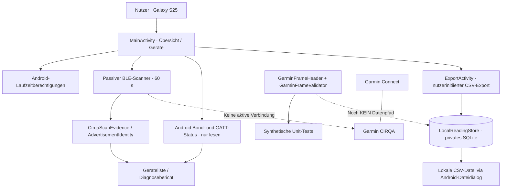
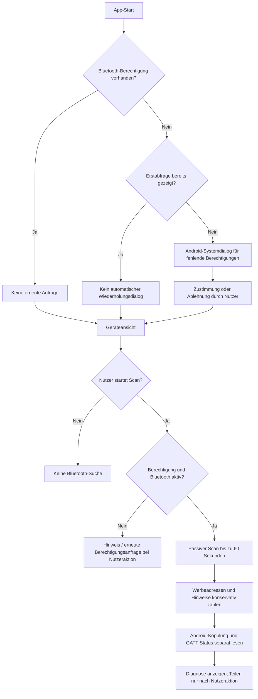
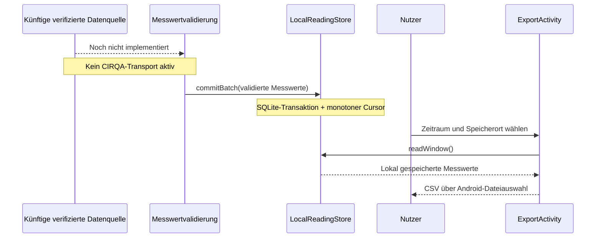

# PulseLibre – Architektur und Quelltext-Review

**Historischer Review-Stand:** 2026-11-15 · Review-Basis: GitHub `main`, unmittelbar nach den CRC-Commits `b112eb53` und `80c00cc8`. Dokumentationskorrektur im README: `ffbb171b`.

**Aktualisierung 2026-11-16:** Dieses Dokument ist eine historische Momentaufnahme und enthält inzwischen überholte Aussagen. Der aktuelle Audit steht unter [AUDIT_2026-11-16.md](AUDIT_2026-11-16.md); die verfolgten Arbeiten stehen in [GitHub-Issues #2–#6](https://github.com/jochenkunkel/pulselibre/issues). Insbesondere sind inzwischen aktive GATT- und ML-Probes einschließlich experimentellem Vordergrunddienst implementiert. R01/R02/R04/R05 und R11 müssen anhand des heutigen Codes neu bewertet werden; der Standard-Diagnoseexport enthält bereits keine rohen BLE-Payloads und `onScanFailed` führt bereits einen Stop-Versuch aus. Keine der historischen Tabellenzeilen darf ungeprüft als aktueller Befund behandelt werden.

## Umfang und Grenzen

Quelltextprüfung der **21 Kotlin-Produktionsdateien** unter `app/src/main/java/de/pulselibre`, dazu `AndroidManifest.xml`, App-Buildkonfiguration, CI-Workflow, README und gezielt die Permission-, CRC- und SQLite-Tests. Das ist eine **statische Codeanalyse**, kein neuer S25-Test, kein vollständiger Penetrationstest und keine neue Behauptung, dass alle denkbaren Fehler ausgeschlossen seien. Bestehende Unit-/Emulatortests und Nutzerberichte sind separat von der Analyse zu bewerten.

## 1. Aktuelle Architektur

**Wichtige Trennung:** Der Garmin-Frame-Validator ist nicht an den BLE-Scanner angeschlossen. Ein BLE-Advertisement ist **kein** GFDI-Frame. Die Datenbank besitzt noch keine echte CIRQA-Datenquelle. Dashboard-Karten werden derzeit mit `HealthSnapshot()` ohne echte Messwerte aufgebaut.

## 2. Tatsächlicher Start- und Diagnoseablauf

**S25-Evidenz:** Nutzer bestätigte die Android-Berechtigungsabfrage beim App-Start und einen laufenden passiven Scan; CIRQA gekoppelt, Android-GATT verbunden (verantwortliche App unbekannt), aber keine CIRQA-Werbeadresse bestätigt. Es wurden keine Gesundheitsdaten gelesen.

## 3. Daten- und Exportpfad (vorbereitet, noch nicht mit CIRQA verbunden)

## 4. Review-Befunde und Risiken

| ID | Priorität | Fundstelle | Beobachtung / Risiko | Konkrete Maßnahme |
|---|---|---|---|---|
| R01 | **Hoch** | `MainActivity.shareDiagnostics`, `showDevice` | Diagnose exportiert BLE-Service-Rohdaten (bis 64 Byte je Eintrag) und Gerätenamen. MAC-Adressen werden nicht direkt exportiert, aber Broadcast-Token können trotzdem personen- oder gerätebeziehbar sein. | Standardmäßig nur redigierten Diagnosebericht teilen; Rohdaten ausschließlich nach separater informierter Bestätigung; Tests auf unbeabsichtigte Kennungen. |
| R02 | **Hoch** | `MainActivity.onScanFailed` | Scan-Fehler setzt `scanning=false`, ruft aber `stopScan` nicht auf. Android kann den Scanner nach Fehler intern bereits beendet haben; ein expliziter, idempotenter Cleanup-Pfad wäre robuster. | Einheitlichen Scan-Ende-/Fehlerpfad, Callback-Cleanup und Lebenszyklus-Tests einführen. |
| R03 | **Mittel** | `MainActivity.startScan` | Mehrfacher Start wird erst **nach** dem Berechtigungs- und Adaptercheck abgefangen; Status- und Fehlerzustände können unklar werden. `onDestroy` setzt `destroyed` vor `stopScan`, das ist derzeit toleriert. | Zustandslogik zentralisieren; Doppelklick-, Abbruch- und Bluetooth-aus-Tests. |
| R04 | **Mittel** | `CirqaScanEvidence.observe` | Wiederholtes Advertisement ersetzt bisherige Einstufung. Ein Garmin-Hinweis kann bei späterem anonymem Paket derselben Adresse wieder verschwinden. | Evidenz pro Adresse monoton und vorsichtig aggregieren; Test für wechselnde Advertisement-Inhalte. |
| R05 | **Mittel** | `MainActivity`, `CirqaScanEvidence` | „Bestätigte CIRQA-Werbeadressen“ ist stärker formuliert als die tatsächliche Adressgleichheit. Private BLE-Adressen können rotieren; Gleichheit allein ist kein kryptografischer Identitätsbeweis. | Anzeige auf „Adressgleichheit mit Android-Kopplung“ umbenennen, Identitätsnachweis getrennt halten. |
| R06 | **Mittel** | `GarminFrameHeader.inspect` | Prüft nur Länge und Typ; die Methode selbst validiert keine CRC. Die strengere `GarminFrameValidator.inspectVerified` ist korrekt als eigener Einstieg vorhanden. | Nur **integritätsvalidierte** (Länge/CRC) Frames an künftige Parser geben; klare API-Namen, unabhängige CRC-Testvektoren und Fuzz-/Grenzwerttests. Das ist keine medizinische Validierung und nach der P0-Entscheidung 24.11.2026 kein Grund, empfangene Daten nicht zu archivieren. |
| R07 | **Mittel** | `LocalReadingStore.commitBatch`, `HistorySync.commitSyncedBatch` | Cursor basiert auf größtem Messzeitstempel. Das ist nur dann ein sicherer Synchronisations-Checkpoint, wenn das Quellprotokoll vollständige, bestätigte Batches garantiert; verspätete Messungen könnten sonst übersehen werden. | Cursor-Semantik an reales Garmin-Protokoll binden, Überlappungsfenster und Replay-Tests. |
| R08 | **Mittel** | `ExportActivity` | `pendingWindow` liegt nur im Activity-Speicher. Bei Prozessneustart während Android-Dateidialog kann die Exportauswahl verloren gehen. Executor-Shutdown und spätere UI-Callbacks verdienen Lebenszyklus-Tests. | `onSaveInstanceState`/zustandsfeste Export-Logik und Prozess-Neustart-Test. |
| R09 | **Mittel** | `AndroidManifest.xml` | `BLUETOOTH_SCAN` nutzt `neverForLocation`; Android darf dadurch bestimmte BLE-Beacons filtern. Die bisherige CIRQA-Nichterkennung ist deshalb **kein** Beweis, dass das Band nicht wirbt. | Auswirkungen dokumentieren; Manifest nur nach Datenschutz- und Berechtigungsprüfung ändern. |
| R10 | **Niedrig** | `BleSessionState`, `BleFormatting`, `BleSafetyPolicy` | Code enthält CONNECTING/CONNECTED-Übergänge und GATT-Eigenschaftshelfer, obwohl die App keine aktive GATT-Verbindung implementiert. Das kann den tatsächlichen Funktionsumfang verschleiern. | Ungenutzte Helfer inventarisieren; nur entfernen, wenn Tests und geplanter Transportpfad das erlauben. |
| R11 | **Niedrig** | `app/build.gradle.kts`, CI | `versionCode=1` und `versionName=0.1.0` bleiben trotz vieler CI-Runs unverändert. Die Run-Nummer ist **keine** Android-Versionsnummer; Release-Upgrades sind noch nicht automatisiert. | Versionsstrategie, signierte Release-Pipeline und reproduzierbare Builds planen. |
| R12 | **Niedrig** | `README.md` vor diesem Review | Veraltete Beschreibung versprach connect/disconnect und GATT read/notify. | **In diesem Dokumentationsupdate korrigiert.** |

### Positive Befunde

- Keine `INTERNET`-Berechtigung im Manifest; `allowBackup=false`.
- Kein `connectGatt`-Aufruf in `MainActivity`; BLE-Diagnose bleibt passiv.
- Keine künstlichen Gesundheitswerte in `DashboardModel`.
- `LocalReadingStore` nutzt Transaktionen, eindeutigen Schlüssel und `INSERT OR IGNORE`; passende Android-Tests für Idempotenz und ungültige Batches vorhanden.
- `RawDataExport` validiert Zahlen, sortiert stabil, quotiert CSV-Felder und entschärft gängige Spreadsheet-Formelpräfixe.
- `GarminFrameValidator` prüft Länge und CRC; CRC-16/ARC-Referenzvektor und Manipulationsfälle werden getestet.
- First-launch-Permission-Policy ist separat als pure Funktion testbar.

## 5. Prüf- und Freigabekriterien

1. Für jede Codeänderung: Unit-Tests, Lint, Debug-Build und API-35-Emulatortests grün.
2. Für Berechtigungen, Scan und Export zusätzlich gezielte Android-Lebenszyklus-/Fehlerpfadtests.
3. Für Garmin-Decoder: unabhängige, synthetische und dokumentierte Testvektoren; beschädigte/verkürzte Eingaben müssen sicher abgelehnt werden.
4. Für echte CIRQA-Kommunikation: vorab gesonderte Nutzerfreigabe, Interoperabilitätsplan mit Garmin Connect und ein Abbruch-/Rollback-Verfahren.
5. Keine Behauptung „Gesundheitsdaten verfügbar“, bevor echte Herkunft, Zeitstempel, Einheit und Integrität auf dem S25 nachgewiesen sind.

Siehe [Roadmap](ROADMAP_TO_CIRQA_DATA.md) und [Protokollrecherche](protocol/research/GARMIN_PROTOCOL_RESEARCH.md).
