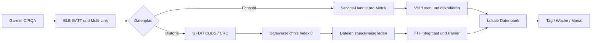

# CIRQA: Messwerte, Historie, Tageswechsel – Architektur-Skizze

Stand: 2026-11-15. Quellenbasiertes Design, **kein Nachweis aller Funktionen am CIRQA**.

## Was aus dem Quellcode anderer Implementierungen hervorgeht

- **Gadgetbridge:** `service/devices/garmin/FileTransferHandler.java` beginnt mit einem Download der Garmin-Dateiverzeichnisliste (Index 0). Jedes Verzeichniselement ist 16 Byte und enthält Dateindex, Typ/Subtyp, Dateinummer, Flags, Länge und Garmin-Zeitstempel. Anschließend werden relevante Dateien einzeln per `DownloadRequestMessage` angefordert; `DownloadRequestStatusMessage` gibt die Größe frei, `FileTransferDataMessage` liefert die Fragmente. Nach Vollständigkeit wird die Datei gespeichert und an den FIT-Importer übergeben. `GarminSupport.java` verwaltet die Download-Warteschlange und fragt unterstützte Dateitypen ab.
- **Gadgetbridge-Dateitypen:** `FileType.java` und `FileTransferHandler.java` führen u.a. `ACTIVITY`, `MONITOR`, `METRICS`, `SLEEP`, `HRV_STATUS`, `SKIN_TEMP`, `CHANGELOG` auf. **Nicht jedes Garmin-Modell stellt alle Typen bereit**. Weitere Typen existieren, aber die Liste allein belegt keine CIRQA-Unterstützung.
- **Transport:** `communicator/v2/CommunicatorV2.java` nutzt Garmin Multi-Link mit dynamischen Handles, GFDI über COBS. `communicator/CobsCoDec.java` reassembliert COBS-Frames mit führendem und abschließendem Nullbyte; `garmin-ble/protocol/gfdi.py` beschreibt GFDI-Header (little-endian Länge, Typ, Payload, CRC16).
- **Live-Dienste:** `garmin-ble/metrics/` beschreibt Herzfrequenz, Schritte, Kalorien, Intensitätsminuten, RR-Intervalle/HRV, Stress, SpO2, Body Battery, Atemfrequenz und Beschleunigungsrohdaten. Am CIRQA sind bislang **nur Puls und Schritte** durch Screenshot verifiziert.
- **Zeit:** `GarminTimeUtils.java` übersetzt Garmin-Zeitstempel (Epoch 1990-01-01) nach Unix. `GarminSupport.onSetTime()` sendet ein `TIME_UPDATED`-Systemereignis. `garmin-ble/protocol/gfdi.py` enthält eine Antwort auf `CURRENT_TIME_REQUEST` mit Garmin-Zeit und Zeitzonenoffset. Das ist Zeitabgleich, **kein Tageszähler-Reset**.

## Geplanter Datenfluss

### Historische Synchronisation als Zustandsautomat

1. Benutzer startet lokale Synchronisation; GATT verbinden, Notifications aktivieren, ML/GFDI registrieren.
2. GFDI-Nachrichten mit COBS-Reassembly, Längen- und CRC-Prüfung dekodieren. Gerätezeit/Zeitzone bei Bedarf abgleichen.
3. Unterstützte Dateitypen erfragen, Dateiverzeichnis (Index 0) abrufen und 16-Byte-Einträge validieren.
4. Relevante neue Dateien (`MONITOR`, `METRICS`, `SLEEP`, `ACTIVITY`, `HRV_STATUS`, ggf. weitere) anhand stabiler Identifikatoren auswählen.
5. Jede Datei stückweise per Offset laden; Status/Fragmentlänge/Offsets/CRC prüfen; unvollständige Übertragungen sicher wiederaufnehmen oder erneut beginnen.
6. FIT-Inhalte prüfen und lokal importieren; nach Dateikennung und Messwert-Zeitstempel deduplizieren.
7. Synchronisation bestätigen, Verbindung beenden. Archivierungs-/Löschflags **nicht** ohne gesonderte Validierung am CIRQA setzen.

### Wer setzt die Zähler zurück?

**Quellcode-Befund:** Die geprüften Garmin-Implementierungen zeigen Uhrzeit-/Zeitzonenkommunikation und geräteseitige Tageswerte, aber **keinen periodischen Mitternachtsbefehl der Smartphone-App zum Nullsetzen der Schritte**. Deshalb darf PulseLibre keinen Reset-Befehl erfinden oder senden. Wie das CIRQA intern Tagesgrenzen und Zielwerte behandelt, ist erst durch Messungen um Mitternacht und durch historische FIT-Daten sicher feststellbar.

**Designentscheidung PulseLibre:**
- **Gerät:** Tageszähler und Zielwert so lesen, wie CIRQA sie sendet. Keine künstlichen Resets, keine Manipulation der Gerätezähler.
- **App:** Rohdaten mit Quellzeitstempel, Geräteidentität, Empfangszeit und Zeitzonenkontext speichern. Tagesansichten anhand lokaler Tagesgrenzen bilden; Wochen- und Monatsansichten aus gespeicherten Tagesdaten aggregieren.
- **Mitternacht:** Die App ändert nur die angezeigte Zeitperiode. Der nächste empfangene Tageszähler wird dem richtigen Kalendertag zugeordnet; niemals den alten Stand als neue Tageszählung übernehmen.
- **Zeitzonen/DST/Reisen:** Garmin-Zeit und Offset separat erfassen, Tagesgrenzen eindeutig definieren; doppelte Messungen und rückwärts laufende Zähler erkennen. Wochenbeginn konfigurierbar, Monatsbeginn Kalendermonat.
- **Nicht belegt:** Ob CIRQA Tageswerte exakt um 00:00 lokale Gerätezeit zurücksetzt, ob die Uhrzeit aktiv vom Smartphone gestellt werden muss, ob Ziele automatisch angepasst werden und welche Schlaf-/SpO2-/Temperatur-Historie konkret existiert.

## Implementierungsreihenfolge

1. **P0** Offline GFDI/COBS/CRC-Framing mit echten Testvektoren, begrenztem Speicher und strenger Validierung.
2. **P1** Geräte-Informationsabfrage und Read-only Dateiverzeichnis-Download mit Opt-in und diagnostischem Ergebnis.
3. **P2** Chunk-Download, FIT-Parser und lokale persistente Speicherung mit Integritäts- und Duplikatprüfung.
4. **P3** Zeitstempel, Zeitzonen, Tages-/Wochen-/Monatsaggregation, Mitternachts- und DST-Tests.
5. **P4** Gerätespezifische Messwert-Matrix aus echten CIRQA-Tests; Beschleunigung, Schlaf und SpO2-Historie nur bei nachgewiesener Unterstützung.
6. **P5** Stabile Hintergrund-Synchronisation erst nach Lifecycle-, Akku- und Datenschutztests.

**Sicherheit/Datenschutz:** offline, keine Internetberechtigung, keine Cloud, kein `CLOSE_ALL`, kein Entkoppeln/Zurücksetzen, keine erfundenen Messwerte. Erst lesend implementieren, vor Geräte-Schreib-/Archivierungsoperationen gesondert prüfen.

## Quellen (Quellcode)

- https://github.com/Freeyourgadget/Gadgetbridge/blob/master/app/src/main/java/nodomain/freeyourgadget/gadgetbridge/service/devices/garmin/FileTransferHandler.java
- https://github.com/Freeyourgadget/Gadgetbridge/blob/master/app/src/main/java/nodomain/freeyourgadget/gadgetbridge/service/devices/garmin/GarminSupport.java
- https://github.com/Freeyourgadget/Gadgetbridge/blob/master/app/src/main/java/nodomain/freeyourgadget/gadgetbridge/service/devices/garmin/FileType.java
- https://github.com/Freeyourgadget/Gadgetbridge/blob/master/app/src/main/java/nodomain/freeyourgadget/gadgetbridge/service/devices/garmin/GarminTimeUtils.java
- https://github.com/Freeyourgadget/Gadgetbridge/blob/master/app/src/main/java/nodomain/freeyourgadget/gadgetbridge/service/devices/garmin/communicator/CobsCoDec.java
- https://github.com/gwerneckp/garmin-ble/blob/main/garmin_ble/protocol/gfdi.py
- https://github.com/gwerneckp/garmin-ble/tree/main/garmin_ble/metrics
