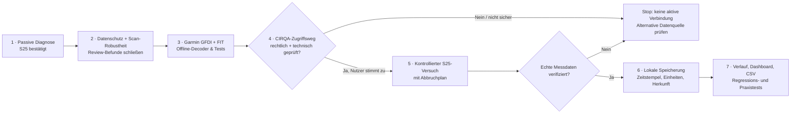

# PulseLibre – Der Weg zu echten CIRQA-Messwerten

**Stand: 2026-11-15.** Diese Roadmap unterscheidet konsequent zwischen *bereits real getestet*, *automatisch getestet* und *noch nicht nachgewiesen*. Sie ersetzt keine Einwilligung in aktive Kommunikation mit dem Band.

## Zielbild

Echte, lokal gespeicherte Messwerte aus dem Garmin CIRQA auf dem Galaxy S25 – nachvollziehbare Quelle, korrekte Zeitstempel, keine erfundenen Werte, ohne Garmin Connect ungefragt zu stören.

## Phase 1 – Bereits nachgewiesen

- Auf dem S25: App startet, Android-Bluetooth-Berechtigung wird beim ersten Start angefragt, passiver BLE-Scan läuft.
- Android meldet CIRQA als gekoppelt und GATT als verbunden; die verantwortliche App ist unbekannt.
- Im Scan **kein** eindeutiger CIRQA-Werbeadressentreffer. Das ist keine Widerlegung der Kopplung.
- In CI bis einschließlich Build #117: erfolgreiche Android-/Emulatortests. Neuere Builds müssen jeweils separat überprüft werden.
- Offline-GFDI-Header- und CRC-16-Tests sind im Repository implementiert; daraus folgt **kein** CIRQA-Datenzugriff.

## Phase 2 – Qualität und Datenschutz (zuerst)

**Priorität P0:** Diagnoseexport standardmäßig redigieren (Review R01); bei Scan-Fehlern idempotentes Cleanup (R02).

**Priorität P1:** Evidenzzählung bei wechselnden Advertisements stabilisieren (R04), Adressgleichheit klar von Identitätsbeweis trennen (R05), Scan-Lebenszyklus testen (R03).

**Abnahmekriterien:** Keine sensiblen Rohpayloads ohne zusätzliche explizite Zustimmung; Fehler und Abbruch hinterlassen keinen aktiven Scan; Regressionstests grün.

## Phase 3 – Offline-Protokollparser

1. GFDI-Längen- und CRC-Prüfung anhand **unabhängiger** Testvektoren erweitern.
2. FIT-Dateiheader, Definitionen, Datensätze, Endianness und Prüfsummen spezifikationsgetreu lesen.
3. Begrenzungen gegen ungültige Längen, übergroße Allokationen, Trunkierung und ungültige Feldtypen.
4. Zeitstempel, Einheiten, unbekannte Felder und Herkunft eindeutig modellieren.
5. Protobuf-Fragmente separat behandeln, falls für CIRQA nachweislich erforderlich.

**Abnahmekriterien:** Synthetische gültige FIT-Dateien werden deterministisch interpretiert; kaputte Dateien sicher abgelehnt; keine Daten werden erfunden; kein Bluetooth-Zugriff nötig.

## Phase 4 – Transportentscheidung: Sicherheits-Gate

- Prüfen, welche CIRQA-Funktionen Gadgetbridge tatsächlich unterstützt und welche Firmware-/Protokollbedingungen gelten.
- Gadgetbridge-Code steht unter **AGPL**: vor jeder Übernahme von Code Lizenz- und Projektkonsequenzen klären. Recherche und unabhängige Implementierung klar trennen.
- Prüfen, ob ein **rechtmäßig zugänglicher, vom Nutzer selbst exportierter Datenweg** existiert. Keine Behauptung, dass Garmin Connect den benötigten Export anbietet, ohne konkreten Nachweis.
- **Keine** aktive CIRQA-GATT-Verbindung, Kopplungsänderung, Subscription oder Schreiboperation ohne ausdrückliche neue Zustimmung.
- Falls ein Test genehmigt wird: Ausgangszustand dokumentieren, Garmin Connect synchronisieren lassen, Stop-Kriterien definieren, keine automatische Wiederholung.

**Gate:** Ohne sicheren Zugriffsweg kein direktes Auslesen. Ein reiner Parser kann keine fremde verschlüsselte GATT-Verbindung mitlesen.

## Phase 5 – Echte Messwerte und lokaler Verlauf

- Validierte Quelle -> plausibilisierte Messung -> atomarer SQLite-Batch -> bestätigter Cursor.
- Nachweise für Gerätereferenz, Messzeit, Empfangszeit, Einheit, Duplikate und verspätete Daten.
- Historische Synchronisation muss Replay-/Überlappungsfenster berücksichtigen; ein bloßes Maximum des Messzeitstempels genügt nicht in jedem Protokoll.
- Dashboard zeigt nur belegte Messwerte; CSV enthält nur lokal vorhandene Daten.

## Phase 6 – Release-Qualität

- Versionsnummernstrategie, signierte Builds, Backup-/Migrationskonzept und Testabdeckung.
- Android-Prozessneustart beim Export, verweigerte Bluetooth-Berechtigung, Bluetooth-aus, wiederholter Scan, App-Hintergrund und Gerätewechsel testen.
- Keine Google-Health-Connect-Abhängigkeit, kein Cloud-Zwang.

## Nächste konkrete Arbeitsreihenfolge

| Reihenfolge | Aufgabe | Erfolgskriterium |
|---|---|---|
| 1 | Diagnoseexport datenschutzfreundlich machen | Standardbericht ohne rohe identifizierende BLE-Daten |
| 2 | Scanner-Cleanup und Zustandsübergänge absichern | Fehler-/Abbruchtests erfolgreich |
| 3 | Evidenzklassifizierung und Begriffe korrigieren | Keine unberechtigte CIRQA-Bestätigung |
| 4 | FIT-Parser als reines Offline-Modul | Valide und fehlerhafte synthetische FIT-Fixtures getestet |
| 5 | CIRQA-Zugriffsweg untersuchen und Genehmigung einholen | Kein Risiko für Garmin Connect ohne bewusste Entscheidung |
| 6 | Reale Daten sicher importieren und speichern | Herkunft, Einheit und Messzeit verifiziert |
| 7 | Dashboard/Verlauf/Export auf echte Daten umstellen | S25-Praxistest und CI grün |

## Nicht als abgeschlossen deklarieren

- CIRQA-Identifikation durch passives Advertising.
- Lesen der CIRQA-Charakteristiken oder Entschlüsselung einer Garmin-Connect-Verbindung.
- Echte Herzfrequenz-, SpO₂-, Schlaf- oder Schrittdaten vom CIRQA.
- Vollständige FIT-Dateiauswertung.
- Hintergrundsynchronisierung und Produktionsrelease.

Weiterführend: [Architektur und Code-Review](ARCHITECTURE_AND_CODE_REVIEW.md), [Protokollrecherche](GARMIN_PROTOCOL_RESEARCH.md), [S25-Testplan](S25_BLE_TEST_PLAN.md).
