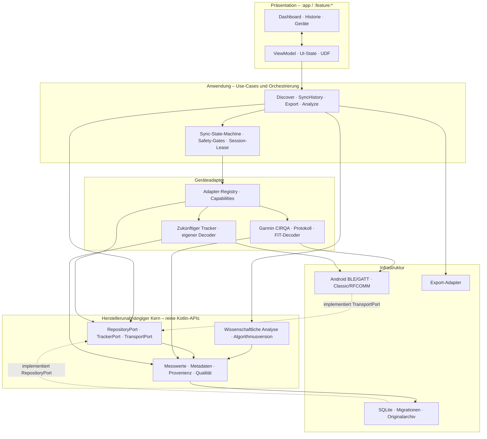

> **STATUS: ZURÜCKGESTELLT / PARKED – KEINE IMPLEMENTIERUNGSFREIGABE (2026-11-22).**
> Ticket [#496](https://github.com/jochenkunkel/pulselibre/issues/496) hat **niedrigste operative Priorität**. Kein Agent darf aus diesem Dokument selbstständig Implementierung, Refactoring, Bluetooth-Umbau, Modulmigration oder neue Umsetzungstickets ableiten. Die bisherige Vorarbeit bleibt als Referenz erhalten. Reaktivierung nur auf ausdrückliche Freigabe des Projektverantwortlichen. Fachlicher Owner: ChatGPT. Laufende Aufgaben haben Vorrang.

## Geparkte Reihenfolge – ausschließlich Planung

1. **Bluetooth zuerst:** BT-01 Bestandsaufnahme; BT-02 Transport-Ports; BT-03 Android-BLE/RFCOMM-Kapselung; BT-04 Discovery/Session-Management; BT-05 CIRQA-Handshake/Protokolltrennung; BT-06 Historien-Synchronisation; BT-07 Replay-/Regressionstests; BT-08 GUI-Anbindung.
2. **Danach:** Domain-Verträge, Datenbank/Provenienz, wissenschaftliche Analyse und GUI-Modularisierung.
3. **Sicherheitsbedingungen:** keine Änderung des produktiven Bluetooth-Verhaltens ohne Tests und explizite Freigabe; bestehende Geräteschutzmechanismen und Datenintegrität erhalten.
4. **Unverbindliche Vorabschätzung:** Bluetooth-Phase 138–233 Agentenstunden; Gesamtkalenderzeit für den späteren Gesamtumbau grob 6–10 Wochen bei drei koordinierten Coding-Agents. Keine Zusage und keine Terminierung.

# PulsLibre – iterativer Modularitätsaudit (ChatGPT)

- **Issue:** https://github.com/jochenkunkel/pulselibre/issues/496
- **Fachlicher Owner:** ChatGPT (keine GitHub-Account-Zuweisung)
- **Beginn:** 2026-11-22
- **Arbeitsmodus:** Iterative, belegte Analyse auf Basis von GitHub `main`; Dokumentation nach jeder Runde.
- **Umfang:** Analyse und Planung, **kein** großflächiges Refactoring und keine aktiven Gerätetests.

## Zielbild

GUI, Anwendungslogik, herstellerunabhängige Domäne und Datenmodelle, Persistenz/Export, wissenschaftliche Analyse, Gerätesynchronisation, Bluetooth-Transport und herstellerspezifische Adapter werden durch explizite Schnittstellen getrennt. Garmin CIRQA ist ein Adapter unter mehreren künftigen Trackern. Domain und wissenschaftliche Berechnungen sollen ohne Android- und Herstellerabhängigkeiten testbar sein.

## Runde 1 – vorläufige Bestandsaufnahme (2026-11-22)

**Untersuchter GitHub-main-Commit:** `95b6895d425d0da2679aedadd7b8fff89b0b38d4` (Verzeichnisindex zum Prüfzeitpunkt). Die nachstehenden Befunde sind gezielte Codeprüfungen und **kein vollständiger Repository-Audit**. Builds und Tests wurden nicht ausgeführt.

| Priorität | Vorläufiger Befund | Beleg | Empfohlene Prüfung |
|---|---|---|---|
| P0 | Nur ein Gradle-App-Modul eingebunden | `settings.gradle.kts` mit `include(":app")` | Paket-/Importgraph und mögliche Modulgrenzen prüfen |
| P0 | Activity verknüpft Android-Bluetooth, Polling, konkrete CIRQA-Synchronisation und Datenzugriff | `app/src/main/java/de/pulselibre/MainActivity.kt` | UI-Anwendungsdienste und ViewModel-Verträge ableiten |
| P0 | Sehr umfangreiche GATT-Session-Orchestrierung mit Android- und SQLite-Abhängigkeiten | `app/src/main/java/de/pulselibre/CirqaMlHandshakeProbe.kt` | Zustandsmaschine, Transport, Protokoll, FIT-Verarbeitung und Speichergrenzen kartieren |
| P1 | Zentrale SQLite-/Migrationsklasse | `app/src/main/java/de/pulselibre/CirqaDatabase.kt` | Repository-Interfaces und Schema-Migrationssicherung prüfen |
| P1 | Dashboard-View greift selbst auf SharedPreferences zu | `app/src/main/java/de/pulselibre/DashboardOverviewView.kt` | UI-State-/Settings-Schnittstelle definieren |
| P1 | Historien-Repository erzeugt konkrete SQLite-Datenbank über Android Context | `app/src/main/java/de/pulselibre/HistoricalObservationRepository.kt` | Domänen-Query-Interface vom SQLite-Adapter trennen |
| P1 | FIT-Committer ist an Android SQLiteDatabase gebunden | `app/src/main/java/de/pulselibre/FitObservationCommitter.kt` | Transaktions-/Persistenzgrenze festlegen |
| Positiv | Rein rechnerische Statistik bereits separierbar | `app/src/main/java/de/pulselibre/PairedCorrelation.kt` | Als Referenz für reines Analysemodul prüfen |
| Positiv | RFCOMM-Transport bereits in separater Klasse und explizit gesperrt | `app/src/main/java/de/pulselibre/CirqaRfcommTransport.kt` | Gate und Transport-Schnittstelle erhalten |

## Vorgeschlagene Modulgrenzen (noch nicht beschlossen)

- `:core:domain`: Geräte-/Messwert-/Provenienzmodelle, Repository- und Dienstverträge; reines Kotlin.
- `:core:analysis`: Statistik und wissenschaftliche Auswertungen; reines Kotlin, keine Android- oder BLE-Imports.
- `:device:api`: Gerätefähigkeiten, Discovery, Session-/Sync-Verträge.
- `:transport:bluetooth`: Android BLE/GATT, Classic/RFCOMM, Verbindungs- und Berechtigungsadapter.
- `:device:garmin-cirqa`: Garmin-spezifisches Protokoll, FIT-Transfer, Decoder-/Synchronisationsadapter.
- `:data:storage`: SQLite, Migrationen, Repository-Implementierungen, Provenienzspeicher.
- `:feature:dashboard`, `:feature:history`, `:feature:devices` und `:app`: Präsentation, Navigation, Composition Root.

**Abhängigkeitsregel:** Kern-Domäne darf keine Android-, Bluetooth-, SQLite- oder Garmin-Implementierung importieren. Adapter implementieren Schnittstellen des Kerns; die App verdrahtet Implementierungen. Ein zweiter Fake-Tracker soll ohne Änderungen an Dashboard und Analysemodul integrierbar sein.

## Iterationsprotokoll

| Runde | Status | Ergebnis | Nächster Schritt |
|---|---|---|---|
| 1 – Inventar und Baseline | In Arbeit | Gradle-Einmodulstruktur und erste kritische Klassen identifiziert | Vollständige Dateiliste, Tests, Importgraph, CI-Stand und Datenfluss erfassen |
| 2 – Kopplungsanalyse | Offen | – | Zyklen und konkrete Schnittstellenbrüche mit Quellverweisen belegen |
| 3 – Soll-Architektur | Offen | – | API-Verträge und ADRs ausarbeiten |
| 4 – Migrationsplan | Offen | – | Kleine unabhängige Tickets, Regressionen und Rollback definieren |
| 5+ – Re-Audits | Offen | – | Nach main-Änderungen erneut prüfen |

## Regeln für Folgearbeiten

1. Jeden Durchlauf mit Datum, Git-Commit-SHA, tatsächlich geprüften Dateien, Ergebnissen, Unsicherheiten und offenen Aufgaben ergänzen.
2. Nach jedem Durchlauf Issue #496 aktualisieren; bestehende Agent-Chat-/Sync- und Session-Regeln in `AGENTS.md` beachten.
3. Keine unerlaubten BLE-/GATT-/FileSync-Aktivitäten, keine physischen Gerätetests ohne Freigabe.
4. Bereits funktionierende FIT-Imports, SQLite-Daten, Provenienz, Exporte und Sicherheitsschranken durch Regressionstests schützen.
5. Refactoring nur über separate, klein zugeschnittene Umsetzungstickets.

## Runde 1b – Abgleich mit Referenzprojekten und Architekturstandards (2026-11-22)

**Status:** Architekturvergleich und Sollbild ergänzt; keine Implementierung, keine Geräteaktion, keine Tests. Die Aussagen über PulsLibre beruhen auf der vorläufigen Codeprüfung aus Runde 1, nicht auf einem vollständigen statischen Importgraphen.

### Externe Referenzen und übertragbare Erkenntnisse

| Quelle | Beobachtetes Architekturprinzip | Übertragung auf PulsLibre | Einschränkung |
|---|---|---|---|
| [Android – Guide to app architecture](https://developer.android.com/topic/architecture) und [Recommendations](https://developer.android.com/topic/architecture/recommendations) | UI-State, unidirektionaler Datenfluss, Repository, klare Zuständigkeiten, Coroutines/Flows | UI kennt nur ViewModel/Use-Cases; Datenbank und Bluetooth sind keine UI-Datenquellen | Kein Zwang, sofort die bestehende View-UI auf Compose umzustellen |
| [Android – Modularization](https://developer.android.com/topic/modularization) und [Patterns](https://developer.android.com/topic/modularization/patterns) | Hohe Kohäsion, geringe Kopplung, API-/Implementierungstrennung, explizite Dependency-Richtung | Klein starten, Grenzen durch Gradle und Architekturtests absichern; `implementation` bevorzugen | Zu feingranulare Module erhöhen Build- und Wartungsaufwand |
| [Gadgetbridge – Projektüberblick](https://gadgetbridge.org/internals/development/project-overview/) und [DeviceCoordinator](https://github.com/Freeyourgadget/Gadgetbridge/blob/master/app/src/main/java/nodomain/freeyourgadget/gadgetbridge/devices/DeviceCoordinator.java) | Geräteunabhängige Koordination, herstellerspezifische `DeviceSupport`-Implementierungen, gemeinsame Bluetooth-Kommunikation | `TrackerAdapter`, `DeviceCapabilities`, `TransportPort`, Registry; CIRQA als ein Adapter | Kein ungeprüftes Kopieren von Code, API-Design oder Lizenzannahmen |
| [OpenTracks](https://github.com/OpenTracksApp/OpenTracks/blob/main/README.md) | Datenschutzorientierte lokale Sportdatenverarbeitung und interoperable Exporte | Offline-first, explizite Exportformate und Datenportabilität beibehalten | Kein direktes Referenzdesign für Multi-Hersteller-FIT-Synchronisation |

### Verbesserungen gegenüber der ersten Soll-Architektur

1. **Fähigkeitsbasiertes Geräte-API statt Garmin-Fallunterscheidungen:** `DeviceCapabilities` beschreibt verfügbare Metriken, Historienabruf, Echtzeitmodus, Batterieinformationen, unterstützte Transporte und Authentifizierung. `UNKNOWN`/nicht verfügbar sind explizite Zustände, nicht Nullwerte mit stillschweigender Bedeutung.
2. **Geräte- und Transportport getrennt:** `TrackerAdapter` kennt Garmin-Protokoll und Decoder; `TransportPort` kapselt BLE/GATT bzw. RFCOMM. Allgemeine Verbindungs- und Sitzungsregeln liegen in einer gemeinsamen Orchestrierung; aktive Schreibkommandos bleiben sicherheitsgeprüft.
3. **Anwendungsfälle und Synchronisationszustandsmaschine:** `DiscoverDevices`, `SyncHistory`, `ObserveMeasurements` und `ExportData` sind UI-unabhängig. Fortschritt, Wiederaufnahme, Abbruch, Timeouts, Idempotenz und Fehler werden typisiert modelliert.
4. **Datenpipeline mit getrennten Verantwortlichkeiten:** unveränderte Originaldatei/Byte-Hash → formatbezogener Parser → validierter kanonischer Messwert → transaktionale Speicherung → abgeleitete wissenschaftliche Analyse. Die Provenienz enthält Geräteidentität, Quellhash, Parser-/Profilversion, Zeitstempelherkunft, Einheiten und Qualitätskennzeichen.
5. **Analyse-Ergebnisse versionieren:** Algorithmusversion, Eingabezeitraum, Datenstand/Quellverweise, Parameter, Unsicherheit und Validierungsstatus sind Teil jedes abgeleiteten Ergebnisses. Wissenschaftliche Aussagen dürfen nicht mit medizinischer Diagnostik gleichgesetzt werden.
6. **Architektur- und Vertragsprüfungen:** JVM-Tests für Domain/Analysis/Parser, Fake-Tracker für Adapter-Vertrag, aufgezeichnete Frames für Decoder, SQLite-Migrationstests, CI-Importregeln und Regressionen für bisherige CIRQA-Daten.
7. **Sicherheit als Querschnitt:** keine ungeprüften Bluetooth-Schreibaktionen, explizite Gerätesitzungs-Lease, Privacy-by-default bei Logs/Exporten, keine Rohdaten in CI-Artefakten.
8. **Pragmatische Modulreihenfolge:** erst `core:domain` und `device:api` als reine Kotlin-Module, danach schrittweise `core:analysis`, `data:storage`, `transport:bluetooth`, `device:garmin-cirqa`; Feature-Module nur bei tatsächlichem Nutzen. Dynamisches Plugin-Laden vorerst nicht erforderlich.

### Schaubild – fachlicher Datenfluss und technische Grenzen

Das folgende Mermaid-Diagramm ist **editierbarer Quelltext**, wird direkt auf GitHub gerendert und zeigt die *vorgeschlagene Zielarchitektur*, **nicht** die bereits implementierte Struktur. Durchgezogene Pfeile sind Laufzeit-/Datenflüsse; Implementierungsabhängigkeiten müssen nach dem Dependency-Inversion-Prinzip auf die jeweiligen Ports zeigen.

**Leseregel:** Die Pfeile `Domain --> Store` und `Garmin --> BT` beschreiben ausschließlich den fachlichen Datenfluss bzw. die Nutzung zur Laufzeit. Im **statischen Gradle-Abhängigkeitsgraphen** darf `:core:domain` nicht von `:data:storage` abhängen; der Garmin-Adapter hängt nur von der Transport-API ab, die konkrete Bluetooth-Implementierung wird in `:app` verdrahtet. Das Schaubild ersetzt deshalb keinen gesonderten statischen Dependency-Graphen.

### Empfohlene Priorität der zusätzlichen Prüfungen

| Priorität | Arbeitspaket | Akzeptanzkriterium |
|---|---|---|
| P0 | CIRQA-Datenpfad Ende-zu-Ende kartieren | Jeder Schritt von Geräteframe bis Dashboard hat dokumentierten Owner und Übergabetyp |
| P0 | Safety-/Session-Grenze spezifizieren | Kein Geräteadapter umgeht Lease, Schreibfreigabe, Timeout oder Abbruch |
| P0 | Domänenmodell und Provenienzvertrag spezifizieren | Alle bestehenden kanonischen Felder einschließlich unbekannter/fehlender Werte verlustfrei abbildbar |
| P1 | Gerätefähigkeiten und Adapter-Vertrag entwerfen | Zweiter Fake-Tracker ohne Änderung an Dashboard/Analyse anschließbar |
| P1 | UI-State- und Repository-Verträge definieren | Keine direkten SQL-/Bluetooth-Imports in künftigen UI-Modulen |
| P1 | Wissenschaftliche Resultate versionieren | Algorithmus, Eingabedatenstand und Unsicherheit reproduzierbar |
| P2 | Modulgrenzen in CI durchsetzen | Architekturtests schlagen bei verbotenen Abhängigkeiten fehl |

### Offene Architekturentscheidungen

- Wo werden Synchronisationsfortschritt und Wiederaufnahme dauerhaft gespeichert?
- Welche FIT-Felder sind universell und welche nur als herstellerspezifische Erweiterung modellierbar?
- Wie werden mehrere gleichzeitig erkannte Geräte priorisiert, ohne den exklusiven CIRQA-Geräteschutz zu verlieren?
- Wann rechtfertigt die Projektgröße zusätzliche Feature-Gradle-Module?
- Welche Daten-/Analysevorgänge benötigen einen eingefrorenen Eingabedatenstand?

**Nächste Iteration:** Vollständigen Importgraphen und Testinventar am dann aktuellen `main` erstellen; anhand der konkreten Abhängigkeiten die Modulgrenzen und das Diagramm nachschärfen.
