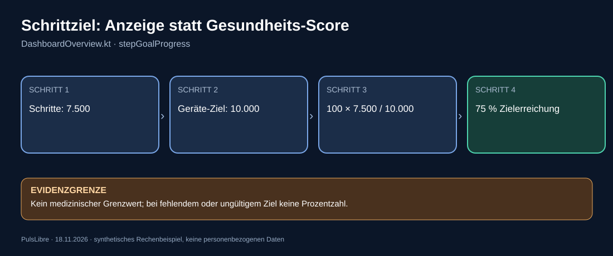
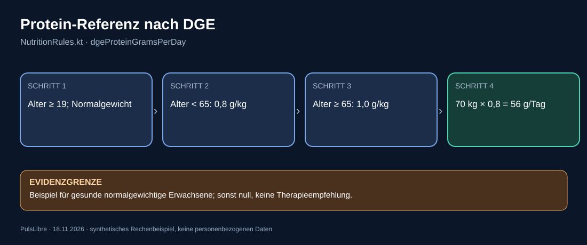
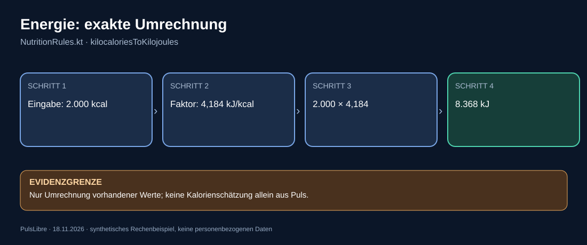
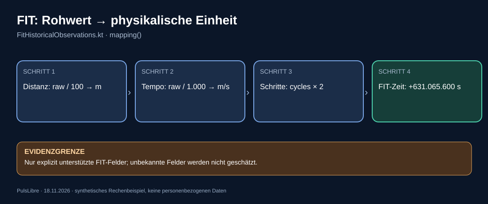
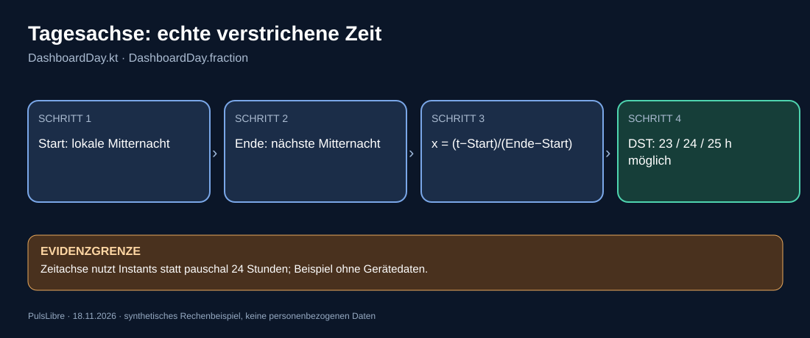
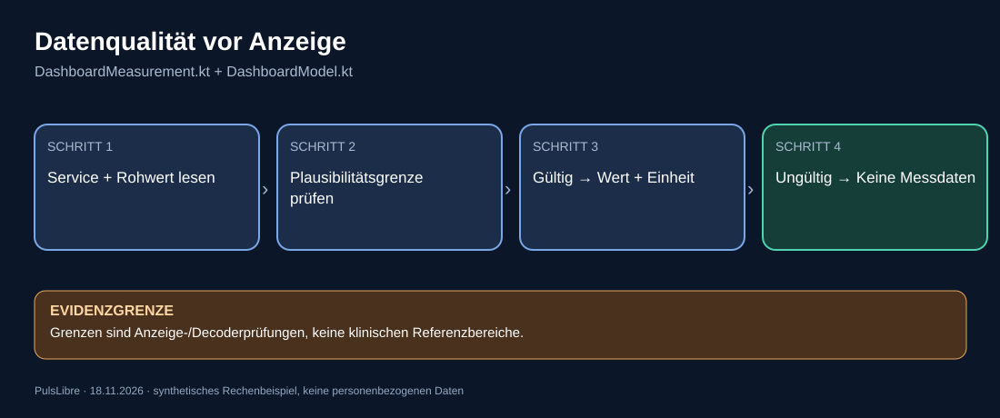
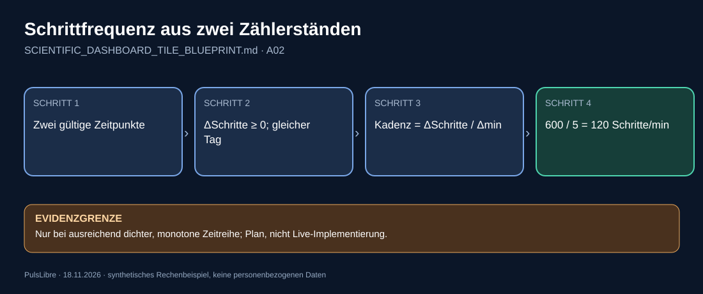
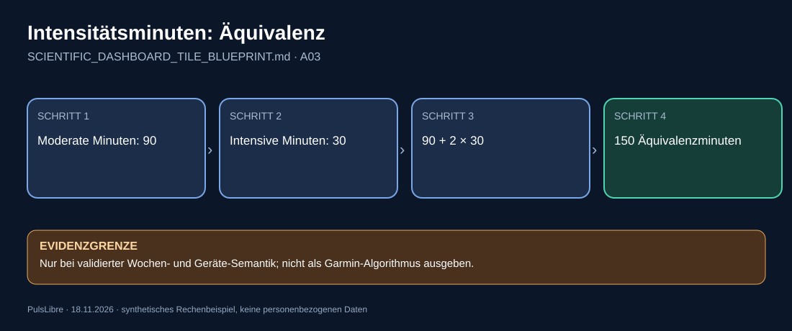
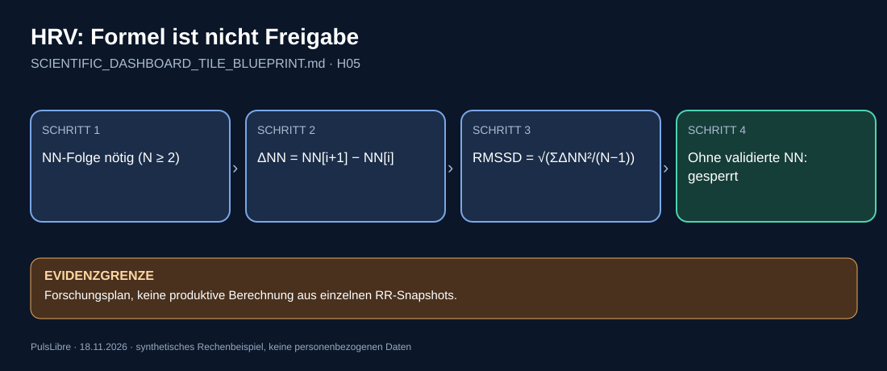

# PulsLibre – Berechnungen visuell erklärt

**Stand: 18.11.2026.** Neun editierbare SVG-Diagramme mit synthetischen Zahlenbeispielen. **Implementierte Kotlin-Logik** und **wissenschaftliche Konzeptformeln** werden ausdrücklich unterschieden. Die Abbildungen sind keine medizinische Beratung und keine Bestätigung einer vollständigen CIRQA-Historiensynchronisation.

## Schrittziel

**Quelle und Status:** `DashboardOverview.kt`: `stepGoalProgress`; tatsächlich implementiert. Beispiel 7.500/10.000 = 75 %. Prozentwert über 100 möglich.

## Proteinreferenz

**Quelle und Status:** `NutritionRules.kt`: ab 19 Jahren bei Normalgewicht; 0,8 g/kg unter 65, 1,0 g/kg ab 65; ansonsten `null`.

## Energieumrechnung

**Quelle und Status:** `NutritionRules.kt`: kcal × 4,184 = kJ; keine Puls-basierte Kalorienschätzung.

## FIT-Feldskalierung

**Quelle und Status:** `FitHistoricalObservations.kt`: Distanz /100, Geschwindigkeit /1000, kumulative Schritte ×2; FIT-Zeit-Offset 631.065.600 s. Nur unterstützte Felder.

## Zeitachse und Sommerzeit

**Quelle und Status:** `DashboardDay.kt`: `fraction` nutzt reale Sekunden zwischen lokaler Tagesmitternacht und Folgetag.

## Datenqualität

**Quelle und Status:** `DashboardMeasurement.kt`, `DashboardModel.kt`: Decoder-/Anzeigegrenzen; ungültige Werte bleiben fehlend.

## Schrittfrequenz – Konzept

**Quelle und Status:** `SCIENTIFIC_DASHBOARD_TILE_BLUEPRINT.md` A02: ΔSchritte / ΔMinuten, nur bei gültiger monotoner Zeitreihe; **keine Behauptung produktiver Umsetzung**.

## Intensitätsäquivalenz – Konzept

**Quelle und Status:** `SCIENTIFIC_DASHBOARD_TILE_BLUEPRINT.md` A03: moderate Minuten + 2 × intensive Minuten; Geräte-/Wochen-Semantik **nicht bestätigt**.

## HRV / RMSSD – gesperrtes Konzept

**Quelle und Status:** `SCIENTIFIC_DASHBOARD_TILE_BLUEPRINT.md` H05: √(Σ(ΔNN)²/(N−1)); **nicht aus isolierten RR-Messwerten berechnen**.

## Fachliche Grenzen

- Ein technischer Plausibilitätsbereich ist kein medizinischer Referenzbereich.
- Einzelne RR-Intervalle erlauben keine validierte HRV-Auswertung; für RMSSD sind geeignete, qualitätsgeprüfte NN-Folgen nötig.
- Die wissenschaftlichen Planformeln zu Kadenz und Aktivitätsäquivalenz sind nicht als bereits produktiv implementierte Algorithmen zu lesen.
- Der FIT-Decoder unterstützt nur explizit abgebildete Standardfelder und ist kein vollständiges Garmin FIT SDK.
- Sämtliche Zahlen in den Bildern sind **synthetische Rechenbeispiele**, keine echten Messwerte.

Siehe [wissenschaftlicher Kachelbauplan](../../science/SCIENTIFIC_DASHBOARD_TILE_BLUEPRINT.md), [Quellcode-Einstieg](../../../README.md) und [technischer Diagrammatlas](README.md).
