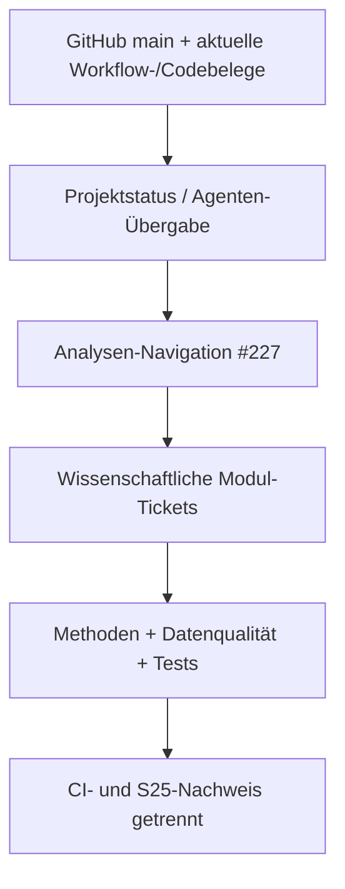

# PulsLibre – Dokumentationsabgleich in zwei Prüfdurchgängen (2026-11-19)

**Auftrag:** GitHub-Dokumentation quellengebunden zusammenfassen, Widersprüche entschärfen, nachvollziehbare Tabellen/Diagramme liefern. **Scope:** Dokumentation und Issues, **keine Android-Quellcodeänderung**. Zeitgebundene Aussagen werden nicht als Echtzeit-/Hardwarevalidierung ausgegeben.

## Quellen und Beleggrenze
Direkt auf GitHub-`main` eingesehen: `README.md`, `AGENTS.md`, `.github/workflows/android.yml`, `docs/project/PROJECT_STATUS.md`, `docs/project/CHAT_START_HERE.md`, `docs/product/ui/DASHBOARD_IMPLEMENTATION.md`, `docs/science/SCIENTIFIC_DASHBOARD_TILE_BLUEPRINT.md`, `docs/science/ANALYSEN_NAVIGATION_CONCEPT.md`, `docs/protocol/data-model/CIRQA_DASHBOARD_GROUND_RULES.md`, `docs/protocol/data-model/CIRQA_SLEEP_MOTION_GROUND_RULES.md`, `docs/project/CLAUDE_CODE_WORKLOG.md`, `docs/archive/2026-11-24/CODE_REVIEW_2026-11-19.md`, `docs/science/ENGINEERING_SCIENTIFIC_STANDARDS.md`, `docs/product/release/ANDROID_RELEASE_READINESS.md`. Die Datei `docs/science/SCIENTIFIC_REFERENCES.md` **existiert nicht**; die Richtlinie verweist stattdessen auf `docs/science/SCIENTIFIC_REFERENCES.md`. Kein Anspruch auf vollständige Inspektion aller Repositorydateien oder aller CI-/Geräteläufe.

## Durchgang 1 – Befunde, Entscheidung und Korrektur

| ID | Schwere | Quellen / Konflikt | Korrektur |
|---|---|---|---|
| D01 | Hoch | `PROJECT_STATUS.md` enthält einen alten Abschnitt „Aktueller Workflow (nach e4a6e23)“ mit schnellen main-Pushes, während `.github/workflows/android.yml` **aktuell** PR- und main-Push-Full-Gates definiert. | Abschnitt als datierten historischen Zwischenstand markieren, aktuellen Workflow an der Spitze nennen. |
| D02 | Mittel | `CHAT_START_HERE.md`-Willkommensprompt sagt, nur ein Agent sei aktiv und CIRQA-Transport gehöre ChatGPT; `PROJECT_STATUS.md`/Agenten-Sync sehen getrennte Zuständigkeiten und OpenCode-Arbeit vor. | Zeitabhängige Agentenaktivität nicht behaupten; GitHub-Sync und abgestimmte Ownership priorisieren. |
| D03 | Mittel | Neuer Analysen-Reiter #227 steht nur als angehängter Block in drei Fachdokumenten, fehlt in Start-/Statusnavigation. | Kanonische Sitemap verlinken, veraltete Vier-Screens-Anweisung als Bestand statt neue unveränderliche IA behandeln. |
| D04 | Mittel | Wissenschafts-Blueprint Stand 17.11. sagt „Kein validierter CIRQA-Historienimport“, während spätere Berichte einen begrenzten V24/V25-FIT-Download nennen. | Aussage als **17.11.-Snapshot** kennzeichnen; Datei-Download ≠ validierte fachliche Schlaf-/HRV-/FIT-Importsemantik. |
| D05 | Mittel | Dashboard-Bestand 17.11. basiert auf `f17f977` und `codex/dashboard-history`, während #41/#45 inzwischen auf main erweitert wurden. | Expliziter Stichtags-/Fortschrittsverweis, ohne historischen Bestand zu überschreiben. |
| D06 | Mittel | `ANDROID_RELEASE_READINESS.md` beschreibt drei gleichgewichtete Navigationseinträge (Stand 15.11.); #227 plant neuen Reiter. | Historische Aussage zeitlich markieren und auf #227 verweisen. |
| D07 | Niedrig | 3 Fachdokumente duplizieren denselben langen Analysen-Block; dadurch künftige Divergenz. | Kanonische Sitemap `docs/science/ANALYSEN_NAVIGATION_CONCEPT.md` als Single Source of Truth; andere Dokumente kurz verlinken. |
| D08 | Niedrig | README nennt lokale JDK-17-Anleitung, CI nutzt JDK 21; beides ist nicht identisch mit Java/Kotlin-Bytecode-Ziel 17. | Explizit unterscheiden: lokale Hinweise, CI-Laufzeit JDK 21, Bytecode-Ziel 17. |
| D09 | Mittel | Wissenschaftliche Referenzen sind unter `docs/science/SCIENTIFIC_REFERENCES.md` normiert; `docs/science/SCIENTIFIC_REFERENCES.md` ist nicht vorhanden. | Pfad nicht erfinden; Referenzpfad im Audit und Navigationsdokument festhalten. |

## Aktuelle fachliche Landkarte (Planungsstatus, kein Fertigstellungsnachweis)

| Modulgruppe | Tickets | Fachliches Gate |
|---|---|---|
| Herz & Kreislauf | #41 | Geräte-Ruhepuls nur bei belegter Semantik, Datenabdeckung getrennt von Schritten |
| Schlaf & Erholung | #43, #44 | Schlafintervalle und Nacht-/Folgetag-Zuordnung verifizieren |
| Bewegung & Entwicklung | #46, #47 | Belastungsvergleich nur mit Aktivitätskontext; 90 Tage nur mit echter Historie |
| Zusammenhänge & Muster | #45 | Zeitreihenabhängigkeit, Mehrfachtests, Sensitivität, keine Kausalität |
| Datenqualität & Methoden | #144, #148 | Quellen, SHA/CRC, fehlende Daten, Import-/Sync-Gates |
| Historienvisualisierung | #219 | Messdichte ≠ Gesundheitsbewertung |

## Durchgang 2 – Nachprüfung
Nach den gezielten Dokumentationskorrekturen werden alle **veränderten** Dateien erneut direkt aus GitHub gelesen. Geprüft werden: #227-Querverweise, historische statt aktuelle CI-Aussagen, relative Links, Referenzpfad, keine Source-Code-Änderungen, konsistente Begriffe „Übersicht“/„Analysen“, und ehrliche Trennung zwischen Plan/Implementierung/CI/S25. Ergebnisse werden hier im zweiten Abschnitt ergänzt.

## Unverändert offene Grenzen
- Kein Anspruch auf vollständige Inspektion des gesamten Git-Trees, aller Issue-Kommentare, aller aktuellen Actions-Runs oder eines angeschlossenen S25.
- Neue wissenschaftliche Ideen sind Backlog, nicht freigegebene, implementierte oder klinisch validierte Features.
- Ein vollständiger Hardware-/BLE-Test ist nicht Teil dieser Dokumentationsarbeit.

## Durchgang 2 – tatsächliche Nachprüfung und Ergebnis (19.11.2026)

**Erneut aus GitHub gelesen:** `README.md`, `docs/project/CHAT_START_HERE.md`, `docs/project/PROJECT_STATUS.md`, `docs/product/ui/DASHBOARD_IMPLEMENTATION.md`, `docs/science/SCIENTIFIC_DASHBOARD_TILE_BLUEPRINT.md`, `docs/protocol/data-model/CIRQA_DASHBOARD_GROUND_RULES.md`, `docs/product/release/ANDROID_RELEASE_READINESS.md`, `docs/science/ANALYSEN_NAVIGATION_CONCEPT.md`. Zusätzlich existierende Quellen `docs/science/SCIENTIFIC_REFERENCES.md` und `docs/collaboration/agent-sync/INDEX.md` geprüft.

| Kontrolle | Ergebnis | Nachweis / Einschränkung |
|---|---|---|
| Neuer Reiter #227 in zentralen Einstiegspunkten | **Bestanden (Dokumentation)** | Alle 8 erneut gelesenen Dokumente enthalten #227; kanonische Sitemap ist verlinkt, sofern fachlich relevant |
| Dreifach duplizierter langer Analysen-Block | **Behoben** | Dashboard-, Wissenschafts- und Datenmodell-Dokument enthalten stattdessen kurze Links auf die Sitemap |
| Alte CI-Aussage als aktueller Workflow | **Behoben** | Der historische Abschnitt in `PROJECT_STATUS.md` ist als überholt markiert; aktueller Workflow ist gesondert beschrieben |
| Agenten-Ownership und behauptete Gleichzeitigkeit | **Behoben (Text)** | Startprompt verweist auf Agenten-Sync; aus Dokumentation wird keine aktuell laufende Session behauptet |
| Historischer vs. neuer Dashboard-Stand | **Behoben (Einordnung)** | `DASHBOARD_IMPLEMENTATION.md` bezeichnet seinen Basis-Commit als Snapshot, nennt spätere #41/#45-Entwicklung |
| CIRQA-Dateidownload vs. fachlich validierter Import | **Behoben (Einordnung)** | Wissenschafts-Blueprint trennt V24/V25-Dateitransport von fachlich validierter Schlaf-/HRV-Semantik |
| Referenzpfad | **Bestanden** | `docs/science/SCIENTIFIC_REFERENCES.md` existiert; `docs/science/SCIENTIFIC_REFERENCES.md` nicht – letzteres nicht verwenden |
| JDK-Laufzeit vs. Bytecode-Ziel | **Behoben (Dokumentation)** | README unterscheidet CI-JDK 21 von Java/Kotlin-Bytecode-Ziel 17 |
| Android-/Emulator-/S25-Abnahme | **Nicht ausgeführt** | Dokumentationsprüfung ist kein Build, keine aktuelle CI-Laufabfrage und kein Gerätetest |
| Vollständige Repo-weite Link-/Codeprüfung | **Nicht durchgeführt** | Prüfumfang ist die explizite Quellliste; weitere historische Dokumente können Altstände enthalten |

**Status:** zwei dokumentierte Prüfzyklen abgeschlossen; die gezielt gefundenen textlichen Konflikte sind auf `main` bereinigt. Keine Behauptung, dass jede Datei im Repository gelesen wurde. Bestehende historisch datierte Arbeitsberichte wurden nicht rückwirkend umgeschrieben.

### Empfehlungen für die nächste Audit-Runde
1. CI-/Hardwarestatus über die neuesten echten GitHub-Actions-Runs und Gerätetests belegen, nicht aus Worklog-Text ableiten.
2. Bei späterer Umsetzung von #227 den UI-Navigationsvertrag mit realem `MainActivity`-/Navigation-Code und Accessibility-Tests abgleichen.
3. Wissenschaftliche Formeln in `docs/science/SCIENTIFIC_REFERENCES.md` und ihren konkreten Implementierungen quellenweise verifizieren.
4. Vor Änderungen an #144/#148 die aktuellen Datenbankschemas und Backup-/Restore-Migrationspfade technisch prüfen.
