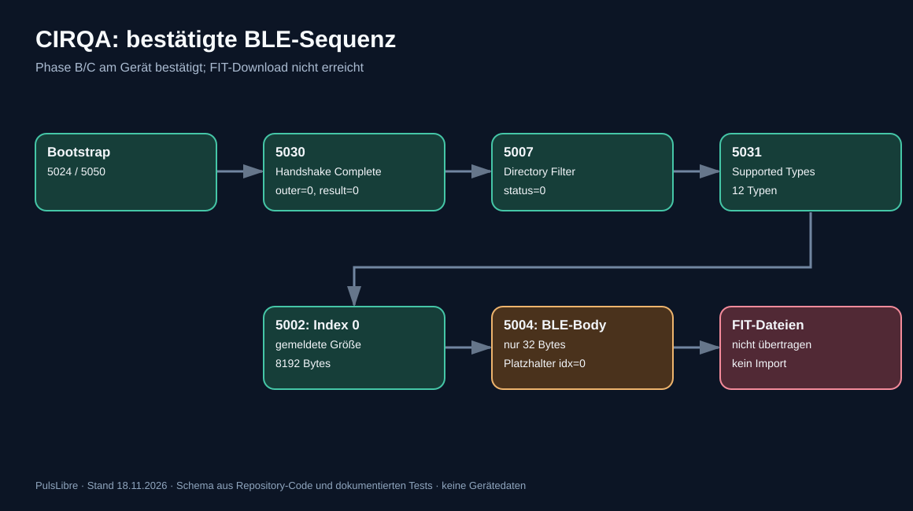
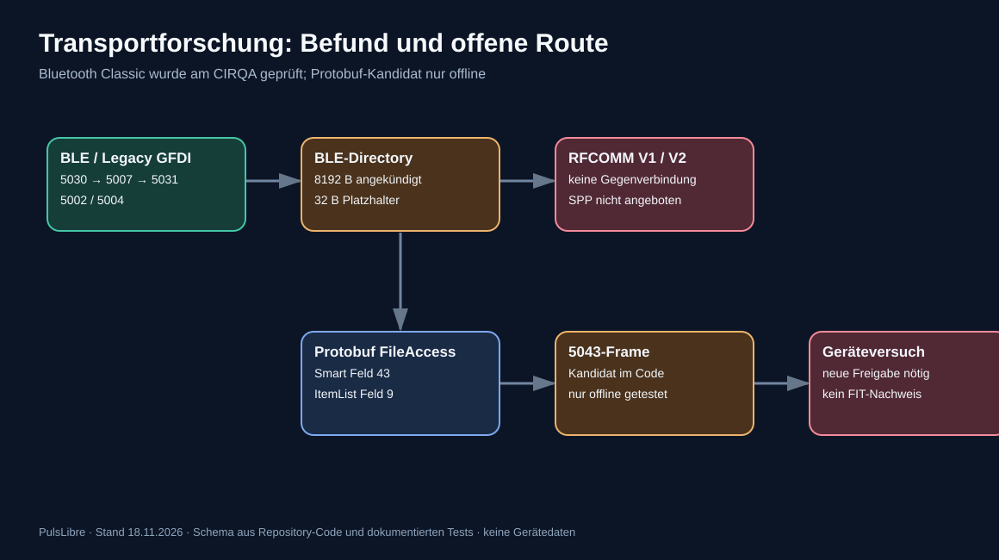
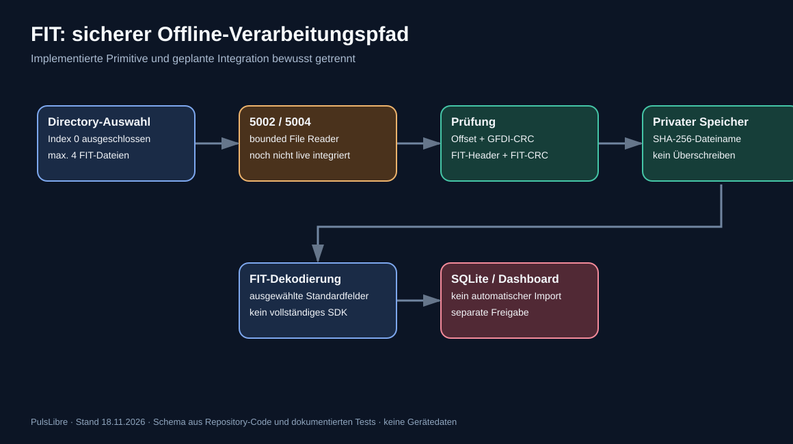
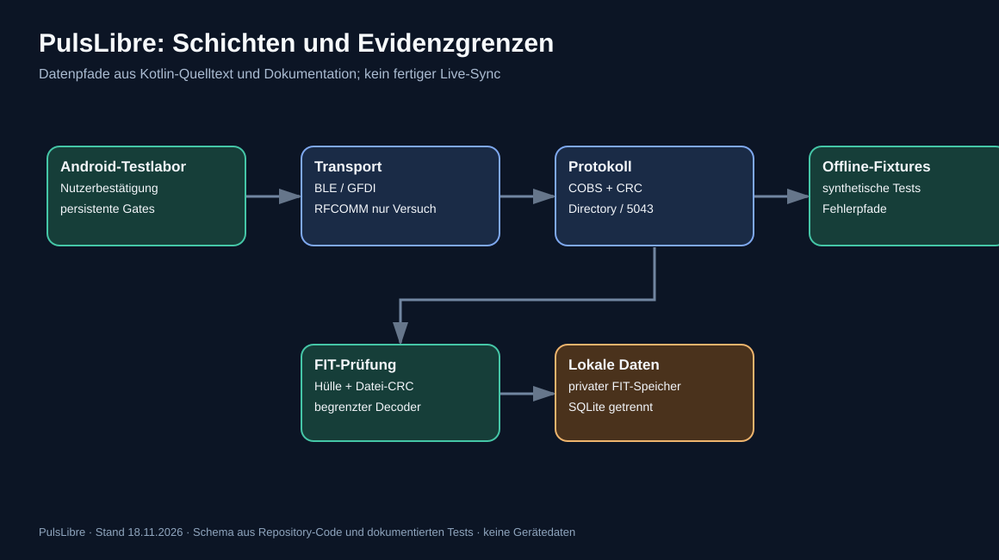

# PulsLibre – technische Ablaufdiagramme

Diese Grafiken sind **editierbare SVG-Dateien**, anhand der Kotlin-Implementierung und der datierten Forschungsberichte vom 18.11.2026 erstellt. Sie enthalten keine Garmin-Binary, keine privaten Gerätedaten und keine dekompilierten Codeauszüge.

## 1. Bestätigte CIRQA-BLE-Sequenz

**Quellen:** [Historical Sync V1](../protocol/experiments/CIRQA_HISTORICAL_SYNC_V1_2026-11-18.md), `CirqaHistoricalSyncV1MultiPhaseSession.kt`. Die 8192 Bytes sind die **gemeldete Größe**, nicht 8192 erfolgreich empfangene Bytes.

## 2. Transportentscheidung und Protobuf-Kandidat

**Quellen:** [aktueller Forschungsstand](../protocol/research/CIRQA_HISTORICAL_RESEARCH_STATUS_2026-11-18.md), `CirqaRfcommRunner.kt`, `CirqaFileAccessListRequest.kt`. Zwei RFCOMM-Versuche blieben ohne Gegenverbindung; die Item-List-Anfrage ist **offline vorbereitet, nicht an das Gerät gesendet**.

## 3. FIT-Validierung und Offline-Speicherung

**Quellen:** [Offline-FIT-Pipeline](../protocol/experiments/CIRQA_OFFLINE_FIT_PIPELINE_2026-11-18.md), `CirqaVerifiedFitStore.kt`, `FitFileHeader.kt`. Die Grafik zeigt einen **konzeptionellen Datenfluss** mit bereits implementierten, aber noch nicht vollständig zu einem Live-Sync verbundenen Bausteinen; Pfeile sind keine Aussage über eine produktive Verbindung.

## 4. Architekturüberblick

**Quellen:** `CirqaHistoricalSyncV1MultiPhaseSession.kt`, `CirqaRfcommRunner.kt`, `CirqaVerifiedFitStore.kt` sowie [Protokollindex](../protocol/README.md). Architekturübersicht, **keine vollständige Klassen- oder Laufzeitabhängigkeitsgrafik**.

## Farb- und Evidenzkonvention

- **Grün:** dokumentierter positiver Gerätebefund oder implementierte Offline-Prüfung (genaue Bedeutung jeweils im Kasten und Quellverweis).
- **Blau:** Komponente oder Modellierung ohne behaupteten Geräteerfolg.
- **Orange:** Einschränkung, unvollständige Integration oder offene Hypothese.
- **Rot:** fehlgeschlagener/gesperrter Pfad oder nicht nachgewiesene Funktion.

**Pflege:** Nach neuen Gerätebefunden zunächst den [kanonischen Forschungsstand](../protocol/research/CIRQA_HISTORICAL_RESEARCH_STATUS_2026-11-18.md) aktualisieren und danach die betroffenen SVG-Grafiken. Keine privaten Rohdaten in Illustrationen übernehmen.
