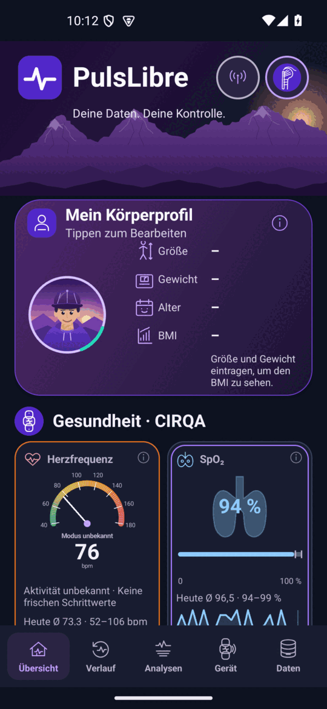
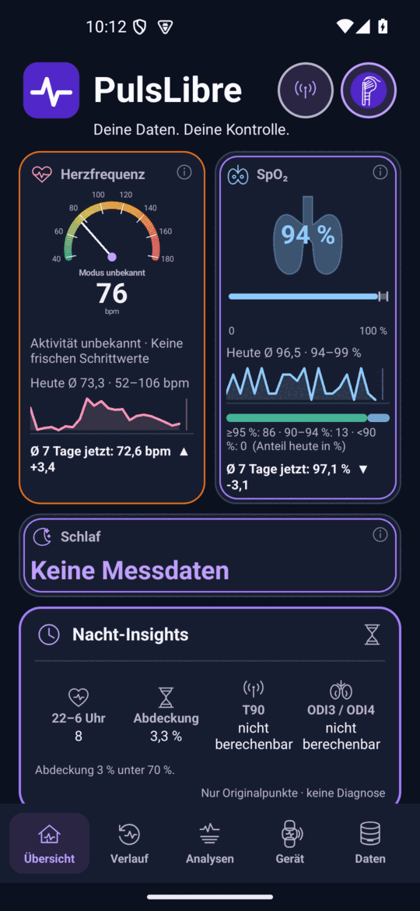
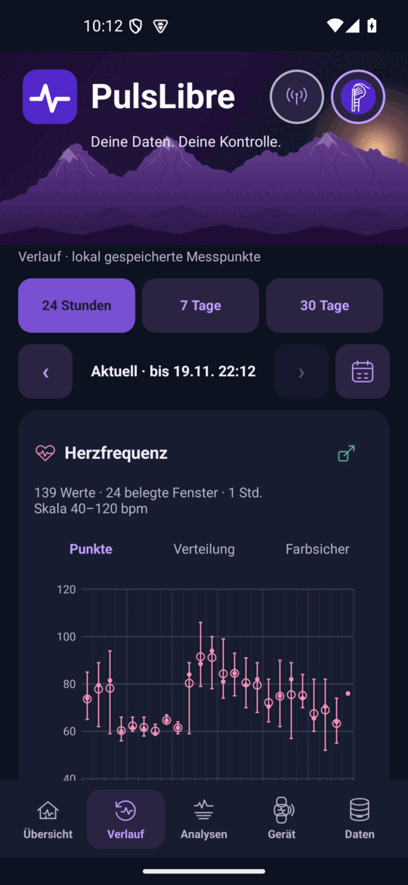
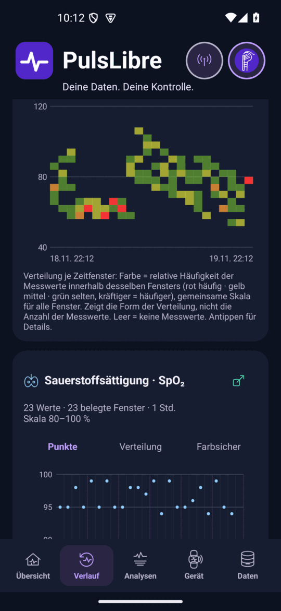
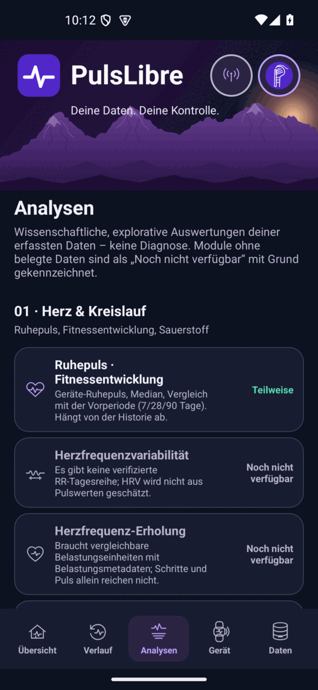
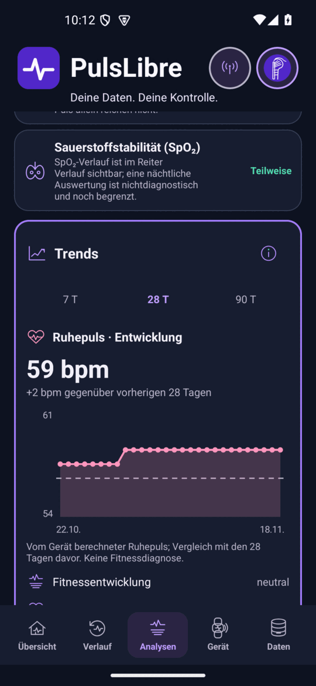
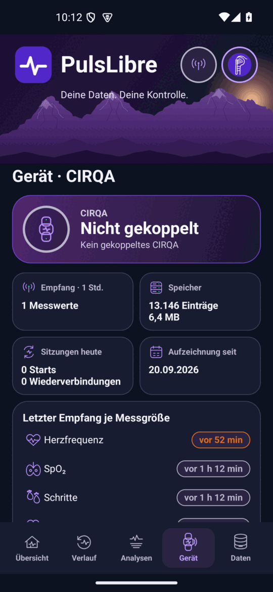
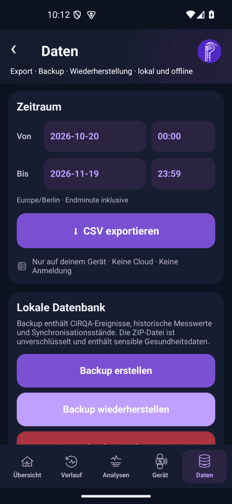
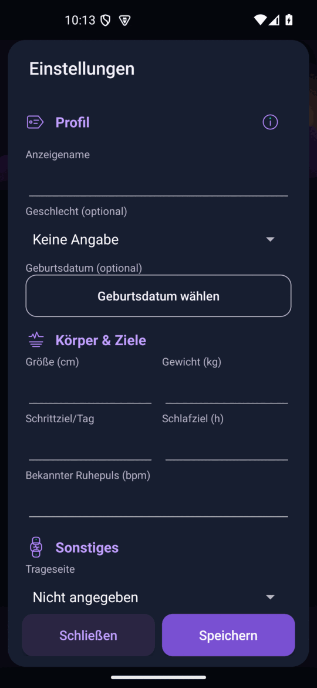

# PulsLibre – Benutzerhandbuch

> **Textstand:** 20.11.2026 (neu: Tag im Überblick, Wochenkarte, Startseite anpassen; die Abbildungen zeigen den Stand vom 19.11.2026 und sind noch nicht aktualisiert) · **Bildstand:** 19.11.2026 · `main` ab Commit cd7c827 (Debug-Build, App-Version 2.0.0) · **Alle Bilder sind Aufnahmen aus dem Android-Emulator (Pixel-Auflösung 1080×2340, Dunkelmodus) mit künstlichen Demo-Daten – keine echten Gesundheitsdaten und kein echtes Armband** (daher „Nicht gekoppelt“ und leere Profilfelder). Alle Aussagen beziehen sich auf den tatsächlichen Stand von `main`; „noch nicht verfügbar“ heißt wirklich: nicht umgesetzt oder ohne belegte Datenquelle. Bilder liegen in `docs/user/images/`.

PulsLibre ist eine **lokale, offline arbeitende** App für das Garmin-CIRQA-Armband. Alle Daten bleiben auf deinem Telefon; es gibt keine Cloud, kein Konto und keine Internetberechtigung. Die App stellt **keine Diagnosen** und keine Gesundheits- oder Fitness-Scores bereit.

## 1. Der Kopfbereich
- Oben stehen Logo, „PulsLibre“ und „Deine Daten. Deine Kontrolle.“. Rechts ein gemeinsamer **Statusknopf** mit Armband-Zustand, Armband-Akku und Zahnrad. Das Symbol im Kreis zeigt: ✓ getragen, ! nicht getragen, durchgestrichen = nicht verbunden, ? = unbekannt. „Getragen“ erscheint nur, wenn das Armband es selbst meldet (Atemmessung bzw. Meldung „nicht am Handgelenk“), sonst „unbekannt“. Der Akkuwert ist der des **Armbands**, nicht des Handys; ohne aktuellen Wert (älter als 12 Stunden oder nicht verbunden) steht „–“. **Tippen** öffnet die Einstellungen, **langes Drücken** zeigt die Verbindungsdetails.
- Auf der Übersicht ist der Kopf groß mit Bergillustration. Sobald du nach unten scrollst, wird er klein (ohne Berge), damit mehr Platz für Messwerte bleibt; am oberen Rand wird er wieder groß. Das gilt auf allen Reitern mit genug Inhalt.

## 2. Reiter in der unteren Leiste
Übersicht · Verlauf · Analysen · Gerät · Daten.

### Übersicht

  
*Abb. 1 – Übersicht: Kopf, Körperprofil und Kennzahlen*

  
*Abb. 2 – Kacheln mit Tacho, Skala und „Keine Messdaten“*

- **Mein Körperprofil:** Größe, Gewicht, Alter und BMI aus deinen eigenen Angaben (Tippen zum Bearbeiten; das Gewicht lässt sich direkt per Antippen ändern). Der BMI ist nur eine Orientierung und wird mit Kategorie in Worten gezeigt.
- **Gesundheit · CIRQA:** Herzfrequenz (Tacho mit Aktivitätskontext), SpO₂ (mit Skala und Verlauf), Schritte heute, Ruhepuls und weitere Gerätewerte (RR-Intervall, Stress, Body Battery …). Jede Kachel hat ein ⓘ mit Quelle, Skala und Einschränkungen. Kacheln mit **dunkelviolettem Rahmen** sind noch **nicht validiert** (z. B. SpO₂ des Bands); sie zeigen Werte, aber keine Bewertung als gesichert.
- **Schrittziel:** Ein in den Einstellungen eingetragenes Schrittziel (100–100 000) hat Vorrang und wird als „Ziel (eigenes)“ gezeigt; ohne eigenes Ziel gilt das vom Band gemeldete („Ziel (Gerät)“). Ab dem Ziel steht dort „Tagesziel erreicht“.
- **Startseite anpassen:** Ganz unten auf der Übersicht lassen sich Kacheln ein- oder ausblenden, in der Reihenfolge verschieben und als Favorit markieren (Favoriten stehen zuerst unter „Im Fokus“). Ausgeblendete Kacheln werden weiter aufgezeichnet, nur nicht angezeigt. „Zurücksetzen“ stellt die Standardansicht wieder her. Die Einstellung bleibt lokal auf dem Gerät.
- **Tag im Überblick:** Eine Karte unten auf der Übersicht öffnet Herzfrequenz und Schritte eines Tages auf **einer gemeinsamen Zeitachse** (Datum über die Schaltfläche wählbar). Zeiten ohne Messwerte sind **schraffiert und mit „keine Daten“ beschriftet** und werden nie verbunden oder geschätzt. Tippen oder Ziehen zeigt Uhrzeit und den Wert jeder Spur (oder „keine Daten“). Mit Zwei-Finger-Zoom oder den Tasten **‹ − + › Tag** lässt sich der Ausschnitt ändern (bis 15 Minuten); im Ausschnitt stehen die Rohpunkte, keine Mittelwerte. Die gestrichelte Linie bei den Schritten ist dein Ziel (eigenes vor Gerätziel). Unter dem Diagramm steht dieselbe Information als Text (auch für TalkBack).
- Weitere Gerätewerte (Kalorien, Intensitätsminuten, Stress, Body Battery …) erscheinen unter den Hauptkacheln, sobald das Band sie sendet; ihre Einheiten und Messbedingungen sind nicht geprüft.
- Fehlende Werte werden als „Keine Messdaten“ gezeigt, nie als 0.

### Verlauf

  
*Abb. 3 – Verlauf, Darstellung „Punkte“*

  
*Abb. 4 – Darstellung „Verteilung“ (rot = häufig, grün = selten)*

- Zeitraum **24 Stunden / 7 Tage / 30 Tage**, Fensternavigation (‹ ›) und Datumswahl. Je Messgröße (Herzfrequenz, SpO₂) eine Karte.
- **Punkte | Verteilung:** „Punkte“ zeigt je Zeitfenster Median (Punkt), Mittelwert (Ring) und Min–Max (Linie). „Verteilung“ zeigt, **wo** die Messwerte im Fenster liegen: Farbe von grün (selten) über gelb zu rot (häufig), kräftiger = häufiger. Der dritte Schalter **„Farbsicher“** zeigt dieselbe Verteilung in einer Skala von blau (selten) über türkis zu gelb (häufig) – ohne Rot/Grün-Unterscheidung. Das ist die **relative** Verteilung innerhalb des Fensters, nicht die Anzahl; leere Fenster bleiben leer. Antippen eines Fensters zeigt Stichprobe, Median, Mittelwert, Min/Max und das häufigste Wertintervall.
- Die Zeitachse ist die **Empfangszeit auf dem Telefon**.

### Analysen

  
*Abb. 5 – Analysen: Gruppen und Module mit Verfügbarkeit*

  
*Abb. 6 – Ruhepuls-Trend im Trend-Block*

Wissenschaftliche, **explorative** Auswertungen in fünf Gruppen (Herz & Kreislauf · Schlaf & Erholung · Bewegung & Entwicklung · Zusammenhänge & Muster · Datenqualität & Methoden). Module ohne belegte Datenquelle (z. B. Schlaf, HRV) stehen als **„Noch nicht verfügbar“** mit Begründung da – es werden keine Werte geschätzt.
- **Trend-Block** (7 T | 28 T | 90 T, Standard 28 T): *Ruhepuls · Entwicklung* mit Median des vom Gerät berechneten Ruhepulses, neutralem Vergleich „−4 bpm gegenüber vorherigen 28 Tagen“ (nicht überlappende Vorperiode) und Tagespunkten – **über fehlende Tage wird keine Linie gezogen**. Zu wenige Tage (7 T ≥ 4, 28 T ≥ 14, 90 T ≥ 45) → nur Tageswerte und ein Hinweis, kein Vergleich.
- **Aktivitäts-Atlas:** Kalenderraster der Tages-Schrittstände (Mo–So). **Graue Zelle = keine verifizierten Daten** (nicht 0 Schritte); Abstufung = relative Schrittzahl deiner erfassten Tage (kein Gesundheitsstatus); die Zahl in der Zelle (z. B. 7,2k) ist das zweite Merkmal neben der Farbe; umrandet = heute, noch nicht abgeschlossen.
- **Zusammenhang Schritte → Ruhepuls am Folgetag** (explorativ, Spearman mit 95-%-Intervall und Robustheitszeile; erst ab 30 gepaarten Tagen) – Antippen öffnet das Streudiagramm.
- **Datenabdeckung:** Ruhepuls und Schritte getrennt als „x von y Tagen“.
- **Letzte 7 Tage:** Ø Schritte pro Tag, Schritte gesamt und Ø Geräte-Ruhepuls über die sieben vollständigen Tage vor heute, je Zeile mit eigener Abdeckung („4 von 7 Tagen“). Mittelwerte zählen nur Tage mit Daten; fehlende Tage sind nie 0. Mit eigenem Schrittziel zusätzlich „Ziel erreicht an x von y Tagen mit Daten“ (auch im Aktivitäts-Atlas für das gewählte Fenster). Schlafdauer, Kalorien, Intensitätsminuten und Stress haben noch keine geprüften Tagesreihen.
- **Methoden und Grenzen:** Quellen, Zeitbezug, Annahmen. Unterhalb von 90 Tagen realer Historie wird nie extrapoliert.

### Gerät

  
*Abb. 7 – Gerät: Verbindung, Kennzahlen, letzter Empfang*

- Die Verbindungskarte zeigt, ob das Band verbunden ist und wann die letzte Messung ankam. Darunter Kennzahlen (Empfang je Stunde, Speicher, Sitzungen heute, seit wann aufgezeichnet) und der **letzte Empfang je Messgröße**.
- **Bandinformationen:** Akku, Firmware, Uhrzeit, Modell. Ein Wert erscheint **nur**, wenn er mit Quelle und Zeitstempel gespeichert ist; sonst „Nicht verfügbar“. Ein Akkustand zeigt Balken und „Stand: vor …“ bzw. „Veraltet · letzter bekannter Stand …“.
- **Unbekannte Datenfelder:** Wenn die Dateien des Bands Felder enthalten, die PulsLibre noch nicht versteht, erscheint ein dezenter Hinweis; die Liste (nach FIT-Nachricht gruppiert) zeigt nur Feldkoordinaten und Häufigkeiten – **keine Messwerte, keine Diagnosen**. Pro Feld kannst du über **„Status ändern“** eine eigene Prüfmarke setzen (ungeprüft · in Prüfung · unterstützt · ignoriert); das verändert keine Messdaten.
- **Aufzeichnung:** „Starten“/„Stoppen“ des Aufzeichnungsdienstes (Android zeigt dabei eine dauerhafte Benachrichtigung mit Stopp-Taste).
- *Versteckt:* Ein **3-Sekunden-Druck auf „Gerät · CIRQA“** öffnet das **Testlabor** (nur lesende Diagnose: App, Bluetooth-Status, Synchronisationszähler, Diagnosepaket mit Vorschau zum bewussten Teilen; „Erweitertes Testlabor“ für Fortgeschrittene).

### Daten

  
*Abb. 8 – Daten: Export und lokale Datenbank (Backup)*

Lokaler Export und Sicherung deiner Daten (Zeitraum wählen, exportieren) sowie Hinweise zu Datenschutz und lokaler Speicherung. Wiederherstellungen verlangen eine ausdrückliche Bestätigung.

> **Datenschutz-Hinweis:** Die Datenbanksicherung ist **nicht verschlüsselt**. Sie enthält deine Gesundheitsdaten im Klartext. Speichere sie nur an einem Ort, dem du vertraust (nicht in einem öffentlich geteilten oder ungesicherten Cloud-Ordner).

**Was das Backup enthält:** deine Messwerte, Ereignisse, Synchronisationsstände, die dekodierten FIT-Daten samt aller Rohfelder und die in der App archivierten Originalinhalte der heruntergeladenen Banddateien. Mit **„FIT-Originale exportieren“** legst du die geprüften FIT-Dateien zusätzlich einzeln als ZIP ab (mit Warnhinweis; sie können Gesundheitsdaten enthalten und sind ebenfalls nicht verschlüsselt).

**Wenn ein Backup nicht klappt:** Die App meldet „Backup fehlgeschlagen“ mit einer technischen Ursache (ohne Messwerte) und löscht die leere Zieldatei wieder. Vorher prüft sie, ob genug freier Speicher vorhanden ist. Ein Backup darf als ZIP bis 512 MB und entpackt bis 2 GB groß sein; die ZIP-Datei ist meist nur ein Bruchteil des Inhalts (Beispiel: 8 MB ZIP für 140 MB Inhalt).

**Wiederherstellen:** Die App prüft das ganze Backup (Prüfsummen, Verweise, Vollständigkeit), **bevor** sie fragt, ob die Datenbank ersetzt werden soll. Bis zu dieser Rückfrage wird nichts verändert; „Abbrechen“ lässt alles, wie es ist. Ist ein Backup ungültig, nennt die App die Ursache.

## 3. Einstellungen (Statusknopf oben rechts)

  
*Abb. 9 – Einstellungen: Profil, Körper & Ziele, Sonstiges*

- **Profil:** Name, Geburtsdatum, Geschlecht, Armseite, Größe, Gewicht, Schritt- und Schlafziele, Ruhepuls-Referenz u. a.; die Angaben werden nur lokal gespeichert.
- **SpO₂-Grenzwerte** (Anzeige-Skala) und weitere Anzeigeeinstellungen.
- **Aufzeichnung:** Schalter „Beim App-Start automatisch aufzeichnen“ – startet den Aufzeichnungsdienst beim Öffnen der App, wenn Bluetooth an ist und die Berechtigungen schon erteilt sind. Die App schaltet Bluetooth nie selbst ein.
- **Darstellung:** System/Hell/Dunkel.
- **Profil löschen** entfernt nur die Profilangaben (nicht die Messdaten und nicht die SpO₂-Einstellungen) und verlangt zwei Bestätigungen.

## 4. Hinweise
- **Dunkel/Hell, große Schrift, TalkBack:** Die App folgt dem System; Statusleisten-Symbole passen sich dem Thema an. TalkBack ist als Anspruch umgesetzt, aber noch nicht in einem vollständigen Gerätedurchlauf geprüft.
- **Bluetooth-Berechtigung** („Geräte in der Nähe“) und Benachrichtigungen werden für die Aufzeichnung gebraucht. Ohne sie zeigt die App „Bluetooth-Berechtigung fehlt“.
- **Akku:** Dauerhafte Aufzeichnung verbraucht Strom auf Telefon und Band; eine Messung dazu läuft (Ticket #235).

## 5. Grenzen
PulsLibre ersetzt keine ärztliche Beratung. Ruhepuls-Werte kommen vom Gerät (nie aus dem Tagesminimum), SpO₂-Werte des Bands sind nicht validiert, Schlaf- und HRV-Analysen sind nicht verfügbar, und Zusammenhänge sind nur Muster in deinen Daten, keine Ursachen.
