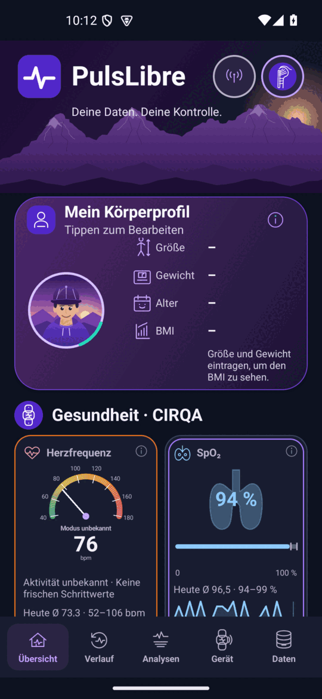
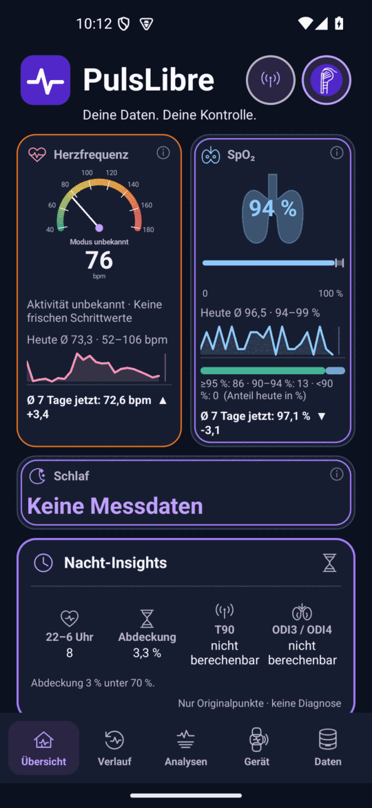
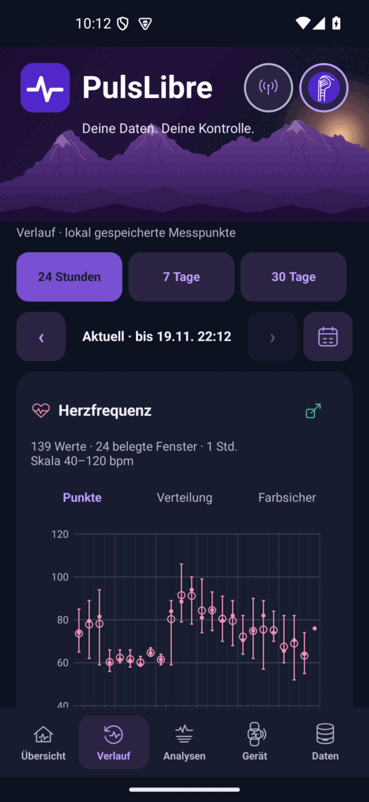
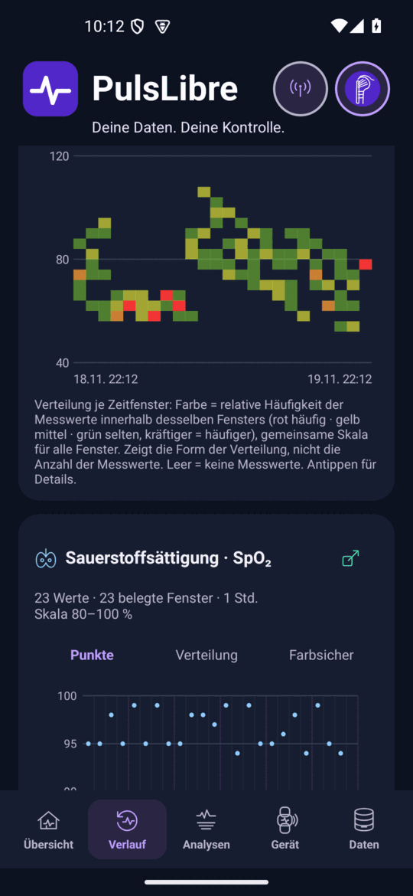
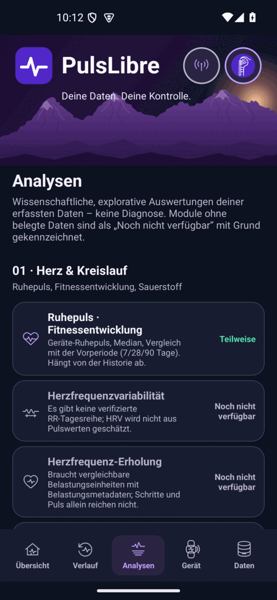
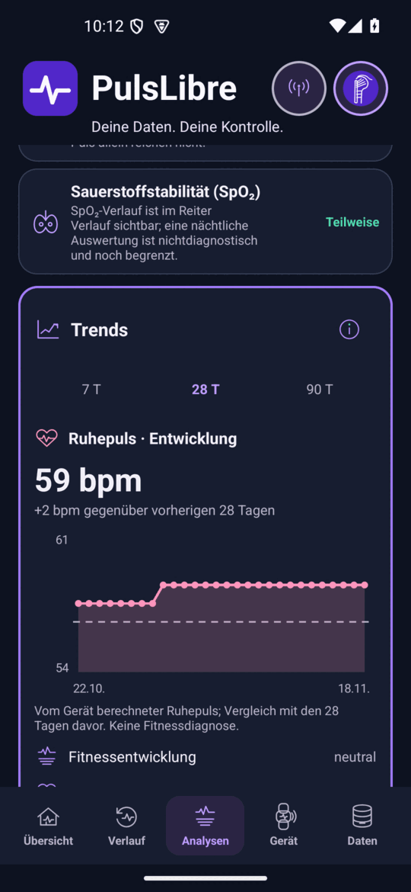
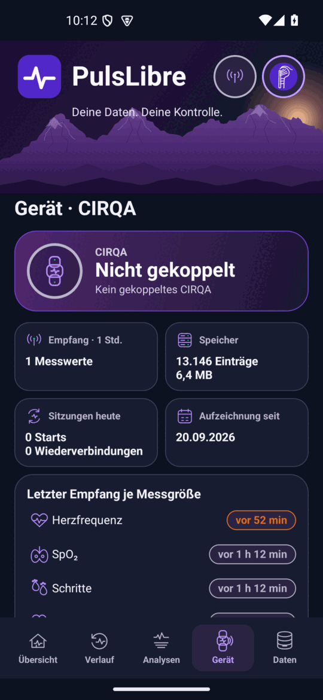
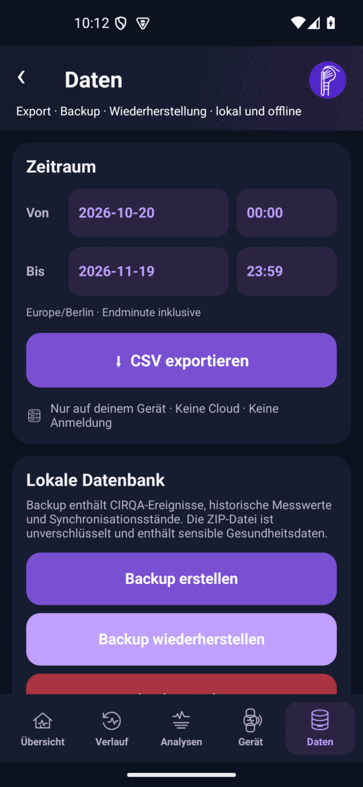
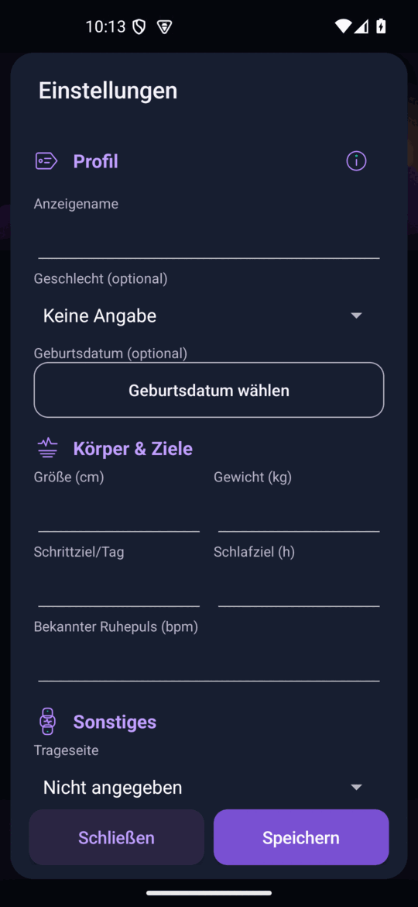

# PulsLibre – User Manual (English)

> **Status:** English translation of [BENUTZERHANDBUCH.md](BENUTZERHANDBUCH.md) (German original, text as of 20 Nov 2026), draft by Claude Code for ticket #365; basis for the French and Spanish versions. **The screenshots are still the German ones** (emulator recordings of 19 Nov 2026, dark mode, 1080×2340, artificial demo data – no real health data and no real band, hence "Nicht gekoppelt" and empty profile fields). They are in `docs/user/images/`. "Not available yet" really means: not implemented, or no verified data source.

PulsLibre is a **local, offline** app for the Garmin CIRQA band. All data stays on your phone; there is no cloud, no account and no internet permission. The app provides **no diagnoses** and no health or fitness scores.

## 1. The header
- At the top you see the logo, "PulsLibre" and "Your data. Your control.". On the right is one combined **status button** with band state, band battery and a gear. The symbol in the circle shows: ✓ worn, ! not worn, crossed out = not connected, ? = unknown. "Worn" only appears when the band reports it itself (respiration measurement or "off wrist" message), otherwise "unknown". The battery value is the **band's**, not the phone's; without a current value (older than 12 hours or not connected) it shows "–". **Tap** opens the settings, **long press** shows the connection details.
- On the Overview the header is large with a mountain illustration. As soon as you scroll down it shrinks (without mountains) to leave more room for readings; at the top it grows again. This applies to every tab with enough content.

## 2. Tabs in the bottom bar
Overview · History · Analyses · Device · Data.

### Overview

  
*Fig. 1 – Overview: header, body profile and key figures*

  
*Fig. 2 – Tiles with gauge, scale and "No measurements"*

- **My body profile:** height, weight, age and BMI from your own entries (tap to edit; weight can be changed directly by tapping it). The BMI is only an orientation and is shown with a category in words.
- **Health · CIRQA:** heart rate (gauge with activity context), SpO₂ (with scale and trend), steps today, resting heart rate and further device values (RR interval, stress, Body Battery …). Every tile has an ⓘ with source, scale and limitations. Tiles with a **dark violet frame** are **not yet validated** (e.g. the band's SpO₂); they show values but not as verified.
- **Step goal:** a step goal entered in Settings (100–100,000) takes precedence and is shown as "Goal (own)"; without your own goal, the one reported by the band applies ("Goal (device)"). Once the goal is reached it says "Daily goal reached".
- **Customize home:** at the very bottom of the Overview you can show or hide tiles, change their order and mark favorites (favorites appear first under "In focus"). Hidden tiles keep being recorded, they are just not shown. "Reset" restores the default view. The setting stays local on the device.
- **Day overview:** a card at the bottom of the Overview opens heart rate and steps of one day on **one shared time axis** (choose the date with the button). Times without readings are **hatched and labeled "no data"** and are never connected or estimated. Tapping or dragging shows the time and the value of each lane (or "no data"). With two-finger zoom or the buttons **‹ − + › Day** you can change the section (down to 15 minutes); a section shows raw points, not averages. The dashed line in the steps lane is your goal (own goal before device goal). Below the chart the same information appears as text (also for TalkBack).
- Further device values (calories, intensity minutes, stress, Body Battery …) appear below the main tiles as soon as the band sends them; their units and measurement conditions are not verified.
- Missing values are shown as "No measurements", never as 0.

### History

  
*Fig. 3 – History, "Points" view*

  
*Fig. 4 – "Distribution" view (red = frequent, green = rare)*

- Range **24 hours / 7 days / 30 days**, window navigation (‹ ›) and date picker. One card per measurement (heart rate, SpO₂).
- **Points | Distribution:** "Points" shows, per time window, the median (dot), the mean (ring) and min–max (line). "Distribution" shows **where** the readings lie within the window: color from green (rare) via yellow to red (frequent), stronger = more frequent. The third switch **"Color-safe"** shows the same distribution on a scale from blue (rare) via turquoise to yellow (frequent), without a red/green distinction. This is the **relative** distribution within the window, not the count; empty windows stay empty. Tapping a window shows sample size, median, mean, min/max and the most frequent value interval.
- The time axis is the **reception time on the phone**.

### Analyses

  
*Fig. 5 – Analyses: groups and modules with availability*

  
*Fig. 6 – Resting heart rate trend in the trend block*

Scientific, **exploratory** evaluations in five groups (Heart & circulation · Sleep & recovery · Activity & development · Relationships & patterns · Data quality & methods). Modules without a verified data source (e.g. sleep, HRV) are shown as **"Not available yet"** with a reason – no values are estimated.
- **Trend block** (7 d | 28 d | 90 d, default 28 d): *Resting heart rate · development* with the median of the resting heart rate computed by the device, a neutral comparison "−4 bpm compared with the previous 28 days" (non-overlapping prior period) and daily points – **no line is drawn across missing days**. Too few days (7 d ≥ 4, 28 d ≥ 14, 90 d ≥ 45) → only daily values and a note, no comparison.
- **Activity atlas:** calendar grid of daily step totals (Mon–Sun). **Gray cell = no verified data** (not 0 steps); shading = relative step count of your recorded days (not a health status); the number in the cell (e.g. 7.2k) is the second cue besides color; outlined = today, not yet complete.
- **Relationship steps → resting heart rate on the following day** (exploratory, Spearman with 95 % interval and a robustness line; only from 30 paired days) – tapping opens the scatter plot.
- **Data coverage:** resting heart rate and steps separately as "x of y days".
- **Last 7 days:** average steps per day, total steps and average device resting heart rate over the seven complete days before today, each row with its own coverage ("4 of 7 days"). Averages count only days with data; missing days are never 0. With your own step goal, also "Goal reached on x of y days with data" (also in the activity atlas for the selected window). Sleep duration, calories, intensity minutes and stress do not yet have verified daily series.
- **Methods and limits:** sources, time reference, assumptions. Below 90 days of real history nothing is ever extrapolated.

### Device

  
*Fig. 7 – Device: connection, key figures, last reception*

- The connection card shows whether the band is connected and when the last reading arrived. Below it are key figures (reception per hour, storage, sessions today, recording since) and the **last reception per measurement**.
- **Band information:** battery, firmware, clock, model. A value appears **only** if it is stored with a source and a timestamp; otherwise "Not available". A battery level shows a bar and "As of: … ago" or "Outdated · last known state …".
- **Unknown data fields:** if the band's files contain fields PulsLibre does not understand yet, a subtle hint appears; the list (grouped by FIT message) shows only field coordinates and counts – **no measurements, no diagnoses**. For each field you can set your own review mark via **"Change status"** (unreviewed · under review · supported · ignored); this does not change any measurement data.
- **Recording:** "Start"/"Stop" of the recording service (Android shows a persistent notification with a stop button while it runs).
- *Hidden:* a **3-second press on "Device · CIRQA"** opens the **test lab** (read-only diagnostics: app, Bluetooth status, sync counters, communication trace – started explicitly, at most 15 minutes, shows only the notifications of a running sync, bytes only after separate consent –, diagnostic package with a preview for deliberate sharing; "Advanced test lab" for advanced users).

### Data

  
*Fig. 8 – Data: export and local database (backup)*

Local export and backup of your data (choose a range, export) as well as notes on privacy and local storage. Restores require explicit confirmation.

> **Privacy note:** the database backup is **not encrypted**. It contains your health data in plain text. Store it only in a place you trust (not in a publicly shared or unsecured cloud folder).

**What the backup contains:** your readings, events, sync states, the decoded FIT data including all raw fields, and the original contents of downloaded band files archived in the app. With **"Export FIT originals"** you additionally save the verified FIT files individually as a ZIP (with a warning; they may contain health data and are also not encrypted).

**If a backup fails:** the app shows "Backup failed" with a technical cause (no readings) and deletes the empty target file again. It checks free storage first. A backup may be up to 512 MB as ZIP and up to 2 GB unpacked; the ZIP is usually a fraction of the content (example: 8 MB ZIP for 140 MB content).

**Restoring:** the app checks the whole backup (checksums, references, completeness) **before** asking whether to replace the database. Nothing changes until that question; "Cancel" leaves everything as it is. If a backup is invalid, the app names the cause.

## 3. Settings (status button, top right)

  
*Fig. 9 – Settings: profile, body & goals, other*

- **Profile:** name, date of birth, gender, wearing side, height, weight, step and sleep goals, resting heart rate reference and more; the entries are stored locally only.
- **SpO₂ limits** (display scale) and further display settings.
- **Language:** German, English, French or Spanish; default is the system language.
- **Recording:** switch "Record automatically on app start" – starts the recording service when the app is opened, if Bluetooth is on and the permissions are already granted. The app never turns Bluetooth on by itself.
- **Appearance:** System/Light/Dark.
- **Delete profile** removes only the profile entries (not the measurement data and not the SpO₂ settings) and asks for two confirmations.

## 4. Notes
- **Dark/light, large text, TalkBack:** the app follows the system; status bar icons adapt to the theme. TalkBack is implemented as a goal but has not yet been checked in a complete run on a device.
- **Bluetooth permission** ("Nearby devices") and notifications are needed for recording. Without them the app shows "Bluetooth permission missing".
- **Battery:** continuous recording uses power on phone and band; a measurement is in progress (ticket #235).

## 5. Limits
PulsLibre does not replace medical advice. Resting heart rate values come from the device (never from the daily minimum), the band's SpO₂ values are not validated, sleep and HRV analyses are not available, and relationships are only patterns in your data, not causes.
