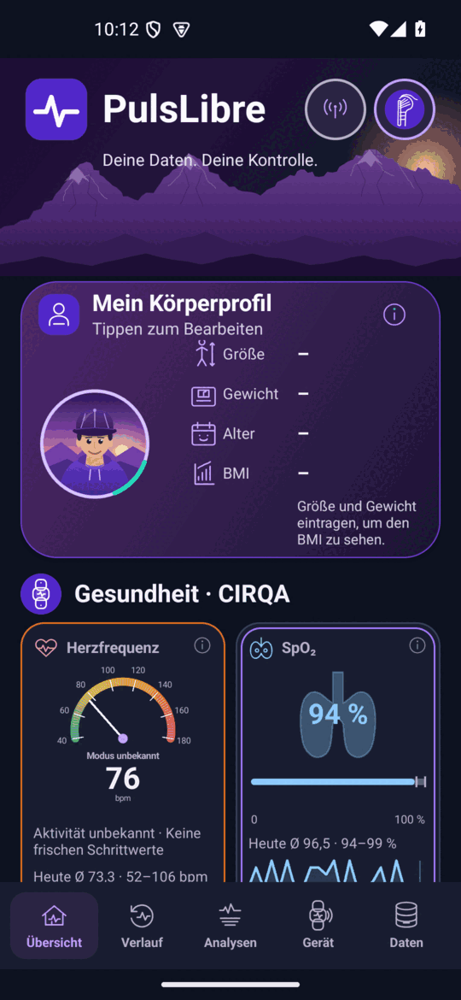
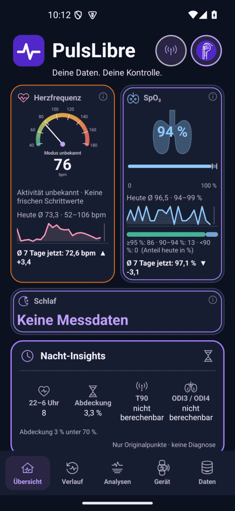
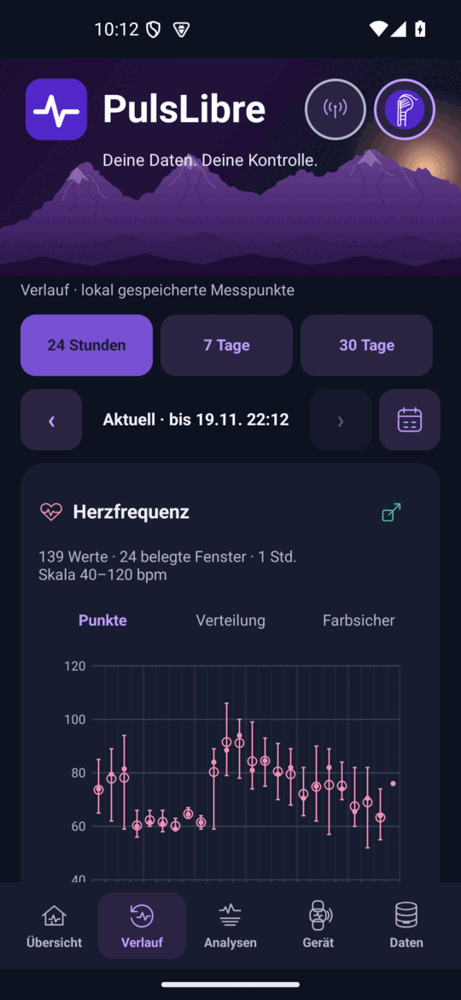
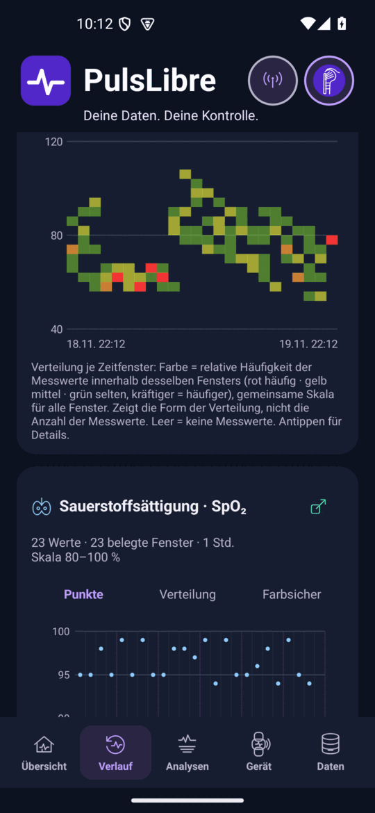
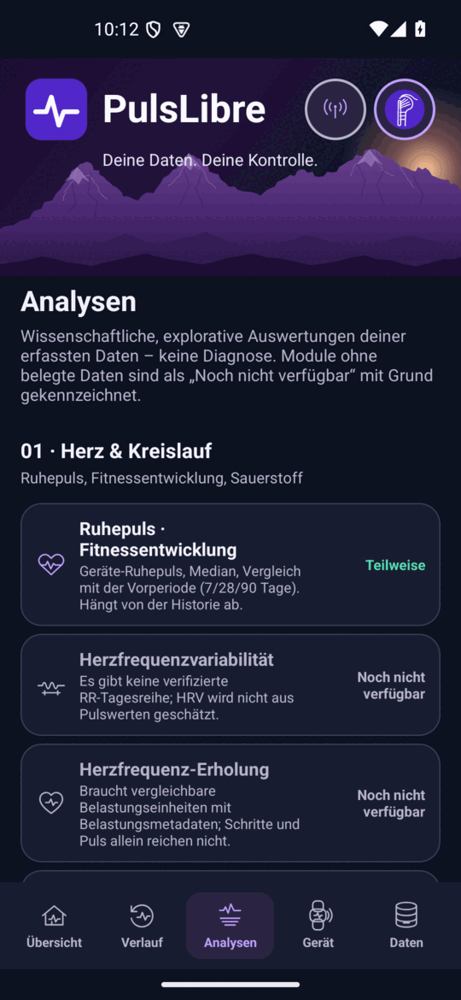
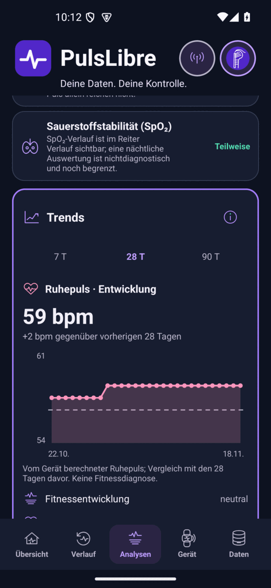
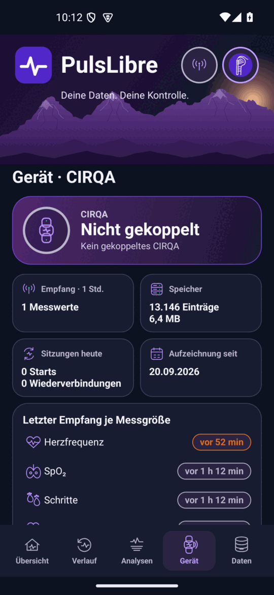
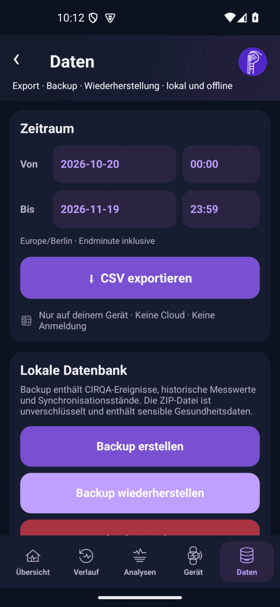
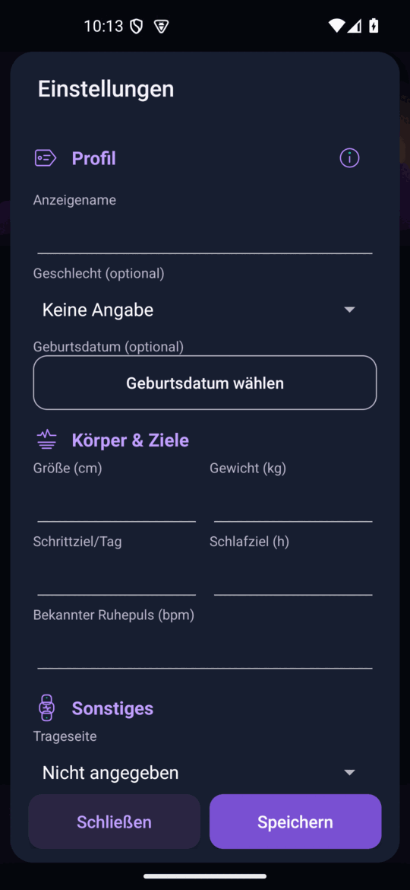

# PulsLibre – Manual de usuario (español)

> **Estado:** traducción al español de [USER_MANUAL.en.md](USER_MANUAL.en.md), basada en el original alemán [BENUTZERHANDBUCH.md](BENUTZERHANDBUCH.md) del 20 de noviembre de 2026. Las capturas siguen en alemán (emulador del 19 de noviembre de 2026, modo oscuro, 1080 × 2340, datos ficticios de demostración, sin datos de salud reales ni pulsera conectada). Se encuentran en `docs/user/images/`. «Todavía no disponible» significa que la función no está implementada o que no hay una fuente de datos verificada.

PulsLibre es una aplicación **local y sin conexión** para la pulsera Garmin CIRQA. Todos los datos permanecen en el teléfono: sin nube, sin cuenta y sin permiso de Internet. La aplicación **no ofrece diagnósticos** ni puntuaciones de salud o condición física.

## 1. Encabezado
- Arriba aparecen el logotipo, «PulsLibre» y «Tus datos. Tu control.». A la derecha hay dos botones: **estado de conexión** (anillo verde = pulsera conectada y transmitiendo valores; toca para ver una explicación) y **Ajustes** (icono de un brazo).
- En la vista general, el encabezado es grande y muestra montañas. Al desplazarte hacia abajo se reduce (sin montañas) para dejar más espacio a las mediciones; al volver arriba se amplía. Esto se aplica a todas las pestañas con contenido suficiente.

## 2. Pestañas de la barra inferior
Vista general · Historial · Análisis · Dispositivo · Datos.

### Vista general

  
*Fig. 1 – Vista general: encabezado, perfil corporal e indicadores principales*

  
*Fig. 2 – Tarjetas con indicador, escala y «Sin mediciones»*

- **Mi perfil corporal:** altura, peso, edad e IMC calculados a partir de tus datos (toca para editar; también puedes modificar directamente el peso). El IMC es solo orientativo y aparece con una categoría descriptiva.
- **Salud · CIRQA:** frecuencia cardíaca (indicador con contexto de actividad), SpO₂ (escala y tendencia), pasos de hoy, frecuencia cardíaca en reposo y otros valores del dispositivo (intervalo RR, estrés, Body Battery…). Cada tarjeta tiene un ⓘ con la fuente, la escala y las limitaciones. Las tarjetas con **borde violeta oscuro** **aún no están validadas** (por ejemplo, la SpO₂ de la pulsera): muestran valores, pero no se presentan como verificados.
- **Objetivo de pasos:** el objetivo introducido en Ajustes (100–100 000) tiene prioridad y se muestra como «Objetivo (propio)»; si no defines uno, se utiliza el comunicado por la pulsera («Objetivo (dispositivo)»). Al alcanzarlo aparece «Objetivo diario alcanzado».
- **Personalizar inicio:** al final de la vista general puedes mostrar u ocultar tarjetas, cambiar su orden y marcar favoritas (aparecen primero en «Destacados»). Los datos de las tarjetas ocultas siguen registrándose; solo dejan de mostrarse las tarjetas. «Restablecer» recupera la vista predeterminada. El ajuste permanece en el dispositivo.
- **Vista del día:** una tarjeta al final abre la frecuencia cardíaca y los pasos de un día en **un eje temporal compartido** (elige la fecha con el botón). Los periodos sin mediciones aparecen **rayados y etiquetados «Sin datos»**; nunca se unen ni se estiman. Al tocar o arrastrar se muestran la hora y el valor de cada serie (o «Sin datos»). Con el zoom de dos dedos o los botones **‹ − + › Día** puedes cambiar el intervalo (hasta 15 minutos). Se muestran puntos originales, no promedios. Debajo del gráfico aparece la misma información en texto (también para TalkBack).
- Otros valores del dispositivo (calorías, minutos de intensidad, estrés, Body Battery…) aparecen bajo las tarjetas principales cuando la pulsera los transmite; sus unidades y condiciones de medición no están verificadas.
- Los valores ausentes se indican como «Sin mediciones», nunca como 0.

### Historial

  
*Fig. 3 – Historial, vista «Puntos»*

  
*Fig. 4 – Vista «Distribución» (rojo = frecuente, verde = poco frecuente)*

- Intervalos de **24 horas / 7 días / 30 días**, navegación entre ventanas (‹ › y selector de fecha). Una tarjeta por medición (frecuencia cardíaca, SpO₂).
- **Puntos | Distribución:** «Puntos» muestra, por ventana, la mediana (punto), la media (anillo) y el mínimo–máximo (línea). «Distribución» indica **dónde** se concentran las mediciones: del verde (poco frecuente) al rojo (frecuente), pasando por el amarillo; una mayor intensidad significa mayor frecuencia. La tercera opción, **«Colores accesibles»**, representa la misma distribución del azul (poco frecuente) al amarillo (frecuente), pasando por el turquesa, sin distinguir rojo y verde. Es una distribución **relativa** dentro de la ventana, no un recuento; las ventanas vacías permanecen vacías. Al tocar una ventana se muestran el tamaño de muestra, la mediana, la media, los extremos y el intervalo de valores más frecuente.
- El eje temporal corresponde a **la hora de recepción en el teléfono**.

### Análisis

  
*Fig. 5 – Análisis: grupos, módulos y disponibilidad*

  
*Fig. 6 – Tendencia de frecuencia cardíaca en reposo*

Evaluaciones científicas **exploratorias** en cinco grupos (Corazón y circulación · Sueño y recuperación · Actividad y evolución · Relaciones y patrones · Calidad de datos y métodos). Los módulos sin una fuente verificada (por ejemplo, sueño o VFC) se indican como **«Todavía no disponible»** con una explicación: no se estiman valores.
- **Bloque de tendencias** (7 d | 28 d | 90 d; predeterminado 28 d): *Evolución de la frecuencia cardíaca en reposo*, con la mediana calculada por el dispositivo, una comparación neutra («−4 bpm respecto a los 28 días anteriores», periodo previo sin solapamiento) y puntos diarios. **No se dibujan líneas entre días sin datos.** Si hay pocos días disponibles (7 d: al menos 4; 28 d: al menos 14; 90 d: al menos 45), solo aparecen valores diarios y una nota, sin comparación.
- **Atlas de actividad:** calendario de pasos totales diarios (lun.–dom.). **Casilla gris = sin datos verificados** (no significa 0 pasos). El sombreado indica la cantidad relativa de pasos de los días registrados, no un estado de salud; el número en la casilla (por ejemplo, 7,2 mil) es una segunda referencia además del color. El contorno indica el día de hoy, todavía incompleto.
- **Relación pasos → frecuencia cardíaca en reposo al día siguiente** (exploratoria, correlación de Spearman con intervalo del 95 % e indicador de robustez; solo a partir de 30 pares de días): al tocar se abre el diagrama de dispersión.
- **Cobertura de datos:** frecuencia cardíaca en reposo y pasos por separado, como «x de y días».
- **Últimos 7 días:** media de pasos diarios, pasos totales y media de la frecuencia cardíaca en reposo proporcionada por el dispositivo durante los siete días completos anteriores a hoy, cada fila con su cobertura («4 de 7 días»). Las medias incluyen solo días con datos; los días ausentes nunca cuentan como 0. Si defines un objetivo propio, también aparece «Objetivo alcanzado x de y días con datos» (también en el atlas para el intervalo seleccionado). La duración del sueño, las calorías, los minutos de intensidad y el estrés todavía no tienen series diarias verificadas.
- **Métodos y límites:** fuentes, referencia temporal y supuestos. Nunca se extrapola a partir de menos de 90 días de historial real.

### Dispositivo

  
*Fig. 7 – Dispositivo: conexión, indicadores y última recepción*

- La tarjeta de conexión indica si la pulsera está conectada y cuándo llegó la última medición. Debajo aparecen indicadores (recepciones por hora, almacenamiento, sesiones de hoy, inicio del registro) y la **última recepción por tipo de medición**.
- **Información de la pulsera:** batería, firmware, reloj y modelo. Un valor aparece **solo** si se ha almacenado con fuente y marca de tiempo; de lo contrario, «No disponible». La batería se representa mediante una barra y «Estado: hace…» o «Desactualizado · último estado conocido…».
- **Campos de datos desconocidos:** si los archivos de la pulsera contienen campos que PulsLibre aún no interpreta, aparece un aviso discreto. La lista, agrupada por mensaje FIT, muestra únicamente identificadores de campos y cantidades: **ni mediciones ni diagnósticos**. Puedes asignar una marca de revisión con **«Cambiar estado»** (sin revisar · en revisión · compatible · ignorado); esto no modifica las mediciones.
- **Registro:** «Iniciar» / «Detener» el servicio de registro (Android muestra una notificación persistente con un botón para detenerlo mientras funciona).
- *Oculto:* una **pulsación de 3 segundos en «Dispositivo · CIRQA»** abre el **laboratorio de pruebas** (diagnósticos de solo lectura: aplicación, estado de Bluetooth, contadores de sincronización, paquete de diagnóstico con vista previa para compartir voluntariamente; «Laboratorio avanzado» para usuarios experimentados).

### Datos

  
*Fig. 8 – Datos: exportación y base de datos local (copia de seguridad)*

Exportación y copia de seguridad locales (elige un intervalo y exporta), además de información sobre privacidad y almacenamiento local. Restaurar requiere confirmación expresa.

> **Privacidad:** la copia de seguridad de la base de datos **no está cifrada**. Contiene tus datos de salud en texto claro. Guárdala solo en un lugar de confianza (no en una carpeta de nube pública o insegura).

**Copia de seguridad y originales FIT:** la copia de la base incluye mediciones, eventos y estados de sincronización, pero **no** los archivos originales de la pulsera. Después de restaurarla (por ejemplo, en otro teléfono), los valores históricos proceden únicamente de la copia; la aplicación no puede recalcularlos a partir de los originales. Con **«Exportar originales FIT»** puedes guardar además los archivos originales en un ZIP (con advertencia: pueden contener datos de salud y tampoco están cifrados).

## 3. Ajustes (icono del brazo)

  
*Fig. 9 – Ajustes: perfil, cuerpo y objetivos, otros ajustes*

- **Perfil:** nombre, fecha de nacimiento, género, lado de uso, altura, peso, objetivos de pasos y sueño, referencia de frecuencia cardíaca en reposo y más. Los datos se guardan solo localmente.
- **Límites de SpO₂** (escala de visualización) y otros ajustes de presentación.
- **Idioma:** alemán, inglés, francés o español; de forma predeterminada, el idioma del sistema.
- **Registro:** «Registrar automáticamente al iniciar la aplicación» activa el servicio al abrir la aplicación si Bluetooth está encendido y ya se han concedido los permisos. La aplicación nunca enciende Bluetooth por sí sola.
- **Apariencia:** Sistema / Claro / Oscuro.
- **Eliminar perfil** borra solo los datos del perfil (no las mediciones ni los ajustes de SpO₂) y solicita dos confirmaciones.

## 4. Notas
- **Modo oscuro/claro, texto grande, TalkBack:** la aplicación sigue la configuración del sistema; los iconos de la barra de estado se adaptan al tema. La compatibilidad con TalkBack es un objetivo, pero todavía no se ha comprobado completamente en un dispositivo.
- Los permisos de **Bluetooth** («Dispositivos cercanos») y notificaciones son necesarios para registrar datos. Sin ellos aparece «Falta el permiso de Bluetooth».
- **Batería:** el registro continuo consume energía del teléfono y de la pulsera; se está realizando una medición (ticket #235).

## 5. Limitaciones
PulsLibre no sustituye el consejo médico. La frecuencia cardíaca en reposo procede del dispositivo (nunca del mínimo diario), los valores de SpO₂ de la pulsera no están validados, los análisis de sueño y VFC no están disponibles y las relaciones solo muestran patrones en tus datos, no causas.
