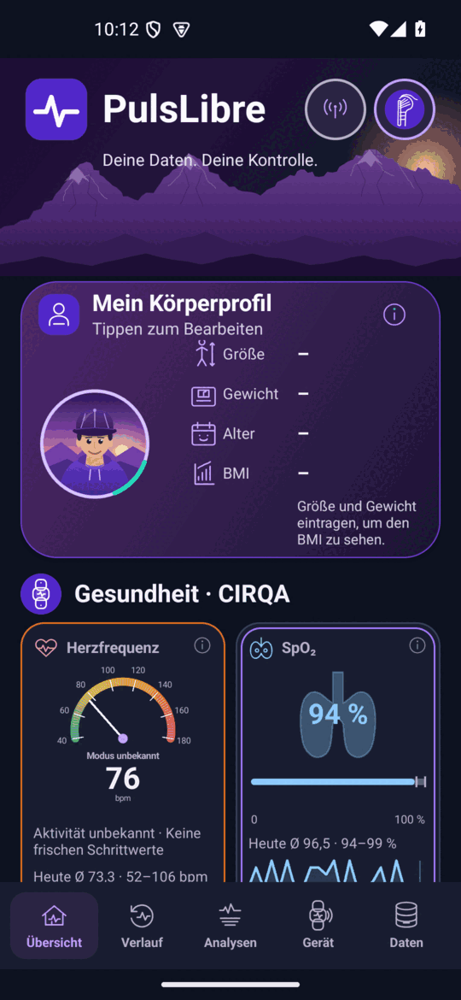
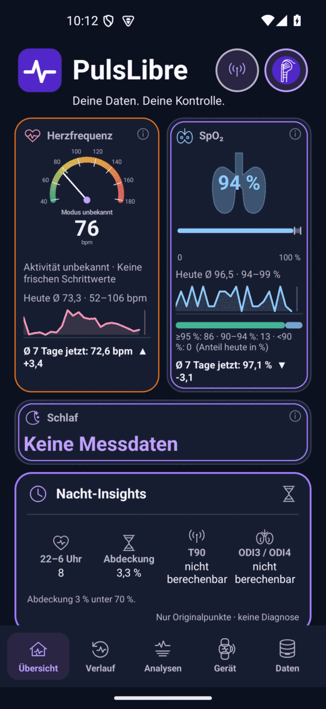
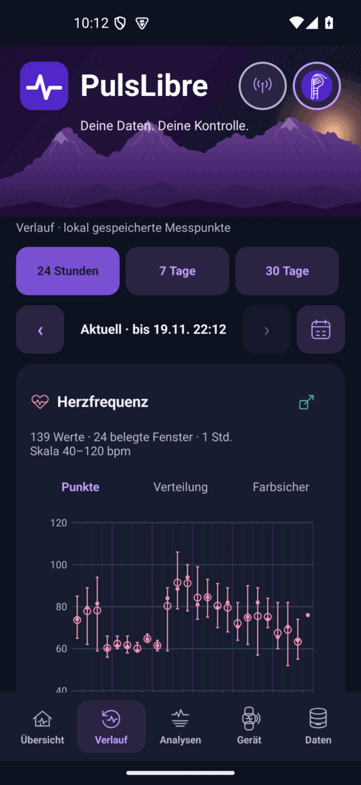
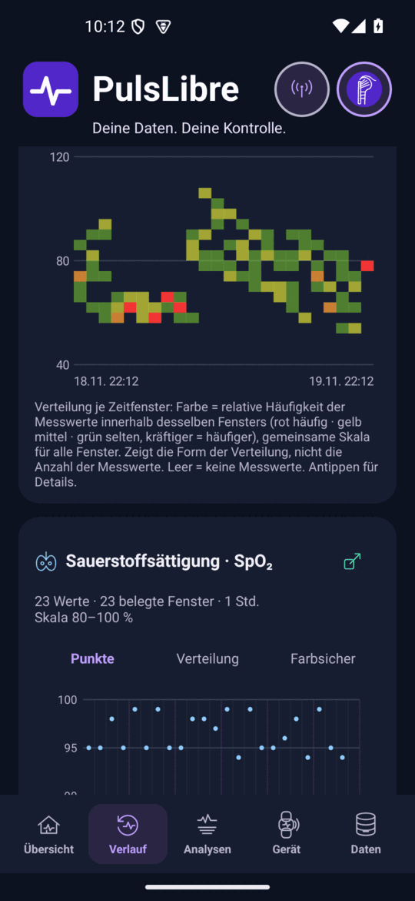
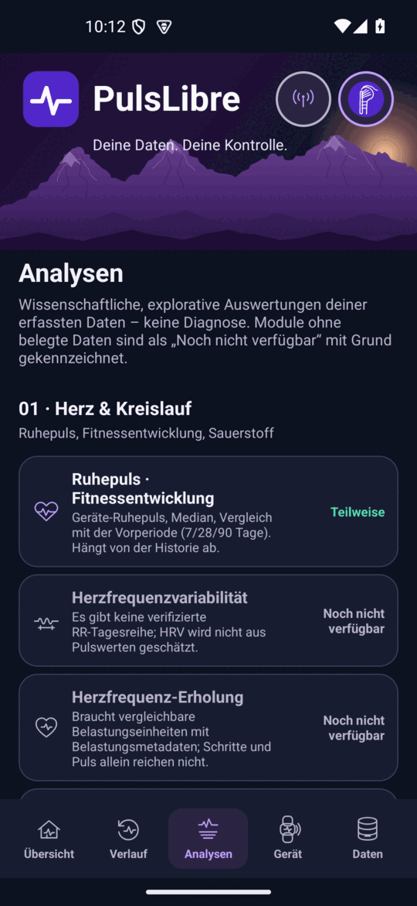
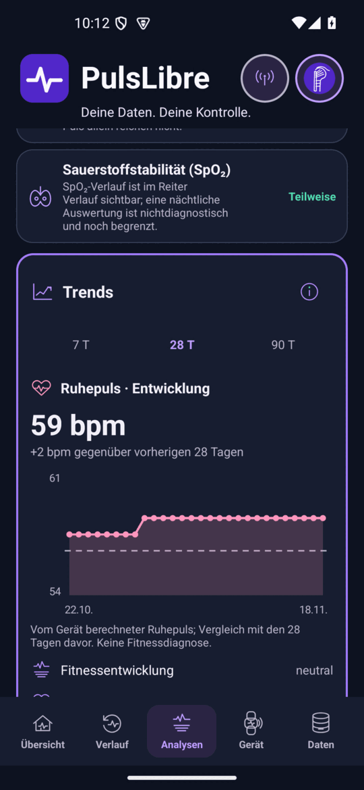
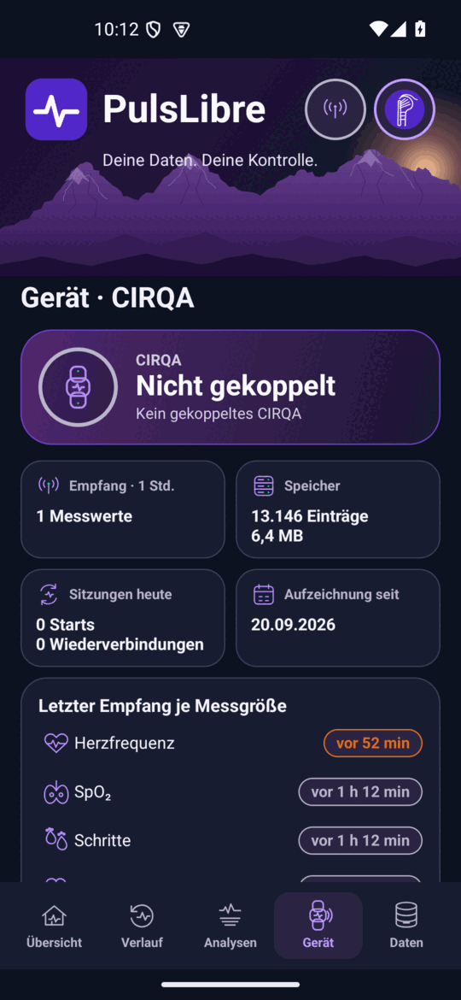
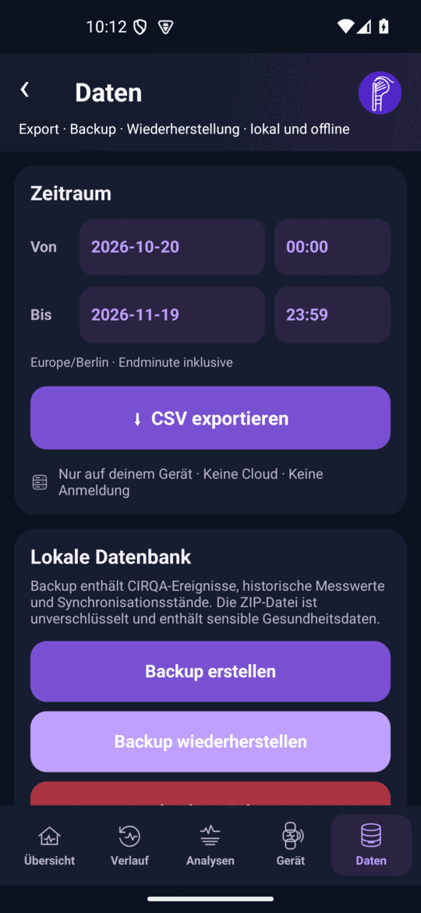
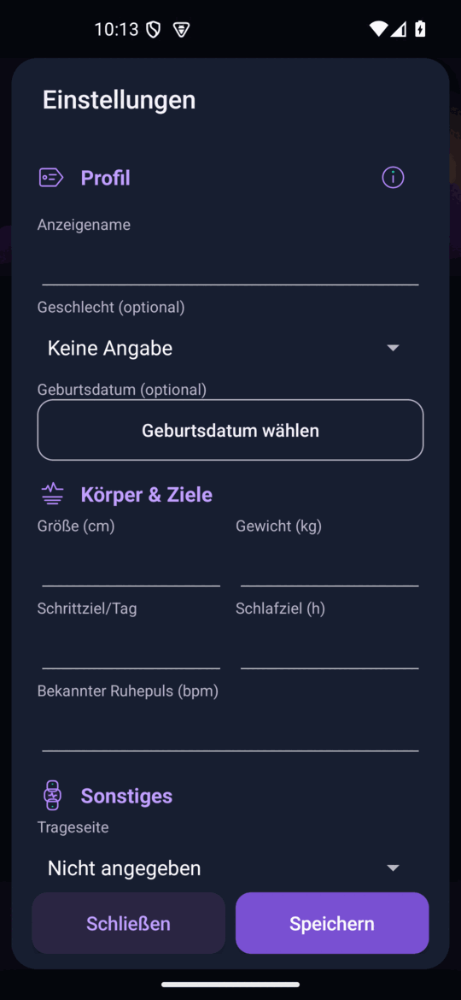

# PulsLibre – Manuel d’utilisation (français)

> **Statut :** traduction française du manuel anglais [USER_MANUAL.en.md](USER_MANUAL.en.md), fondé sur l’original allemand [BENUTZERHANDBUCH.md](BENUTZERHANDBUCH.md) du 20 novembre 2026. Les captures d’écran restent en allemand (émulateur du 19 novembre 2026, mode sombre, 1080 × 2340, données de démonstration fictives, sans données de santé réelles ni bracelet connecté). Elles se trouvent dans `docs/user/images/`. « Pas encore disponible » signifie : fonction non implémentée ou absence de source de données vérifiée.

PulsLibre est une application **locale et hors ligne** pour le bracelet Garmin CIRQA. Toutes les données restent sur votre téléphone : aucun cloud, aucun compte et aucune autorisation Internet. L’application ne fournit **aucun diagnostic** ni score de santé ou de forme physique.

## 1. En-tête
- En haut figurent le logo, « PulsLibre » et « Vos données. Votre contrôle. ». À droite, deux boutons : **état de connexion** (anneau vert = bracelet connecté et transmettant des valeurs ; toucher pour une explication) et **Paramètres** (icône représentant un bras).
- Sur la vue d’ensemble, l’en-tête est grand et comporte une illustration de montagnes. Il se réduit au défilement vers le bas pour laisser plus de place aux mesures, puis s’agrandit en remontant. Cela s’applique aux onglets dont le contenu est suffisamment long.

## 2. Onglets de la barre inférieure
Vue d’ensemble · Historique · Analyses · Appareil · Données.

### Vue d’ensemble

  
*Fig. 1 – Vue d’ensemble : en-tête, profil corporel et indicateurs principaux*

  
*Fig. 2 – Tuiles avec jauge, échelle et « Aucune mesure »*

- **Mon profil corporel :** taille, poids, âge et IMC issus de vos saisies (touchez pour modifier ; le poids peut aussi être modifié directement). L’IMC sert uniquement de repère et s’accompagne d’une catégorie descriptive.
- **Santé · CIRQA :** fréquence cardiaque (jauge avec contexte d’activité), SpO₂ (échelle et tendance), pas du jour, fréquence cardiaque au repos et autres valeurs de l’appareil (intervalle RR, stress, Body Battery…). Chaque tuile possède un ⓘ indiquant source, échelle et limites. Les tuiles au **cadre violet foncé** ne sont **pas encore validées** (par exemple la SpO₂ du bracelet) : leurs valeurs sont affichées, mais non présentées comme vérifiées.
- **Objectif de pas :** un objectif saisi dans les Paramètres (100 à 100 000) est prioritaire et indiqué comme « Objectif (personnel) » ; sinon, l’objectif communiqué par le bracelet s’applique (« Objectif (appareil) »). Une fois atteint, « Objectif quotidien atteint » apparaît.
- **Personnaliser l’accueil :** tout en bas, vous pouvez afficher ou masquer des tuiles, changer leur ordre et choisir des favoris (affichés en premier sous « À la une »). Les données des tuiles masquées continuent d’être enregistrées ; seules les tuiles ne sont plus affichées. « Réinitialiser » rétablit la présentation par défaut. Ce réglage reste sur le téléphone.
- **Vue de la journée :** une carte en bas ouvre les mesures de fréquence cardiaque et de pas d’une journée sur **un axe temporel commun** (choisissez la date avec le bouton). Les périodes sans mesures sont **hachurées et indiquées « Aucune donnée »** ; elles ne sont jamais reliées ni estimées. Toucher ou faire glisser affiche l’heure et la valeur de chaque série (ou « Aucune donnée »). Le zoom à deux doigts ou les boutons **‹ − + › Jour** permettent de modifier la plage (jusqu’à 15 minutes). Une plage affiche les points bruts, pas des moyennes. La même information figure sous le graphique sous forme de texte (également pour TalkBack).
- D’autres valeurs de l’appareil (calories, minutes d’intensité, stress, Body Battery…) apparaissent sous les tuiles principales dès leur transmission ; leurs unités et conditions de mesure ne sont pas vérifiées.
- Les valeurs manquantes sont affichées comme « Aucune mesure », jamais comme 0.

### Historique

  
*Fig. 3 – Historique, vue « Points »*

  
*Fig. 4 – Vue « Distribution » (rouge = fréquent, vert = rare)*

- Périodes **24 heures / 7 jours / 30 jours**, navigation entre fenêtres (‹ ›) et sélection de date. Une carte par mesure (fréquence cardiaque, SpO₂).
- **Points | Distribution :** « Points » affiche, par fenêtre, la médiane (point), la moyenne (anneau) et le minimum–maximum (trait). « Distribution » montre **où** se situent les mesures : du vert (rare) au rouge (fréquent), en passant par le jaune ; une couleur plus intense indique une fréquence plus élevée. Le troisième mode **« Palette accessible »** présente la même distribution du bleu (rare) au jaune (fréquent), via le turquoise, sans distinction rouge/vert. Il s’agit d’une distribution **relative** dans la fenêtre, pas d’un nombre de mesures ; les fenêtres vides restent vides. Toucher une fenêtre affiche le nombre d’échantillons, la médiane, la moyenne, les extrêmes et l’intervalle de valeurs le plus fréquent.
- L’axe temporel utilise **l’heure de réception sur le téléphone**.

### Analyses

  
*Fig. 5 – Analyses : groupes, modules et disponibilité*

  
*Fig. 6 – Évolution de la fréquence cardiaque au repos*

Analyses scientifiques **exploratoires** réparties en cinq groupes (Cœur et circulation · Sommeil et récupération · Activité et évolution · Corrélations et motifs · Qualité des données et méthodes). Les modules sans source de données vérifiée (par exemple sommeil, VFC) portent la mention **« Pas encore disponible »** et une explication : aucune valeur n’est estimée.
- **Bloc des tendances** (7 j | 28 j | 90 j ; 28 j par défaut) : *Évolution de la fréquence cardiaque au repos*, avec médiane de la fréquence cardiaque au repos calculée par l’appareil, comparaison neutre (« −4 bpm par rapport aux 28 jours précédents », période antérieure sans chevauchement) et points quotidiens. **Aucune ligne ne relie les jours sans données.** Si trop peu de jours sont disponibles (7 j : au moins 4 ; 28 j : au moins 14 ; 90 j : au moins 45), seuls les points quotidiens et une note apparaissent, sans comparaison.
- **Atlas d’activité :** calendrier des totaux de pas quotidiens (lun.–dim.). **Case grise = aucune donnée vérifiée** (et non 0 pas). La teinte représente le nombre relatif de pas des jours enregistrés, pas un état de santé ; le chiffre dans la case (par exemple 7,2 k) fournit une indication en plus de la couleur. Un contour indique aujourd’hui, journée encore incomplète.
- **Relation pas → fréquence cardiaque au repos le lendemain** (exploratoire, corrélation de Spearman avec intervalle à 95 % et indication de robustesse ; à partir de 30 jours appariés) : toucher ouvre le nuage de points.
- **Couverture des données :** fréquence cardiaque au repos et pas, séparément, en « x jours sur y ».
- **Sept derniers jours :** moyenne des pas par jour, total des pas et moyenne de la fréquence cardiaque au repos fournie par l’appareil sur les sept journées complètes précédant aujourd’hui, avec une couverture propre à chaque ligne (« 4 jours sur 7 »). Les moyennes ne prennent en compte que les jours documentés ; les jours manquants ne valent jamais 0. Avec un objectif personnel de pas, affichage aussi de « Objectif atteint x jours sur y avec données » (également dans l’atlas d’activité pour la période choisie). La durée du sommeil, les calories, les minutes d’intensité et le stress ne disposent pas encore de séries quotidiennes vérifiées.
- **Méthodes et limites :** sources, référence temporelle et hypothèses. Rien n’est extrapolé à partir de moins de 90 jours d’historique réel.

### Appareil

  
*Fig. 7 – Appareil : connexion, indicateurs et dernière réception*

- La carte de connexion indique si le bracelet est connecté et quand la dernière mesure est arrivée. Dessous figurent des indicateurs (réceptions par heure, stockage, sessions du jour, début de l’enregistrement) et la **dernière réception pour chaque mesure**.
- **Informations du bracelet :** batterie, micrologiciel, horloge, modèle. Une valeur n’apparaît **que** si elle est enregistrée avec une source et un horodatage ; sinon, « Non disponible ». La batterie est représentée par une barre et « État : il y a… » ou « Obsolète · dernier état connu… ».
- **Champs de données inconnus :** si les fichiers du bracelet contiennent des champs que PulsLibre ne comprend pas encore, un indice discret apparaît. La liste, regroupée par message FIT, n’affiche que les identifiants de champs et leurs nombres d’occurrences : **aucune mesure, aucun diagnostic**. Vous pouvez attribuer une marque de suivi à chaque champ avec **« Modifier le statut »** (non examiné · en cours d’examen · pris en charge · ignoré) ; cela ne modifie aucune mesure.
- **Enregistrement :** « Démarrer » / « Arrêter » le service d’enregistrement (Android affiche une notification permanente avec bouton d’arrêt pendant son fonctionnement).
- *Fonction cachée :* un **appui de 3 secondes sur « Appareil · CIRQA »** ouvre le **laboratoire de test** (diagnostics en lecture seule : application, Bluetooth, compteurs de synchronisation, enregistrement de communication – démarré explicitement, 15 minutes au maximum, uniquement les notifications d’une synchronisation en cours, octets seulement après un accord séparé –, paquet de diagnostic avec aperçu avant partage volontaire ; « Laboratoire avancé » pour utilisateurs expérimentés).

### Données

  
*Fig. 8 – Données : export et base locale (sauvegarde)*

Export et sauvegarde locaux des données (choisir une période puis exporter), avec informations sur la confidentialité et le stockage local. Toute restauration nécessite une confirmation explicite.

> **Confidentialité :** la sauvegarde de la base de données **n’est pas chiffrée**. Elle contient vos données de santé en clair. Conservez-la uniquement dans un emplacement de confiance (pas dans un dossier cloud public ou non sécurisé).

**Sauvegarde et fichiers FIT originaux :** la sauvegarde de la base contient vos mesures, événements et états de synchronisation, mais **pas** les fichiers originaux du bracelet. Après une restauration (par exemple sur un autre téléphone), les valeurs historiques proviennent donc uniquement de la sauvegarde ; l’application ne peut pas les recalculer à partir des originaux. Avec **« Exporter les fichiers FIT originaux »**, vous pouvez également sauvegarder ces fichiers dans une archive ZIP (avec avertissement : ils peuvent contenir des données de santé et ne sont pas chiffrés non plus).

## 3. Paramètres (icône du bras)

  
*Fig. 9 – Paramètres : profil, corps et objectifs, autres réglages*

- **Profil :** nom, date de naissance, genre, côté de port, taille, poids, objectifs de pas et de sommeil, référence de fréquence cardiaque au repos, etc. Toutes les saisies restent locales.
- **Limites de SpO₂** (échelle d’affichage) et autres réglages de présentation.
- **Langue :** allemand, anglais, français ou espagnol ; par défaut, langue du système.
- **Enregistrement :** l’option « Enregistrer automatiquement au démarrage » lance le service à l’ouverture de l’application si le Bluetooth est activé et si les autorisations ont déjà été accordées. L’application n’active jamais le Bluetooth elle-même.
- **Apparence :** Système / Clair / Sombre.
- **Supprimer le profil** efface uniquement les données du profil (pas les mesures ni les réglages SpO₂) et demande deux confirmations.

## 4. Remarques
- **Mode sombre/clair, grands caractères, TalkBack :** l’application suit les réglages système ; les icônes de la barre d’état s’adaptent au thème. La prise en charge de TalkBack est un objectif, mais aucun contrôle complet sur appareil n’a encore été effectué.
- Les autorisations **Bluetooth** (« Appareils à proximité ») et notifications sont nécessaires à l’enregistrement. Sans elles, l’application affiche « Autorisation Bluetooth manquante ».
- **Batterie :** l’enregistrement continu consomme de l’énergie sur le téléphone et le bracelet ; des mesures sont en cours (ticket #235).

## 5. Limites
PulsLibre ne remplace pas un avis médical. La fréquence cardiaque au repos provient de l’appareil (jamais du minimum quotidien), les valeurs SpO₂ du bracelet ne sont pas validées, les analyses du sommeil et de la VFC ne sont pas disponibles et les corrélations ne décrivent que des motifs dans vos données, pas des causes.
