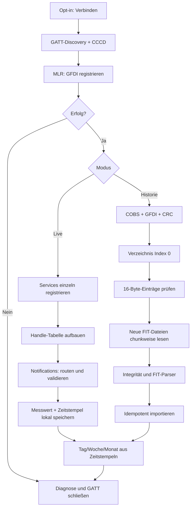

# PulseLibre / Garmin CIRQA – Protokolldefinition v0.1

**Status 2026-11-15:** Reverse Engineering und Implementierungsvertrag, keine offizielle Garmin-Spezifikation. Ein **Register** ist hier meistens ein *dynamischer Multi-Link-Service-Handle*, kein festes Hardware-Sensorregister. Kennzeichnung: **[C]** am CIRQA per Screenshot bestätigt; **[O]** aus offenem Quellcode abgeleitet; **[U]** am CIRQA unbestätigt.

## 1. Schichten und Begriffe

`BLE GATT → Garmin Multi-Link (MLR) → {Realtime-Dienste | GFDI mit COBS → FIT-Dateien} → validierte Messwerte → lokale Datenbank`.

- GATT-Service **[C]**: `6a4e2800-667b-11e3-949a-0800200c9a66`. Garmin Connect 5.31 durchsucht laut statischer APK-Analyse ML-Daten-Characteristics `6a4e2810` bis `6a4e2819`; als Schreib-Characteristic nutzt es jeweils die korrespondierende UUID `+0x10`, falls vorhanden, andernfalls dieselbe Characteristic für Lesen und Schreiben **[O, Garmin-Connect-5.31-APK; konkrete CIRQA-Characteristics damit nicht bestätigt]**. PulseLibre bildet diese Auswahl nach, prüft aber die tatsächlich entdeckten Notify-/Write-Properties und CCCD vor dem Handshake.
- RX: Notifications vom Gerät; TX: Schreibvorgänge der App; CCCD Notifications aktivieren. Tatsächlich verfügbare Paar-UUIDs werden zur Laufzeit entdeckt.
- Alle Mehrbyte-Zahlen in den unten beschriebenen MLR-/GFDI-Feldern sind **Little Endian**, sofern nicht anders markiert. `u8`=8 Bit, `u16`=16 Bit, `u32`=32 Bit, `u64`=64 Bit; `i32`=vorzeichenbehaftete 32 Bit.
- Keine feste Registeradresse für Puls, SpO₂ usw. Die App fordert einen **Servicecode** an, das Band weist einen **Handle** zu; nur danach darf das Paket diesem Dienst zugeordnet werden.

**Provenienz:** Bereich und Fallback stammen aus statischer Analyse von Garmin Connect 5.31 (`classes12.dex:defpackage.vit.initialize`, UUID-Gegenstückableitung in `defpackage.eb00`). Das ist proprietäres Referenzverhalten, keine offizielle Garmin-Spezifikation und kein CIRQA-Mitschnitt; es wurde kein dekompilierter Garmin-Code übernommen.

## 2. Multi-Link (MLR) Byte-Protokoll

### 2.1 Sendeformat REGISTER_ML_REQ **[C/O]**

| Byte-Offset | Länge | Typ | Inhalt |
|---|---:|---|---|
| 0 | 1 | u8 | Routing: `0x00` = Steuerkanal |
| 1 | 1 | u8 | Typ `0x00` = REGISTER_ML_REQ |
| 2 | 8 | u64 LE | Client-ID `2` (`02 00 00 00 00 00 00 00`) |
| 10 | 2 | u16 LE | Servicecode, z.B. GFDI=1, HR=6, Steps=7 |
| 12 | 1 | u8 | reserviert, `0` |

**13 Byte gesamt**. Beispiel GFDI: `00 00 02 00 00 00 00 00 00 00 01 00 00`.

### 2.2 Empfang REGISTER_ML_RESP **[C/O]**

| Byte-Offset | Länge | Typ | Inhalt |
|---|---:|---|---|
| 0 | 1 | u8 | `0x00` Steuerkanal |
| 1 | 1 | u8 | `0x01` REGISTER_ML_RESP |
| 2 | 8 | u64 LE | Client-ID=2 |
| 10 | 2 | u16 LE | beantworteter Servicecode |
| 12 | 1 | u8 | Status; `0` Erfolg |
| 13 | 1 | u8 | dynamischer Handle; gültig `1..127` |
| 14+ | variabel | – | mögliche Erweiterungsbytes; Bedeutung nicht CIRQA-bestätigt |

**Kernlänge 14 Byte**; am echten CIRQA **16-Byte-Antwort** für GFDI beobachtet. PulseLibre akzeptiert 14–64 Byte und validiert die festen Felder, ohne Erweiterungsbytes als Messwerte zu interpretieren. Registrierungen für HR/Steps und Live-Daten **[C]**; weitere Services **[U]**.

### 2.3 Daten-Routing **[C/O]**

- Erstes Byte `0` = Control; kein Messwert.
- Wenn Bit 7 gesetzt (`b7=1`): Handle = `(byte0 & 0x70) >> 4`, also Bits **6..4**; Werte 1..7. Bits 3..0 sind nicht als Payload zu interpretieren.
- Sonst `byte0` direkt als Handle 1..127.
- Nutzdaten beginnen bei Byte **1**; nur anhand der **in dieser Verbindung bestätigten Handle→Service-Zuordnung** dekodieren.
- Host→Band: nacktes Handlebyte gefolgt von Service-Nutzdaten; BLE-MTU und Fragmentierung beachten.
- `CLOSE_ALL_REQ` (Steuer-Typ 5) existiert in Referenzcode; PulseLibre nutzt es **nicht**, da Registrierung ohne CLOSE_ALL am CIRQA nachgewiesen wurde. Kein Reset/Unpairing.

## 3. Realtime-Servicecodes und Felder

**Alle folgenden Felder sind Service-Nutzdaten nach Entfernung des 1-Byte-MLR-Routings.** Layouts aus `garmin-ble/metrics/*.py`, sofern nicht am Gerät verifiziert. Größen sind **Mindestlängen**, zusätzliche Bytes dürfen nicht ungeprüft interpretiert werden.

| Service dez/hex | Feldlayout ab Offset 0 | Mindestlänge | Semantik/Einheit | Evidenz |
|---|---|---:|---|---|
| 6 / 0x06 HR | `u8 padding, u8 bpm, u8 resting_bpm` | 3 B | bpm; Ruhepuls 0=unbekannt | **[C]** |
| 7 / 0x07 Steps | `u32 steps, u32 goal` | 8 B | heutige Schritte und Ziel | **[C]** |
| 8 / 0x08 Calories | `u32 total, u32 active` | 8 B | Kalorienwerte; Einheit/Skalierung gerätespezifisch prüfen | [O/U] |
| 10 / 0x0A Intensity | `u16 moderate, u16 vigorous` | 4 B | Intensitätsminuten | [O/U] |
| 12 / 0x0C HRV | `u16 rr_interval` | 2 B | RR-Intervall in ms; nicht ohne Algorithmus mit RMSSD gleichsetzen | [O/U] |
| 13 / 0x0D Stress | `i8 level` | 1 B | Bereich 0–100; negative Werte = unbekannt | [O/U] |
| 19 / 0x13 SpO₂ | `u8 percent` | 1 B | 1–100%; `0xFF` = Sensor nicht bereit | [O/U] |
| 20 / 0x14 Body Battery | `i8 level` | 1 B | Bereich 0–100; negative Werte = unbekannt | [O/U] |
| 21 / 0x15 Respiration | `i8 breaths_per_minute` | 1 B | Atemzüge/min; positive Werte | [O/U] |
| 16 / 0x10 Accelerometer | gepackte Samples; nicht als einfache Ganzzahl behandeln | variabel | Rohbeschleunigung; Format/Rate gesondert prüfen | [O/U] |

**Wichtig:** Diese Tabelle definiert den *aktuell implementierten Decoder-Vertrag*, nicht eine vollständige offizielle CIRQA-Feldliste. Prüfen, ob ältere/neue Firmware zusätzliche Felder, Skalierungen oder andere Dienstaktivierungen verwendet. Keine synthetischen Werte. HR=87, Ruhepuls=66, Schritte=10244, Ziel=8830 wurden in einem echten CIRQA-Test (#193) angezeigt.

## 4. GFDI-Anwendungskanal und Historie

### 4.1 Framing **[O/U]**

- GFDI ist **Service 1**, über dessen registrierten dynamischen MLR-Handle.
- GFDI-Nachrichten werden in einen **COBS-Frame** mit führendem und abschließendem `0x00` eingeschlossen; Fragmentierung über mehrere BLE-Notifications möglich. COBS-Reassembly strikt längen- und zeitbegrenzt.
- Nach COBS-Decoding: `u16 packet_size | u16 message_type | payload[N] | u16 crc16` (**6 Byte Overhead**), alles LE. `packet_size=6+N`. CRC16 über Bytes **vor** dem CRC, Polynom/Initialwert unbedingt anhand `garmin-ble/protocol/crc.py` und Gadgetbridge-Testvektoren verifizieren, bevor das Senden aktiviert wird. Die aktuell geprüfte Python-`parse_message`-Funktion validiert Größe/CRC **nicht** selbst; PulseLibre muss dies tun.
- Referenztypen: `5000` Status/ACK, `5024` Device Information, `5030` System Event, `5043` Protobuf Request, `5044` Protobuf Response, `5052` Current Time Request. **Keine** Vermischung dieser Typnummern mit MLR-Servicecodes.
- Geräteinformation (5024) Payload: `u16 protocol_version, u16 product_number, u32 unit_number, u16 software_version, u16 max_packet_size` (=12 B), danach drei Strings jeweils `u8 length | UTF-8 bytes[length]`: BLE-Name, Gerätename, Modell. Nur innerhalb geprüfter Paketgrenzen lesen.

### 4.2 Historische Dateisynchronisation **[O/U]**

Gadgetbridge `FileTransferHandler.java` beginnt mit `DownloadRequestMessage(fileIndex=0, offset=0, requestType=NEW, ...)` für das **Verzeichnis**. Danach:
1. `DownloadRequestStatusMessage`: Erfolg/Größe prüfen, Pufferspeicher begrenzen.
2. `FileTransferDataMessage`: Fragmente mit Offset in korrekter Reihenfolge übernehmen, Länge/CRC prüfen.
3. Verzeichnisbytes müssen ein Vielfaches von **16** sein. Pro Eintrag:
   - Offset 0 `u16 file_index` (2 B)
   - Offset 2 `u8 data_type` (1 B)
   - Offset 3 `u8 sub_type` (1 B)
   - Offset 4 `u16 file_number` (2 B)
   - Offset 6 `u8 specific_flags` (1 B)
   - Offset 7 `u8 file_flags` (1 B)
   - Offset 8 `u32 file_size` (4 B)
   - Offset 12 `u32 garmin_timestamp` (4 B)
4. Relevante FIT-Dateitypen (data_type 128) nach `FileType.java`: `ACTIVITY` Subtyp 4, `MONITOR` 32, `METRICS` 44, `SLEEP` 49, `HRV_STATUS` 68; weitere nur wenn tatsächlich vorhanden. Unterstützte Dateitypen beim Gerät abfragen, **nicht** aus Garmin-Modellfamilie erraten.
5. Dateien einzeln anhand Index/Offset laden, Integrität/Dateilänge prüfen, FIT-Header/CRC validieren, nach Zeitstempel und Identität deduplizieren, erst danach lokal speichern.
6. Synchronisationsstatus nur nach erfolgreichem Import fortschreiben. **Keine** Dateiarchivierung, Löschung oder Flag-Änderung am Band ohne separaten Geräteversuch.

**Noch offen:** Exakte GFDI-Nachrichtenfelder/Typcodes für File-Download-Request, Status und Chunk werden vor dem ersten aktiven Download direkt aus `messages/{DownloadRequestMessage,FileTransferDataMessage,...}.java` byteweise übernommen und mit Testvektoren verifiziert. Sie sind hier absichtlich nicht erfunden.

### 4.3 FIT-Historie

FIT-Dateien enthalten gerätespezifisch Monitoring, Aktivität, Schlaf, HRV usw. Ihre lokalen Message-Definitionen, Basistypen, Skalierungen und Zeitstempel müssen über einen separaten FIT-Parser gelesen werden. **Dateityp ≠ garantiert vorhandener Messwert.** Der Parser soll unbekannte Felder sicher überspringen und Rohdateien bis zur vollständigen Validierung unverändert aufbewahren.

## 5. Uhrzeit, Tageswechsel, Reset und Aggregation

- Garmin-Epoch = **1990-01-01 00:00:00 UTC**, Unix-Offset **631065600 Sekunden**. `unix_seconds = garmin_seconds + 631065600`.
- GFDI `CURRENT_TIME_REQUEST` Typ 5052; `garmin-ble/protocol/gfdi.py` antwortet mit Typ 5000 und Payload `u16 ref_type=5052, i8 status=0, u32 reference_id, u32 garmin_timestamp, i32 utc_offset_seconds, i32 dst_end, i32 dst_start` = **23 B**. Das ist **Zeitabgleich**, kein Schritt-Reset. `GarminSupport.onSetTime()` sendet ein `TIME_UPDATED`-Systemereignis.
- **Kein nachgewiesener Smartphone-Befehl für Tages-/Wochen-/Monats-Reset.** Keine solchen Befehle senden. Band verwaltet eigene Tageszähler; CIRQA-Mitternachtsverhalten bleibt zu messen.
- App speichert Messzeit in UTC, Empfangszeit und Geräte-Zeitzonenkontext; Tageswerte werden dem lokalen Kalendertag zugeordnet. Wochen-/Monatsansichten sind **Abfragen/Aggregationen** über Tage, kein Zurücksetzen von Bandregistern.
- Bei Zeitzonenwechsel/DST keine Verdoppelung von Zeiträumen; Tageszähler dürfen nicht über Tagesgrenzen aufsummiert werden. Für kumulative Tageszähler gilt pro Tag ein plausibler letzter/maximaler Stand; bei Rücksprüngen und Firmware-Resets Segmentwechsel markieren, nicht negative Schritte berechnen.
- **Testplan:** Vor/nach 00:00, ohne App-Verbindung, mit/ohne Zeitabgleich, Zeitzonenwechsel, DST, Band-Neustart, mehrtägiger Offline-Phase. Erst danach Aussage zum CIRQA-internen Reset.

## 6. Algorithmus / Zustandsautomat

**Invarianten:** (a) nie Service ohne bestätigten Handle dekodieren; (b) nie Messwert ohne gültige Länge und Wertebereich; (c) nie GFDI ohne vollständige COBS-Nachricht und gültige CRC; (d) niemals partiellen FIT-Import als vollständig markieren; (e) niemals künstlichen Mitternachts-Reset an das Band senden; (f) offline/keine Cloud/kein CLOSE_ALL/kein Unpairing; (g) strikte Timeouts und Größenlimits.

## 7. Quellen und nächste Verifikation

- `Gadgetbridge/.../garmin/communicator/v2/CommunicatorV2.java`
- `Gadgetbridge/.../garmin/communicator/CobsCoDec.java`
- `Gadgetbridge/.../garmin/FileTransferHandler.java`, `FileType.java`, `GarminTimeUtils.java`, `GarminSupport.java`
- `gwerneckp/garmin-ble/garmin_ble/protocol/{mlr,gfdi,crc}.py`, `metrics/*.py`
- Eigene CIRQA-Screenshots aus Build #186 (GFDI registriert) und #193 (HR/Steps live).
- Die Quellcodes sind Referenzmaterial, keine Freigabe zum wörtlichen Kopieren AGPL-lizenzierter Implementierungen.

**Offene Spezifikationsaufgaben:** CRC16-Parameter/Testvektoren; Download-Nachrichtentypen und Chunk-Layouts; FIT-Felddefinitionen für CIRQA; genaue Einheit/Skalierung von Kalorien, HRV und Atemwerten; Timeouts/MTU/Flow-Control; reale Tagesgrenzen und Schlaf-/SpO₂-Historie. Erst source-backed Tests, dann schrittweise Live-Freigabe.
