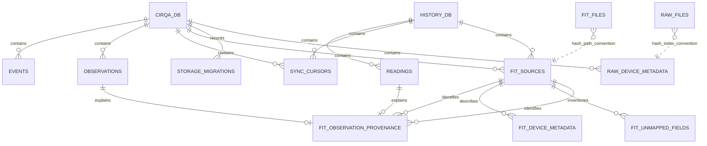
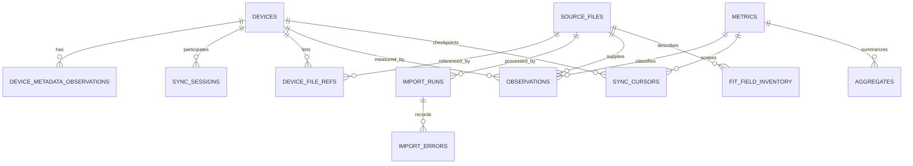

# CIRQA persistence: code-backed audit and migration plan

- Date: 2026-11-20
- Scope: Phase A of issue #144; read-only source review of `main` at
  `530cda2d0ed68b2650b6e679fac0d00c03d85eef` plus existing unit/backup code.
- This document describes implemented structures separately from proposals.
  It does not claim a device-history completeness result or authorize deletion.

## Implemented storage inventory (IST)

### SQLite files and tables

`cirqa_measurements.db` is opened by `CirqaDatabase` at schema version **6**.
`onConfigure` enables SQLite foreign-key enforcement. Tables and keys created by
the helper:

| Table | Key / purpose | Relations and indexes |
| --- | --- | --- |
| `events` | `id` integer PK; unique `line_sha256`; UTC receive text, nullable dashboard time, kind, nullable service, JSON payload | `events_service_time(service, received_at_utc)`, `events_kind_time(kind, received_at_utc)`, partial `events_dashboard_time(service, dashboard_time DESC, id ASC) WHERE kind='reading'`. JSON payload is deliberate protocol/event flexibility, not normalized measurement storage. |
| `storage_migrations` | `migration_key` PK plus four source counts and completion time | Marker for the historical-store copy; not a per-row migration ledger. |
| `observations` | composite PK `(device_id, metric, measured_at_ms, sample_id)`; value/unit, nullable receive time | `observations_by_time(measured_at_ms)`. Time/device/metric remain observation attributes, not dimension FKs. |
| `sync_cursors` | `device_id` PK, `last_committed_ms` | No FK to a device or protocol/dataset dimension. |
| `fit_sources` | content SHA-256 PK, byte count, relative path, validation time, decoder/profile versions | Parent for provenance, FIT device metadata, and unmapped-field inventory. |
| `fit_observation_provenance` | `sample_id` PK; observation key, source hash, record/message/field coordinates, quality and decoder version | FK to `fit_sources` (`RESTRICT`) and exact observation composite key (`CASCADE`); indexes by `(source_sha256, record_ordinal)` and `(metric, measured_at_ms)`. |
| `fit_device_metadata` | PK `(source_sha256, record_ordinal)`; nullable observed time and whitelisted typed FIT device-info fields | FK to `fit_sources` (`RESTRICT`); time index. |
| `raw_device_metadata` | source SHA-256 PK; size, verified time, parser version, optional software version and mass-storage flag, transfer count | Metadata extracted from verified raw Device XML; it has no declared FK to `fit_sources`. Time index. |
| `fit_unmapped_fields` | composite key of source/message/kind/field/base-type/size/developer-index/classification; counts, decoder/profile versions, review status | FK to `fit_sources` (`RESTRICT`); status index. |

`pulselibre_readings.db` is opened by `LocalReadingStore` at schema version **2**.
Its `onConfigure` also enables foreign keys:

| Table | Key / purpose | Relations and indexes |
| --- | --- | --- |
| `readings` | composite PK `(device_id, metric, measured_at_ms, sample_id)`; value/unit and nullable receive time | `readings_by_time(measured_at_ms)`. |
| `sync_cursors` | `device_id` PK and last committed time | No protocol/dataset dimension. |
| `fit_sources` | SHA-256 PK and file/decoder/profile metadata | Parent for provenance. |
| `fit_observation_provenance` | `sample_id` PK and FIT field coordinates/quality | FKs to source (`RESTRICT`) and exact reading key (`CASCADE`); indexes by source/record and metric/time. |

The two database schemas intentionally overlap for history while consolidation
is in progress. Both are private app databases; neither is a Room schema.

### App-private files and non-database state

- `CirqaVerifiedFitStore` persists only CRC-verified FIT originals as
  `verified_fit/<sha256>.fit`; it verifies bytes/hash on reuse, writes and fsyncs
  a same-directory temporary file, then atomically renames and verifies.
- `CirqaVerifiedRawFileStore` stores exact-size, bounded non-FIT originals as
  `<sha256>.bin` using the same content-addressed/atomic publication pattern.
- Database source rows refer to FIT relative paths. Raw metadata rows index
  validated XML but are not a general index of every raw file. No FK currently
  connects either physical file store to a universal `source_files` table.
- Settings/preferences and transient caches are separate from these relational
  stores. The old overnight JSONL is explicitly removed by `CirqaDatabase.onOpen`
  per an earlier user decision; this is not part of the FIT/raw stores.
- Backup archives contain database JSONL snapshots, **not original FIT/raw
  bytes**. The backup format is unencrypted.

### Implemented data path and failure boundaries

1. A caller receives CIRQA transfer bytes; the transport/session code owns
   protocol retries and transfer completion. `runDrained` is a run outcome, not
   proof of complete device history.
2. FIT bytes are accepted by the file store only after independent FIT envelope
   and CRC verification. Non-FIT bytes require an exact expected size and the
   raw-store size bound.
3. The offline FIT decoder produces candidate observations, device metadata,
   and unmapped-field inventory. FIT source hash, decoder/profile versions, and
   field coordinates are carried into persistence; a file hash is not a
   measurement identity.
4. `FitObservationCommitter.commit` writes the source, observations, metadata,
   provenance, and unmapped fields in a SQLite transaction. Stable observation
   keys make replay idempotent; conflicting data is checked rather than silently
   overwritten. The canonical writer first ensures the old history has been
   copied.
5. The legacy `LocalReadingStore.commitBatch` writes readings and advances its
   per-device time cursor within one database transaction. A time cursor is not
   a verified protocol pagination cursor.
6. `HistoricalObservationRepository` reads bounded/keyset-paged normalized
   observations. CSV export combines event and normalized history. Dashboard
   consumers have not yet been migrated to this repository.
7. Backup creation serializes snapshots to checksummed archive entries.
   `prepareRestore` bounds/extracts and validates manifest, checksums, record
   shapes and supported cross-references before the UI's overwrite confirmation.
   Restore replaces database rows transactionally; it does not restore source
   file bytes or preferences.

Time semantics are distinct in the model: FIT observation measurement time,
optional receive time, source validation time, raw metadata verification time,
and event receive time. No universal sync-session/import-run table currently
records all stages or protocol-specific checkpoints.

## IST ER diagram

The diagram is limited to relations actually declared in current DDL. Dashed
links denote content-addressed file naming/lookup conventions rather than
SQLite foreign keys.

The repeated logical table names belong to separate physical databases. The
diagram does not imply cross-file SQL foreign keys.

## Normalization and storage decision

Keep the two-database layout temporarily; do not perform a one-step cutover.
The long-term one-database target remains reasonable because the canonical
database already contains events and normalized history, and it allows one
transactional integrity domain. However, two physical DB transactions cannot be
made atomic with ordinary SQLite transactions, the current copy is recoverable
and idempotent, and the historical DB is still a rollback source. Retire it only
after repeated verified copies, backup/restore coverage, consumer cutover, and a
separately approved retention decision.

The current model is partly normalized: observations and source provenance are
relational, and raw protocol evidence remains JSON intentionally. It is not
strict 3NF: device and metric strings are repeated, cursors lack protocol/type
scope, and there are no device/metric dimensions, file-reference/session/import
entities, or general source-file registry. Those are candidates for a versioned
target schema, not existing tables.

## Proposed SOLL ERD (design only; not production DDL)

Candidate keys: stable local pseudonymous `device_key`; canonical `metric_key`;
`source_sha256`; import-run/session IDs; cursor key `(device_key, protocol,
dataset_key)`. `observations` should retain an explicit idempotency key and
source-record coordinates, with a uniqueness rule based on source identity and
field/sample identity—not merely equal time/value. `device_file_refs` must keep
remote UIDs and transaction context local and sensitive. Metadata observations
must carry observed time, source and freshness. Derived sleep/activity/HRV or
other measures must carry algorithm and input provenance/version. Unknown FIT
fields remain inventory, not silently promoted into a clinical metric.

## Migration, rollback, backup and integrity plan

1. **Inventory and protect:** take a verified private backup of both DBs and
   inventory/hash all app-private source files before any schema/data movement.
   Never publish health rows or raw archive contents. Current archives are
   checksummed but not encrypted; use protected private storage.
2. **Add schema only:** introduce target tables/version with foreign keys,
   `CHECK`/`UNIQUE` constraints and indexes; preserve old tables and both source
   databases. Keep upgrade migrations transactional and fail closed if a source
   version is unsupported.
3. **Backfill in resumable batches:** deterministic idempotency keys; write
   target batch and checkpoint in the same target transaction. Scope checkpoints
   by device/protocol/dataset and advance only after durable import. Re-running a
   batch must not duplicate rows or skip uncommitted input.
4. **Reconcile before switching readers:** compare per-table counts, key sets,
   value/unit/receive-time equality, source hashes/byte lengths, provenance
   references, and `PRAGMA foreign_key_check`/`integrity_check`. Count equality
   alone is insufficient to prove row equality.
5. **Cut over readers/writers gradually:** repository APIs remain the boundary;
   validate dashboard/export/backup consumers against the canonical source while
   retaining the old DB unchanged. Record migration version and completion
   evidence. On mismatch, stop cutover and continue reading the untouched source.
6. **Backup compatibility:** version archive manifests and entries; restore old
   formats explicitly and transactionally. Add fixtures for every supported
   format and failure injection before/inside/after row batches. A database-only
   restore must disclose that original FIT/raw bytes are absent; do not imply a
   self-contained restore.
7. **Retirement is separate:** no old database or file deletion is included in
   this plan. Any retention/deletion requires an explicit decision after proven
   backup, restore, referential reconciliation, and rollback window.

### Code-backed gaps and risks to close in implementation phase

- `storage_migrations` stores source row counts and completion time. The fast
  path skips when the four counts match; same-count edits/deletes are not
  detected by that marker. The full copy path compares copied rows and counts,
  but the skip marker is not a content fingerprint.
- The current copy uses transactions on both DB handles and does not delete
  source rows. These transactions are not a cross-database atomic commit. If
  interruption occurs after destination commit but before source transaction
  completion, rerun/reconciliation is required; source preservation makes this
  recoverable in the intended append-only case.
- `raw_device_metadata.source_sha256` has no FK to `fit_sources`; that may be
  intentional because XML raw files are not FIT files, but a generic source
  registry is needed before a truthful FK can cover both types.
- The database archive is unencrypted and omits original file bytes. Checksums
  detect accidental archive corruption, not malicious tampering or secrecy.
- Current cursor keying and timestamp semantics are insufficient to assert
  protocol-level historical coverage or server-side delta support.
- Physical file publication and SQLite commit are separate durability domains.
  A crash may leave an unreferenced content-addressed file; a safe orphan audit
  can report it, but automatic deletion is out of scope.
- Full cross-version migration/restore failure-injection fixtures, full database
  FK/integrity checks in routine tests, and file-store/DB reconciliation tests
  remain implementation work.

## Verification and claims

The schema above was read from actual helpers and DDL on the cited source
revision. Historical local device counts and SQLite checks from the earlier
private reconciliation remain local evidence only; this audit did not open the
phone, band, or private backup. No complete CIRQA device history is claimed.
