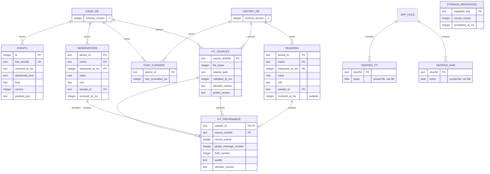
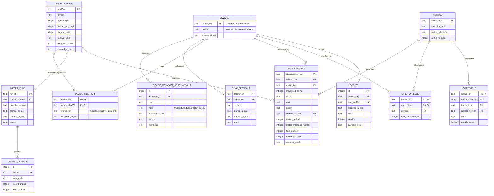

# ADR: CIRQA local storage and additive consolidation

- Date: 2026-11-18
- Status: Proposed target; current schema and migration status are stated separately.
- Scope: SQLite event/history stores and immutable private CIRQA file originals.

## Decision

Keep one app-private database file as the long-term target: `cirqa_measurements.db`.
It will contain both protocol/event evidence and normalized measurements. Retain
FIT and non-FIT originals as separate immutable, content-addressed files; SQLite
stores their hashes, format, size, validation/import status, and relative path.
This avoids copying binary payloads into SQLite while allowing measurements to
reference their exact source.

Do not convert all protocol evidence into relational columns: `events.payload_json`
is a deliberate flexible envelope for versioned, observed protocol messages.
Measurements used for queries, dashboards, exports, and scientific work belong
in typed relational tables. Future aggregate/rollup data for #140 belongs in the
same database, keyed by metric, time bucket, aggregation method/version, and
source range; no separate aggregate database is warranted at current scale.

This decision is **not yet a completed consolidation**. The app still has two
SQLite files; the historical store is being additively normalized without
deleting or rewriting its existing data.

## Verified current state

Observed constraints/indexes: `events.line_sha256` is unique;
`events_service_time(service, received_at_utc)`,
`events_kind_time(kind, received_at_utc)`, and partial
`events_dashboard_time(service, dashboard_time DESC, id ASC)` are indexed.
`readings` has composite primary key `(device_id, metric, measured_at_ms,
sample_id)` and `readings_by_time(measured_at_ms)`. `sync_cursors.device_id`
is the primary key. Historical DB schema v2 adds `fit_sources` and
`fit_observation_provenance` with FKs to source hash and the exact readings
composite key. The v1→v2 migration creates only new tables/indexes; it preserves
existing readings and cursors. Existing v1 rows have no fabricated provenance;
replaying a verified original can add provenance by stable sample ID.

Canonical `cirqa_measurements.db` schema v4 now has corresponding normalized
tables plus a whitelisted FIT device-metadata table. `ensureHistoricalStoreCopied()` copies historical rows in a destination
transaction, verifies every copied key/value/provenance and table counts, and
can be rerun without duplicating rows. A count marker skips unchanged source
snapshots and is cleared by database restore. The source DB and original files
are preserved. The CSV export path invokes this copy stage.

Backup format v4 includes events, both historical and canonical readings,
cursors, FIT-source metadata, provenance, and canonical whitelisted FIT
device-metadata rows. The restore reader accepts format v1–v3; older versions
contain no device-metadata snapshot. Original file bytes remain outside all
backup formats.

The 18 Nov 2026 S25 snapshots passed SQLite `integrity_check`. Observed counts
and privacy-limited reconciliation are in
`../research/CIRQA_S25_OFFLINE_RECONCILIATION_2026-11-18.md`.

## Target model (not current production DDL)

Implementation DDL must use `PRAGMA foreign_keys=ON`, `CHECK` constraints for
nonnegative timestamps and finite/valid values, explicit `NOT NULL`, and indexes
on `(device_key, metric_key, measured_at_ms)`, `(source_sha256, record_ordinal)`,
and session/status/time queries. A device and metric alone do not prove sample
identity. Content-file deduplication is by SHA-256; observation deduplication is
by decoder-derived stable idempotency key. Exact timestamp/value matches are
retained unless an explicit scientifically reviewed rule says otherwise.
Profile field definitions remain traceable to the pinned Garmin profile release;
the app does not need to copy the entire external profile into each database.

## Data lifecycle and clocks

1. V24/V25 experimental transfer receives complete bounded file bytes.
2. FIT files pass envelope/header/file CRC checks and are atomically published
   as `<sha256>.fit`; raw files pass their exact announced size and are published
   as `<sha256>.bin`. Incomplete files are not published.
3. Decoder emits only explicitly supported profile fields. Unknown fields remain
   skipped/recorded as inventory evidence, not guessed.
4. Validation filters missing timestamps and non-importable quality values.
5. Historical schema v2 writes each FIT file's normalized readings, source
   metadata, field provenance and per-device cursor in one transaction.
   Replays use stable source/record/field keys; conflicting decoder output fails
   closed rather than silently overwriting an earlier observation.
6. Dashboard/history paths primarily query `events`; normalized observations
   are copied into schema v3 during FIT import, CSV export or backup creation.
   FIT imports now write to canonical schema v4 after that copy and extract a
   strict `device_info` whitelist. Dashboard readers have not yet cut over.
   Backup v4 serializes both stores and supports restore from v1–v3; it does not
   embed original FIT bytes.

`measured_at_ms` is the device/FIT measurement clock. `received_at_ms` is the
local transfer/import clock and must not replace a missing measurement time.
`observed_at_utc` is when metadata was actually seen. A file-list transaction
identifier is not a committed SQLite cursor.

## Migration and rollback plan

1. Create an app-private backup and record old schema versions, row counts,
   primary-key uniqueness, cursor values, and original file hash/size manifest.
   Do not reset, rename, or delete either database/file store.
2. **Implemented additive step:** upgrade `pulselibre_readings.db` v1→v2 by
   adding FIT source/provenance tables and indexes; preserve every existing row
   and cursor. New FIT batches now write readings, provenance and cursor in one
   transaction. A verified original can add provenance to a matching existing
   reading by its stable sample key.
3. **Implemented copy stage:** add normalized tables/indexes to `CirqaDatabase`
    schema v3 and copy historical readings, FIT source metadata and cursors in a
   transaction. The copy verifies matching keys/values and source/destination
   counts; conflicting destination rows fail closed and roll back. The old DB
   remains intact as rollback evidence.
4. Make migration restartable: a source-count marker is written only after
   successful validation. Interrupted transactions roll back; a later export
   retries if the historical source row counts have changed.
5. **Implemented write/backup stage:** new FIT imports write to canonical
   observations and whitelisted FIT device metadata after the history copy.
   Backup v4 serializes canonical and historical rows/provenance/cursors plus
   metadata; restore accepts v1–v3, validates references before confirmation,
   and marks the copy stage complete for v3/v4 restores. Original bytes remain
   excluded.
6. Run backup→restore round trips against both pre-migration and migrated
   fixtures. Compare counts, stable keys, cursors, event hashes and file hashes.
   Retire neither legacy DB nor original files as part of this migration.

The old app version must fail safely when opening a newer DB rather than
downgrading or replacing it. Rollback is to restore a verified backup with a
compatible app version; copying a live SQLite main file without its journal is
not a valid backup procedure.

## Operational/privacy decisions

- Keep the database and original files app-private. No cloud, telemetry, or
  committed health data. Backup v4 is checksummed but **not encrypted**; do not
  claim encryption. Encryption-at-rest for user-selected backups requires a
  separate key-management decision.
- Keep content-addressed originals immutable. Quotas/orphan cleanup require
  explicit policy and must never delete user health data implicitly.
- Bound each file and batch, decode and commit incrementally, index time windows,
  and paginate large result sets. Avoid whole-history materialization in UI.
- Room is not selected solely for style: the existing SQLite/OpenHelper path is
  small and explicit. Reconsider if query/schema complexity justifies generated
  migrations and compile-time DAO checks.

## Remaining acceptance work

The diagrams and target/migration decision are architecture artifacts. The
historical DB and canonical DB have normalized FIT tables; new FIT writes and
backup v4 target/preserve canonical rows and whitelisted device metadata with
v1–v3 restore support. The historical DB remains as a rollback source.
Dashboard readers, re-backfilling existing FIT files for metadata recovery,
physical retirement of the old store, XML/raw metadata decoding, file-byte
backup/restore, and a broad populated-device migration rehearsal remain open.
