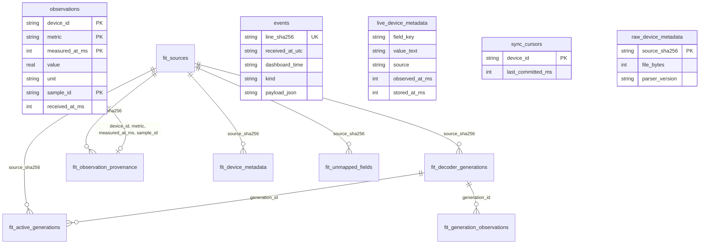
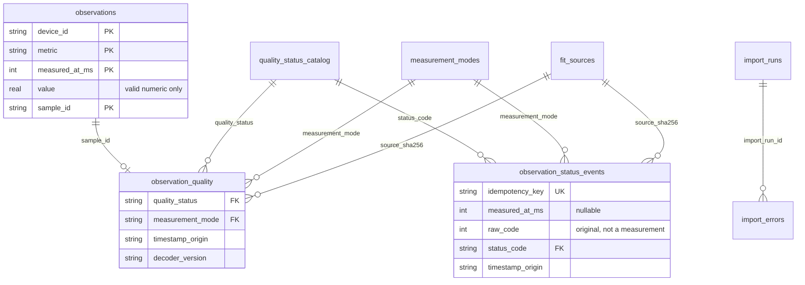

# #144 – IST-/SOLL-Datenmodell: Originaldaten, Messwerte, Qualität und Provenienz

Stand: 2026-11-22 · Owner: Datenmodell-/Persistenz-Agent (OpenCode) · Ausgang: `origin/main` `c3bc65f0`

> **Lesart:** Dies ist Phase A von #144. Alle Aussagen sind nach Evidenzgrad markiert:
> **[DB]** = aus einer **lesend** geöffneten lokalen Kopie einer echten v8-Datenbank direkt geprüft;
> **[CODE]** = aus dem aktuellen Kotlin-Quellcode auf `main` geprüft;
> **[FACH]** = fachliche Anforderung aus #144/#150/#506, noch nicht implementiert;
> **[OFFEN]** = Abhängigkeit von FIT-Agent/ChatGPT oder noch nicht geprüft.
> Es werden hier keine personenbezogenen Werte, Gerätekennungen oder Roh-Payloads dokumentiert – nur Schema, Zählstände und Aggregationen.

## 1. Ziel und Grundsatz

Originaldaten bleiben **unverändert** und content-adressiert erhalten. Interpretierte, physikalisch gültige Messwerte, nicht-numerische Geräte-/Sensorstati und Qualitätsinformationen sind getrennte Entitäten. Ein ungültiger Wert einer Messgröße darf niemals einen Wert einer anderen Messgröße invalideren. Ein FIT-Statuscode wie `-100`/`-200`/`-300` (Atemfrequenz), `HR = 0` oder `SpO₂ = 255` ist ein **Status im Original**, kein physiologischer Messwert und wird nicht als negativer bzw. normaler Messwert persistiert.

## 2. IST-Inventur

### 2.1 Kanonische SQLite-Datenbank `cirqa_measurements.db` [DB]

Lokale Read-only-Kopie: `user_version = 8`, `PRAGMA quick_check = ok`, 42 Schema-Objekte. Tabellen und tatsächliche Zeilenzahlen:

| Tabelle | Zeilen | Zweck laut DDL/Name |
|---|---:|---|
| `events` | 400 | rohe BLE-/Protokollereignisse als `payload_json`, `line_sha256` UNIQUE |
| `observations` | 27.884 | normalisierte, Triple PK `(device_id, metric, measured_at_ms, sample_id)`, `value REAL`, `unit`, `received_at_ms` – **ohne Qualitäts-/Modus-/Timestamp-Ursprungsspalte** |
| `fit_sources` | 24 | content-adressierte FIT-Quelle, `file_bytes`, `relative_path`, `decoder_version`, `profile_version` |
| `fit_decoder_generations` | 24 | `generation_id`, `decoder_version`, `profile_version`, `output_digest`, `output_count` |
| `fit_active_generations` | 24 | aktive Generation je `source_sha256` |
| `fit_generation_observations` | 27.884 | generationierte Werte mit `record_ordinal`, `global_message_number`, `field_number`, `quality='PROFILE_VALID'`, `timestamp_origin` |
| `fit_observation_provenance` | 27.884 | `sample_id`-Provenienz mit FK auf `observations` und `fit_sources`, `decoder_version` |
| `fit_device_metadata` | 120 | FIT-`device_info`-Felder inkl. Batterie-Feldern (nullable, mit CHECK-Grenzen) |
| `fit_unmapped_fields` | 10.862 | unbekannte/nicht gemappte FIT-Felder mit `classification`, `review_status` |
| `raw_device_metadata` | 1 | verifizierte Nicht-FIT-Raw-Metadaten (`software_version`, `mass_storage_mode`, `transfer_direction_count`) |
| `live_device_metadata` | 38–62 in vier lokalen Kopien | generische Textwerte `field_key/value_text/unit/source/observed_at_ms/stored_at_ms` mit UNIQUE(field_key, source, observed_at_ms) |
| `sync_cursors` | 1 | `last_committed_ms` pro `device_id` |
| `storage_migrations` | 1 | Nachweis des Legacy-Kopierschritts |
| `android_metadata`, `sqlite_sequence` | 1 / 2 | Android-/SQLite-intern |

Aggregate der 27.884 `observations` [DB, ohne Individualwerte]: `distance` 14.985 (min 0, max 12,68), `heart_rate` 12.804 (47–147), `speed` 95 (0–1,818). **Keine negativen Werte** in dieser Kopie; 14.900 `distance`- und 22 `speed`-Zeilen sind 0. Alle `fit_generation_observations` haben `timestamp_origin='DIRECT'` und `quality='PROFILE_VALID'`. Die lokale v8-Kopie enthält **keine** Review-Kandidatentabelle – eine v9-Migration muss also auch v8-Datenbanken ohne diese Tabelle sicher handhaben.

Wichtige constraints [DB]: FKs mit `ON DELETE RESTRICT` bzw. `CASCADE`, CHECKs für `timestamp_origin IN ('DIRECT','RECONSTRUCTED_TS16','RECONSTRUCTED_COMPRESSED','UNKNOWN')`, `quality='PROFILE_VALID'`, `battery_level_percent BETWEEN 0 AND 100`. `observations` hat **keinen** FK auf ein Gerät, keine Qualitäts-, Modus-, Kontext-, Decoder- oder Herkunftsspalte.



### 2.2 Zweite Datenbank `pulselibre_readings.db` [CODE]

Legacy-Store `LocalReadingStore.kt:90-96` mit `readings`, `sync_cursors`, Legacy-FIT-Provenienz und Review-Kandidaten (`LocalReadingStore.kt:104-187`), Schema-Version **3** und aktivierten Foreign Keys (`:93-96`). Upgrade nur `1..2 → 3`, additiv (`:126-133`). Die **kanonische** Ablage liegt in `cirqa_measurements.db`. Der Legacy-Store wird über `ATTACH ... AS legacy` (`CirqaDatabase.kt:1749-1755`) für Kopie/Restore eingebunden.

**Schema-Alter bei v8 [CODE]:** `CirqaDatabase.kt:448-501` legt `fit_review_candidates` und `live_device_metadata` beim Öffnen bedingt nach (`sqlite_master`/`PRAGMA table_info`, vgl. `:309-320`). Das erklärt, warum lokal v8-Dateien mit und ohne Kandidatentabelle coexistieren können: nicht jede v8-Datei hat denselben physischen Tabellensatz. `user_version` ist kein hinreichender Zustandsbeweis.

### 2.3 Dateistores und abgeleitete Daten [DB/CODE]

- `verified_fit/<sha256>.fit`: CRC-/headerprüfte FIT-Originale, atomar und content-adressiert [CODE].
- content-adressierte Nicht-FIT-Rawdateien `<sha256>.bin` mit exakter Längenprüfung [CODE].
- Originalbytes sind **nicht** Teil des SQLite-Backups [CODE/DB]; Referenzintegrität muss über `fit_sources.source_sha256` und `raw_device_metadata.source_sha256` geprüft werden.
- `unified_measurements` ist nach #514 ein abgeleiteter, rebuildbarer Store und bleibt aus Backup/Migration ausgenommen [CODE, von #517-PR-Body bestätigt].

### 2.4 Datenlebenszyklus (IST, grounded) [DB/CODE]

`BLE-/FileSync-Transfer → HCI-/Protokollereignis (events.payload_json) → integritätsgeprüfte Originaldatei (verified_fit/<sha>.fit / <sha>.bin) → FIT-Decoder-Generation (fit_decoder_generations, fit_sources) → PROFILE_VALID-Beobachtung (fit_generation_observations + observations + fit_observation_provenance) → Backfill/Import (sync_cursors, storage_migrations) → Dashboard/Export/Backup`.

Zeitbegriffe sind IST-mäßig nicht überall getrennt: `events.received_at_utc` (Empfang), `observations.measured_at_ms` (Messung laut FIT), `observations.received_at_ms` (Import), `live_device_metadata.observed_at_ms` (Beobachtung), `fit_sources.validated_at_ms` (Validierung). `timestamp_origin` existiert nur in `fit_generation_observations`, nicht in `observations`. [DB]

### 2.5 Code-IST: Import, Idempotenz, Transaktionen, Fehlerbehandlung [CODE, verifiziert 22.11.2026]

- **Decoder:** `FitHistoricalObservations.kt:13-16` (`DECODER_VERSION="1"`, `PROFILE_VERSION="21.222.0"`, FIT-Epoche, Maximalgrenzen). Timestamp-253, komprimierte Zeit und `timestamp_16` werden getrennt erkannt (`:256-285`); ohne früheren vollständigen Timestamp bleibt die Zeit `null` (`:466-483`), `0xffffffff` wird verworfen (`:273-285`). Unbekannte Felder werden nur inventarisiert, nie als Werte importiert (`:104-110`, `:425-429`).
- **Gültigkeit:** HR nur `1.0..240.0` ist `PROFILE_VALID` (`:396-420`); FIT-Sentinels `0xff`/`0xffff`/`0xffffffff` (`:530-535`); SpO₂ `0xff`, Stress/Respiration `0x7fff` werden als Review-Kandidaten-Invalid markiert (`:319-381`). Review-Kandidaten bleiben `UNTRUSTED_PROFILE_CANDIDATE` mit nullable Zeit (`:84-102`).
- **Idempotenz:** `sample_id = sha256(fileSha:recordOrdinal:global:field)` (`FitHistoricalObservations.kt:405-419`), Generierungs-ID analog (`FitDecoderGeneration.kt:40-49`), Output-Digest über sortierte `sample_id` inkl. Wertbits/Einheit/Feldkoordinaten/Qualität/Zeitursprung (`:44-68`). DB-Inserts mit `INSERT OR IGNORE` und PK/UNIQUE (`FitObservationCommitter.kt:86-103`, `:239-311`), Feldinventar per `ON CONFLICT ... DO UPDATE` (`:155-189`). Originaldateiname ist der Inhalts-Hash; gespeicherte Bytes werden vor Übernahme verifiziert (`CirqaVerifiedFitStore.kt:36-61`).
- **Transaktion:** eine Transaktion für Source, Review-Kandidaten, Inventar, Gerätemetadaten, Observations, Provenienz, Generation und Cursor (`FitObservationCommitter.kt:84-337`, `setTransactionSuccessful()` `:334`, `endTransaction()` im `finally` `:335-337`). Generationen sind unveränderlich; eine zweite Generation wird nicht automatisch aktiv (`:342-346`, `:451-452`).
- **Bestätigter Fehlerpfad (Prüfpunkt aus #144):** `CirqaFitBackfill.kt:100-113` fing pro Datei ursprünglich nur `IOException` und `SQLiteException`. Die Integritätsprüfungen im Committer nutzen `require(...)` → `IllegalArgumentException` (`:22-71`, `:231-236`) und `check(...)`/`error(...)` → `IllegalStateException` (`:99-102`, `:140-151`, `:217-227`, `:272-288`, `:390-394`, `:427-438`, `:450`). Beide Typen umgingen den dateiweisen Handler und beendeten die gesamte `run()`-Schleife; spätere Dateien und `CirqaUnknownFitInventory.scanAndPersist(...)` in `MainActivity.kt:128-136` wurden übersprungen. Der äußere Worker fing nur pauschal `Exception` (`MainActivity.kt:125-140`), ohne strukturiertes `FAILED`-Ergebnis. **Status der Behebung:** in diesem Branch werden beide Typen als `FailureStage.SOURCE_CONFLICT` pro Datei erfasst; die `check(...)`-Prüfungen und der Transaktions-Rollback bleiben aktiv. Regressionstest: `CirqaFitBackfillTest.kt` (`metadataConflictIsReportedPerFileAndLaterFilesContinue`, `decoderContractViolationIsReportedPerFileAndLaterFilesContinue`).
- **Backup:** `DatabaseBackup.kt` Format `de.pulselibre.local-database-backup`, Version **8** (`:26-27`, `:120-121`), Entry-Sets v1–v8 (`:33-71`), Manifest mit SHA/Record-Counts (`:798-846`), `prepareRestore()` validiert vor jeder Datenänderung (`:94-118`, `:145-242`), inklusive neu berechnetem Output-Digest und `PRAGMA foreign_key_check` (`:1186-1233`). Restore ersetzt beide Stores in einer Transaktion (`CirqaDatabase.kt:1248-1269`). Original-FIT-Bytes sind nicht im Backup.

## 3. SOLL-Modell (additiv, keine neue Datenbank)

Entscheidung: **eine kanonische SQLite-Datenbank** `cirqa_measurements.db` bleibt fachliche Wahrheit; `pulselibre_readings.db` bleibt aus Kompatibilitätsgründen erhalten und wird nicht zu einer dritten Datenbank konsolidiert. Physische Konsolidierung/Normalisierung ist ein separater, später zu begründender Schritt; #140 bleibt zurückgestellt. #496 bleibt gesperrt.

### 3.1 Trennung der Dimensionen [FACH, verabschiedet in diesem Dokument]

| Dimension | IST | SOLL (additiv) |
|---|---|---|
| Originaldaten | unveränderte FIT-/Raw-Bytes im content-adressierten Store | unverändert; zusätzlich `source_sha256`-FK in jeder abgeleiteten Zeile |
| Numerischer Messwert | `observations.value` (nur PROFILE_VALID) | bleibt; **keine** Statuscodes als Zahlen |
| Qualität je Messgröße | nur `fit_generation_observations.quality='PROFILE_VALID'`, nicht in `observations` | `observation_quality` mit `sample_id`-FK, `quality_status`, `measurement_mode`, `sensor_context`, `confidence`, `raw_status_code`, `timestamp_origin`, `decoder_version`, `profile_version` |
| Nicht-numerische Originalzustände | keine eigene Tabelle; Review-Kandidaten separat | `observation_status_events`: `raw_code`/`raw_value_text` + `status_code` + Herkunft, `measured_at_ms` **nullable**, `idempotency_key` UNIQUE |
| Messmodus/Kontext | nicht persistiert | `measurement_modes` / `sensor_contexts` als kleine Kataloge mit `UNKNOWN`-Fallback; FK statt CHECK-Enum, damit neue belegte Modi ohne DDL ergänzbar sind |
| Geräte-/Sensorkontext | `live_device_metadata` als Text-Store | bleibt; Ergänzung um `quality_status`/`confidence`/`freshness` in einer begleitenden Tabelle, keine Vermischung mit Messwerten |
| Zeitstempel-Semantik | `timestamp_origin` nur in Generationstabelle | in `observation_quality` und `observation_status_events` übernommen; `UNKNOWN` → `measured_at_ms = NULL`; unknown FIT messages erhalten **keinen** erfundenen Zeitstempel |
| Herkunft | `fit_observation_provenance`, `fit_sources` | identisch, zusätzlich für Statuszeilen und Importfehler |
| Decoder-/Profilversion | `fit_decoder_generations`, `fit_observation_provenance` | in jeder Qualitäts-/Statuszeile wiederholt (immutable, nicht „latest“) |
| Idempotenz | `sample_id` + generation key + `INSERT OR IGNORE` | `idempotency_key` UNIQUE auch für Statuszeilen; Re-Import erzeugt keine Duplikate |
| Fehlerbehandlung | `IOException`/`SQLiteException` pro Datei; `IllegalStateException`/`IllegalArgumentException` brachen den Lauf ab [CODE, jetzt dateiweise abgefangen] | `SOURCE_CONFLICT` als dritter dateiweiser Fehlerstage; strukturierte `import_errors` später; Integritätsprüfungen bleiben aktiv; whole-run abort nur bei echter Systemschädigung |

### 3.2 Implementierte Tabellen (v9, 22.11.2026)

> Das folgende DDL entspricht `CirqaDatabase.createObservationQualitySchema(...)`. Katalog-FKs tragen `ON DELETE RESTRICT`, damit bestätigte Semantiken nicht stillschweigend gelöscht werden können. `observation_status_events.source_sha256` ist nullable und erlaubt damit auch Nicht-FIT-Kontexte; wenn gesetzt, muss die Quelle in `fit_sources` existieren.

```sql
CREATE TABLE IF NOT EXISTS quality_status_catalog (
    status_code TEXT PRIMARY KEY NOT NULL,
    description TEXT NOT NULL,
    source_of_semantics TEXT NOT NULL
);
CREATE TABLE IF NOT EXISTS measurement_modes (
    mode_code TEXT PRIMARY KEY NOT NULL,
    description TEXT NOT NULL,
    source_of_semantics TEXT NOT NULL
);
CREATE TABLE IF NOT EXISTS observation_quality (
    id INTEGER PRIMARY KEY AUTOINCREMENT,
    device_id TEXT NOT NULL,
    metric TEXT NOT NULL,
    measured_at_ms INTEGER NOT NULL CHECK(measured_at_ms >= 0),
    sample_id TEXT NOT NULL,
    quality_status TEXT NOT NULL REFERENCES quality_status_catalog(status_code) ON DELETE RESTRICT,
    measurement_mode TEXT NOT NULL REFERENCES measurement_modes(mode_code) ON DELETE RESTRICT,
    sensor_context TEXT NOT NULL DEFAULT 'UNKNOWN',
    confidence INTEGER CHECK(confidence IS NULL OR confidence BETWEEN 0 AND 100),
    raw_status_code INTEGER,
    timestamp_origin TEXT NOT NULL CHECK(timestamp_origin IN
        ('DIRECT','RECONSTRUCTED_TS16','RECONSTRUCTED_COMPRESSED','UNKNOWN')),
    source_kind TEXT NOT NULL,
    source_sha256 TEXT,
    record_ordinal INTEGER,
    global_message_number INTEGER,
    field_number INTEGER,
    decoder_version TEXT NOT NULL,
    profile_version TEXT NOT NULL,
    stored_at_ms INTEGER NOT NULL CHECK(stored_at_ms >= 0),
    UNIQUE(device_id, metric, measured_at_ms, sample_id),
    FOREIGN KEY(device_id, metric, measured_at_ms, sample_id)
      REFERENCES observations(device_id, metric, measured_at_ms, sample_id) ON DELETE CASCADE,
    FOREIGN KEY(source_sha256) REFERENCES fit_sources(source_sha256) ON DELETE RESTRICT
);
CREATE TABLE IF NOT EXISTS observation_status_events (
    id INTEGER PRIMARY KEY AUTOINCREMENT,
    idempotency_key TEXT NOT NULL UNIQUE,
    device_id TEXT NOT NULL,
    metric TEXT NOT NULL,
    measured_at_ms INTEGER CHECK(measured_at_ms IS NULL OR measured_at_ms >= 0),
    timestamp_origin TEXT NOT NULL CHECK(timestamp_origin IN
        ('DIRECT','RECONSTRUCTED_TS16','RECONSTRUCTED_COMPRESSED','UNKNOWN','NOT_APPLICABLE')),
    raw_code INTEGER,
    raw_value_text TEXT,
    status_code TEXT NOT NULL REFERENCES quality_status_catalog(status_code) ON DELETE RESTRICT,
    measurement_mode TEXT NOT NULL REFERENCES measurement_modes(mode_code) ON DELETE RESTRICT,
    sensor_context TEXT NOT NULL DEFAULT 'UNKNOWN',
    source_kind TEXT NOT NULL,
    source_sha256 TEXT,
    record_ordinal INTEGER,
    global_message_number INTEGER,
    field_number INTEGER,
    decoder_version TEXT NOT NULL,
    profile_version TEXT NOT NULL,
    observed_at_ms INTEGER,
    stored_at_ms INTEGER NOT NULL CHECK(stored_at_ms >= 0),
    CHECK ((measured_at_ms IS NOT NULL AND timestamp_origin IN
              ('DIRECT','RECONSTRUCTED_TS16','RECONSTRUCTED_COMPRESSED'))
           OR (measured_at_ms IS NULL AND timestamp_origin IN ('UNKNOWN','NOT_APPLICABLE'))),
    FOREIGN KEY(source_sha256) REFERENCES fit_sources(source_sha256) ON DELETE RESTRICT
);
CREATE TABLE IF NOT EXISTS import_runs (
    import_run_id TEXT PRIMARY KEY NOT NULL,
    started_at_ms INTEGER NOT NULL,
    finished_at_ms INTEGER,
    source_sha256 TEXT,
    decoder_version TEXT NOT NULL,
    profile_version TEXT NOT NULL,
    status TEXT NOT NULL CHECK(status IN ('RUNNING','COMPLETED','PARTIAL','FAILED')),
    observed_count INTEGER NOT NULL DEFAULT 0,
    status_count INTEGER NOT NULL DEFAULT 0,
    error_count INTEGER NOT NULL DEFAULT 0
);
CREATE TABLE IF NOT EXISTS import_errors (
    id INTEGER PRIMARY KEY AUTOINCREMENT,
    import_run_id TEXT NOT NULL REFERENCES import_runs(import_run_id) ON DELETE RESTRICT,
    source_sha256 TEXT,
    error_class TEXT NOT NULL,
    redacted_message TEXT NOT NULL,
    occurred_at_ms INTEGER NOT NULL,
    decision TEXT NOT NULL CHECK(decision IN ('FILE_SKIPPED','RUN_ABORTED'))
);
```

Konkrete Statuscodes, Modi und Konfidenzquellen werden **nicht** spekulativ befüllt; die Kataloge werden mit `UNKNOWN` initialisiert und erst nach fachlicher Freigabe durch den FIT-Agenten ergänzt [OFFEN]. Bestehende `fit_review_candidates` bleiben unverändert `UNTRUSTED_PROFILE_CANDIDATE` und werden nicht automatisch in gültige Messwerte oder Statusereignisse umgewandelt.



## 4. Offene Punkte / Abhängigkeiten

- [OFFEN] FIT-Agent: verbindliche Semantik und Repräsentation für RR −100/−200/−300, HR 0, SpO₂ 255; Messmodus/Konfidenz, Timestamp-Ursprung und Decoder-/Profilversion (siehe agent-sync-Nachricht 2026-11-22 22:41 UTC).
- [OFFEN] GUI-Agent: Bestätigung der stabilen Lese-API; neue Felder sind zunächst additiv und werden nicht automatisch angezeigt.
- [OFFEN] Code-IST: Feldgenaue Fehlerbehandlung und genaue Legacy-Store-Version werden aus dem Quellcode nachgetragen.
- [FACH] `coverage=device-history-unverified` bleibt unverändert; dieses Dokument ist kein Beleg für vollständige Historie oder medizinische Validierung.
