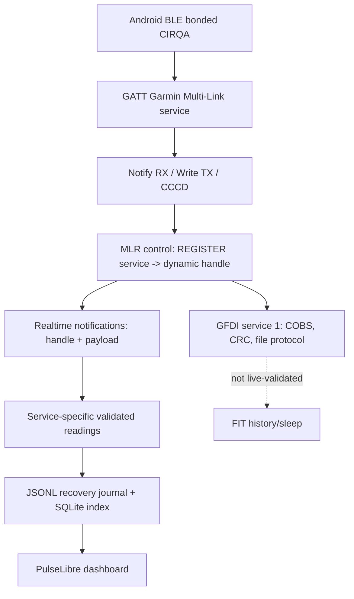

# PulseLibre CIRQA Bluetooth protocol: observed ground truth and independent comparison

**Date:** 2026-11-16. **Status:** reverse-engineered working hypothesis + on-device evidence, **not** Garmin's official specification. The repository is on **GitHub** (`jochenkunkel/pulselibre`); no GitLab remote was identified or modified.

## Evidence taxonomy

- **C — CIRQA-observed:** user device screenshots and previously analyzed overnight JSONL, not independent raw BLE packet capture.
- **I — implemented:** inspected Kotlin source; may have synthetic unit tests but does not establish device compatibility.
- **T — third-party observed:** a different Garmin model, not automatically CIRQA.
- **U — unverified:** incomplete or not observed.

### End-to-end layers

### BLE transport and MLR [I; portions C]

- GATT Multi-Link service UUID `6a4e2800-667b-11e3-949a-0800200c9a66`. Search complete notify/write characteristic pairs RX `6a4e2810..2814`, TX `6a4e2820..2824`; activate CCCD `0x2902`.
- `REGISTER_ML_REQ`: 13 bytes `00 00 02 00 00 00 00 00 00 00 SS SS 00` (service code `SS SS` little-endian).
- `REGISTER_ML_RESP`: core 14 bytes: control 0, response type 1, 8-byte client ID 2, u16 LE service, u8 status (0 accepted), u8 dynamically assigned handle. Device-specific extension bytes may follow.
- Notification routing: first byte 0 control; high bit set -> handle in bits 6..4 (1..7); otherwise bare handle 1..127. Do **not** assume handle equals service ID. Service-specific payload begins after routing byte.
- PulseLibre registers GFDI service 1, then each requested realtime service, **without CLOSE_ALL** in normal operation. No unpairing/reset.
- GFDI is a separate application channel; its COBS, CRC, FIT/file transfer are not demonstrated live on CIRQA. Do not treat a realtime sample as a FIT record.

### Observed realtime service contract [C/I]

| ML service | Decoded field(s) | CIRQA evidence |
|---|---|---|
| 6 HR | padding u8, bpm u8, resting bpm u8 | live screenshots + overnight JSONL |
| 7 Steps | u32 LE steps, u32 LE goal | live screenshots + overnight JSONL; cumulative counter can reset |
| 8 Calories | u32 LE total, u32 LE active | live screenshot + overnight JSONL |
| 10 Intensity | u16 LE moderate, u16 LE vigorous | live screenshot + overnight JSONL |
| 12 HRV | u16 LE RR interval ms | live screenshot + overnight JSONL; **not** RMSSD |
| 13 Stress | signed byte 0..100 | overnight JSONL |
| 19 SpO2 | u8 1..100 percent | live screenshot + overnight JSONL |
| 20 Body Battery | signed byte 0..100 | live screenshot + overnight JSONL |
| 21 Respiration | signed byte breaths/min | live screenshot + overnight JSONL |

The previous complete overnight export contained **5,055 readings**, 83 attempt summaries and 9 successfully decoded services. The screenshots confirm decoded values, not the full on-air wire format or clinical accuracy.

### Service 16 accelerometer [T/U]

- PulseLibre allowlists service 16 in a bounded opt-in test but has **not** confirmed registration or streaming on CIRQA.
- Initial CIRQA result `Service 16 ohne bestätigte Antwort` was inconclusive: a code bug sent service 6 during exploratory registration; the subsequent fix has no user-provided service-16 confirmation yet.
- Current `startMotionDiscovery` sends REGISTER(16) after GFDI, **but does not send a service-specific stream-start payload**. Therefore 0 packets cannot prove absence even after registration.
- On a **quatix 7**, MousePods reports REGISTER(16), then `0x01` start / `0x00` stop on the assigned service handle, and 17-byte notifications (1 routing + 16 payload): 2-byte header (13-bit wrapped timestamp, upper 3 bits sample count), then 14 bytes of nine signed 12-bit x/y/z counts, 256 counts/g, three samples/packet at ~25 Hz.
- **Important disagreement in references:** `garmin-ble/metrics/accelerometer.py` calls the first u16 a `timestamp_ms` without extracting count bits, whereas MousePods documents the upper 3 bits as sample count. This must be verified on CIRQA before selecting a decoder. No gyroscope is established on CIRQA.
- Do not automatically send start/stop or unknown service commands: require a separate bounded explicit user test, correct handle registration, safe cleanup, and a payload validator.

## External project comparison

| Topic | PulseLibre / CIRQA | gwerneckp/garmin-ble | MousePods (quatix 7) | wh1le/garmin-bridge | Gadgetbridge |
|---|---|---|---|---|---|
| Target | Android + CIRQA | Python Garmin BLE | Linux quatix 7 | Linux/Fenix-focused | Android, multiple Garmin models |
| Multi-Link dynamic handles | Implemented, CIRQA realtime proven | Implemented | Via garmin-ble | Garmin GFDI handshake | Implemented |
| Live HR/steps/SpO2/etc | 9 services observed on CIRQA | Metric parsers | Focuses on motion | Primarily connection and sync | Broad model-specific integration |
| Motion service 16 | Experimental registration, **unconfirmed** | Decoder for 3×XYZ | Verified quatix 7 ~25 Hz, explicit start byte | Not established here | Protocol reference, device-dependent |
| Unknown service discovery | Strict candidate allowlist [16] | Known enums/services | Reads service-4 capability bitmap; reports 24/25/27/28 unknown on quatix 7 | Not established | Device/model-specific |
| GFDI/FIT sync | Parser/research only; no CIRQA live sync | GFDI library | Not main focus | Handles auth, time, settings | Broad FIT transfer implementation |
| CLOSE_ALL | Not sent in normal probe | Has command | Used in its experimental tools | Model-specific handshake | Varies by integration |
| Device-specific proof | Real CIRQA decoded metrics | Other Garmin models | quatix 7, not CIRQA | Other models | Other models |

### Key engineering deltas and priorities

1. **Most important motion delta:** registration is not stream activation. MousePods explicitly writes `0x01` to the service-16 dynamic handle. PulseLibre currently does not. Implement only as a separately authorized, time-bounded experiment after successful registration; stop safely with `0x00` if started.
2. **Capability discovery:** MousePods reports service 4 registration bitmap. PulseLibre currently has an allowlist only. A read-only, bounded capability query after verified protocol review could prevent guessing service numbers; do not assume the bitmap semantics are identical on CIRQA.
3. **Accelerometer header disagreement:** first 16-bit field may pack timestamp and count; preserve raw packet length and independently validate against controlled motion and known packet fixtures.
4. **GFDI history:** Gadgetbridge/garmin-bridge implement more session machinery than PulseLibre. Do not conflate proven realtime BLE with FIT history access.
5. **Privacy/safety:** no CLOSE_ALL, unpairing, pairing reset, destructive file flags, bulk service-number probing or cloud transfer.

## Directly inspected primary source references

- PulseLibre `docs/protocol/CIRQA_PROTOCOL_SPEC.md`, `GarminMlHandshake.kt`, `GarminMlOffline.kt`, `GarminRealtime.kt`, `CirqaMlHandshakeProbe.kt`, `GarminServiceDiscovery.kt`, `GarminFrameValidator.kt`; own device screenshots and overnight export analysis.
- https://github.com/gwerneckp/garmin-ble/blob/main/garmin_ble/protocol/mlr.py — MLR framing and registration.
- https://github.com/gwerneckp/garmin-ble/blob/main/garmin_ble/metrics/accelerometer.py — motion payload decoder and timestamp interpretation.
- https://github.com/starman-tech/mousepods/blob/main/docs/GARMIN.md — measured quatix 7 motion stream, service 4 capability bitmap, start/stop bytes and limitations.
- https://github.com/wh1le/garmin-bridge/blob/main/src/protocol/handshake.py — GFDI handshake/device information/time/configuration.
- https://gadgetbridge.org/internals/specifics/garmin-protocol/ — Garmin protocol families and FIT transfer background (referenced by existing repository research; not independently reopened in this revision).

External code is inspected for facts, **not copied**. Check AGPL obligations before integrating third-party implementations.

## Ground truth boundary

**What is proven:** CIRQA BLE exchanges yielded nine decoded realtime service families in user tests; SQLite/JSONL handling is separately implemented. **What is not proven:** service 16 works on CIRQA; correct motion packet semantics; GFDI FIT history access; sleep-stage inference; full on-air byte trace. Do not upgrade [T] or [U] to [C] without real CIRQA capture and tests.
