# CIRQA Smart/MLR → FIT → SQLite pipeline audit

- Date: 2026-11-20
- Audited source: `main` at `530cda2d0ed68b2650b6e679fac0d00c03d85eef`.
- Method: static code review only; no device/BLE access and no private health
  files read. This is not a full pipeline, FIT-semantic, or hardware validation.

## Implemented call path

```mermaid
flowchart LR
    UI[Confirmed history action] --> PROBE[CirqaMlHandshakeProbe]
    PROBE --> LIST[Item-list / page state]
    LIST --> PULL[Pull request and MLR assembly]
    PULL --> VALIDATE[exact-size and file classification]
    VALIDATE -->|FIT CRC valid| STORE_FIT[CirqaVerifiedFitStore]
    VALIDATE -->|non-FIT exact-size| STORE_RAW[CirqaVerifiedRawFileStore]
    STORE_FIT --> DECODE[FitHistoricalObservations.decode]
    DECODE --> BACKFILL[CirqaFitBackfill.importVerifiedFile]
    BACKFILL --> COPY[CirqaDatabase.ensureHistoricalStoreCopied]
    COPY --> COMMIT[FitObservationCommitter transaction]
    COMMIT --> OBS[observations + source + provenance + metadata + inventory]
    STORE_RAW --> RAWMETA[optional whitelisted Device XML metadata]
    RAWMETA --> DB[CirqaDatabase]
```

The explicit user confirmation and detailed call-site gate are documented in
the active-GATT audit. This diagram is scoped to the current source code; it
does not assert that every device file is listed, nor that all historical pages
are reachable.

## Stage semantics observed in code

| Stage | Code behavior | Important boundary |
| --- | --- | --- |
| List/pull | `CirqaMlHandshakeProbe` queues list items, checks a bounded expected size, sends a pull, and assembles MLR bytes. | A completed run/page is not a complete-history proof. |
| Transfer complete | `completeSyncFile()` calls `mlrValidation()`, records one redacted per-file summary, clears state, then advances the queue. | The summary carries details such as exact-size, CRC, decode and SQLite result. |
| Raw verification | Exact-size non-FIT bytes are written by `CirqaVerifiedRawFileStore`; Device XML metadata indexing is attempted separately. | A metadata-index failure is visible in the per-file result but does not invalidate already-stored original bytes. |
| FIT verification | FIT header/file CRC is checked before `CirqaVerifiedFitStore.saveVerified()`. | Verified file publication and SQLite persistence are separate durability domains. |
| Decode/import | The live path decodes once for a summary, then `CirqaFitBackfill.importVerifiedFile()` reads and decodes the stored file again and calls `commitFitFile`. | The second decode is the actual database-import input. Unsupported fields remain in inventory/original bytes rather than being guessed. |
| SQLite commit | `FitObservationCommitter` uses one SQLite transaction for source, observation rows, provenance, canonical metadata/inventory, and cursor update. Conflicting existing rows fail checks; duplicate stable keys are idempotent. | The returned integer is `records.size`, i.e. eligible candidates committed/reconciled, not newly inserted-row count. |
| Offline backfill | `CirqaFitBackfill.run()` independently verifies content-addressed filenames and CRCs, then commits files one by one. | An exception aborts the run and no final aggregate is returned; previous per-file transactions remain committed, and rerun can resume idempotently. |
| Readers/exports | The repository pages normalized history; CSV combines canonical events/history and old-store history during transition. | Main dashboard readers remain event-oriented; no end-to-end dashboard integration is claimed. |

## Concrete status-reporting gap

`completeSyncFile()` classifies a file as successful if `mlrValidation()` contains
`privateFit=CREATED`/`ALREADY_PRESENT` or `privateRaw=CREATED`/`ALREADY_PRESENT`.
For a FIT file, this remains true when the same summary reports
`sqlite=failed:<ExceptionType>`. Thus the aggregate completed-file counter
currently means **received, validated, and privately stored**, not
**successfully imported into SQLite**. The per-file diagnostic preserves the
SQLite failure, so the code does not erase that detail; however, consumers must
not label this aggregate “files imported” or “pipeline complete.”

Similarly, a CRC-verified but unsupported FIT is correctly retained and counted
as a successful transfer/storage result while the per-file text says
`decode=unsupported`. Raw metadata indexing is an optional stage and can fail
without loss of the verified raw original. A future structured result should
retain these distinctions instead of deriving stage outcomes by searching a
formatted string.

`CirqaFitBackfill.Result.filesImported` includes decoded files with zero
eligible observations; those have the explicit per-file status
`NO_IMPORTABLE_OBSERVATIONS`. `importableObservations` is the number of
eligible candidates processed, not necessarily a count of newly inserted rows
on replay. These labels need precise UI/report wording before being exposed as
new product metrics.

## Recommended next hardening (state at audited main commit)

1. Replace string-substring classification with a typed per-file outcome:
   `TRANSFERRED`, `VERIFIED`, `DECODED`, `IMPORTED`, `NO_IMPORTABLE_DATA`,
   `UNSUPPORTED`, and stage-specific `FAILED`; preserve original verified files
   when a later decode/DB stage fails.
2. Report separate per-stage counters. Keep current completed-transfer count
   only if explicitly labelled as such; never equate it to imported rows,
   completed pagination, or complete device history.
3. Add a regression test for FIT private-save success + SQLite failure and for
   verified unsupported FIT. Assert stored/verified and import outcomes remain
   distinct and redacted.
4. Keep each file's DB commit atomic and independently resumable. Add a test
   proving a later file can be retried after an earlier commit, and distinguish
   replayed candidates from newly inserted rows only if that count is actually
   implemented.
5. Coordinate any persisted per-file import status, protocol-scoped cursor, or
   source registry with #144 before designing DDL or changing backup formats.

## Offline retry hardening follow-up (local branch, 2026-11-20)

The current OpenCode feature branch extends `CirqaFitBackfill.run()` without
changing the database schema or BLE path:

- A file read `IOException` is reported as `FAILED/READ`; an Android
  `SQLiteException` during its per-file commit is reported as `FAILED/DATABASE`.
  The run continues to later files and returns its per-file summary instead of
  discarding it on these expected failure classes.
- Decode/eligibility counts computed before a failed SQLite commit are preserved
  in that file's result. The immutable content-addressed FIT original is left
  untouched. Non-SQLite integrity/programming exceptions still propagate rather
  than being mislabeled as a recoverable database error.
- `importableObservations` counts profile-valid, timestamped candidates decoded,
  including candidates whose DB commit failed. `committedObservations` counts
  candidates from successful per-file commits/reconciliation; it is **not** a
  count of newly inserted rows. `filesImported` counts files whose store call
  returned successfully, including files with no eligible observations.
- A focused JVM regression test injects a SQLite exception on one of two files,
  verifies that the other file still completes, confirms both originals remain,
  then retries and verifies stable idempotency keys and separate candidate vs.
  committed counts. An instrumentation regression now uses a trigger to inject
  a real SQLite transaction failure and checks rollback plus retry; this uses
  synthetic FIT bytes in an isolated temporary database, not private originals.

On the current local code, `./tools/ci-local.sh --full` completed successfully
on 2026-11-20. The gate passed preflight, all 91 Python tests, JVM unit tests,
Debug/R8 Release build and APK diagnostics, lint, instrumentation-APK assembly,
and API-35 emulator instrumentation. All 111 instrumentation tests passed with
0 failures, errors, or skips; the coverage artifact was generated. This
includes both `CirqaFitBackfillInstrumentedTest` cases: synthetic offline
backfill/replay and SQLite-triggered rollback/retry. No GitHub dispatch, phone
instrumentation, BLE operation, database migration, or private-original replay
was performed.

## Evidence limits

- No device/Garmin Connect run was performed for this audit.
- No current private FIT originals were opened or re-decoded here.
- No unlisted page, time filter, server-side delta, full-history coverage, or
  unsupported FIT field meaning is inferred.
- No CI or implementation completion is claimed by this audit document.
